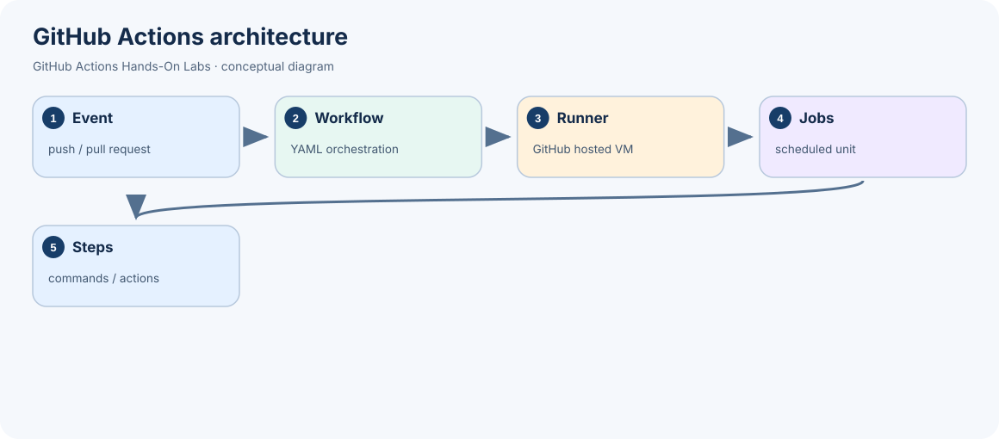
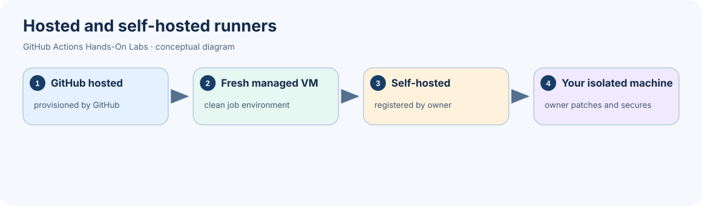
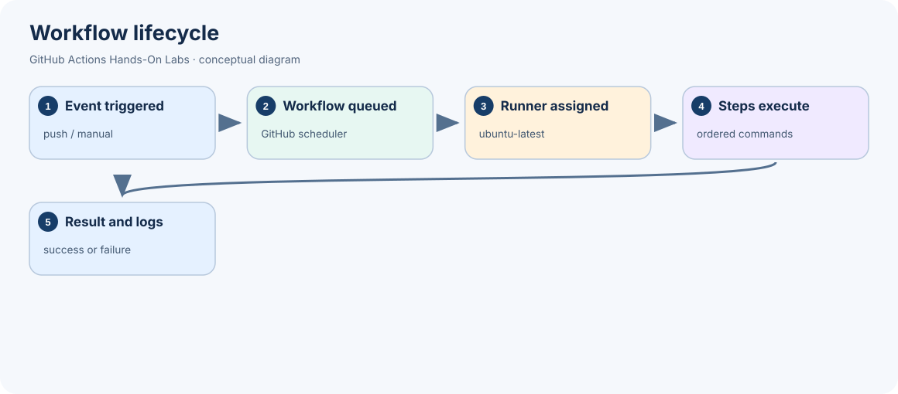
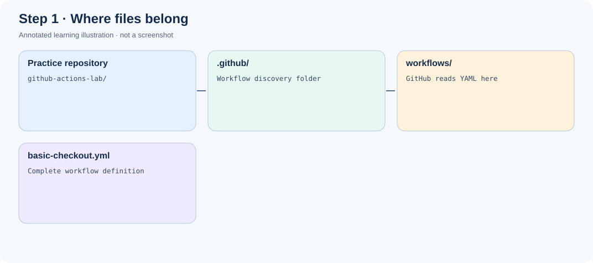
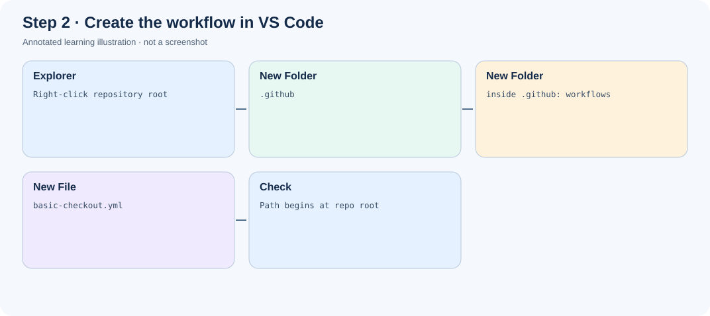
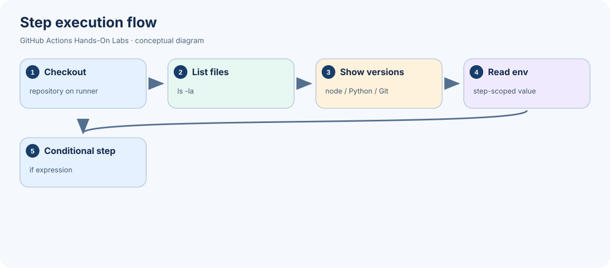
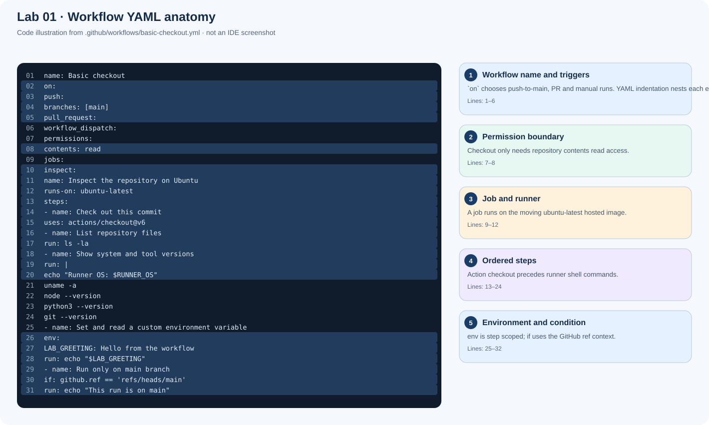
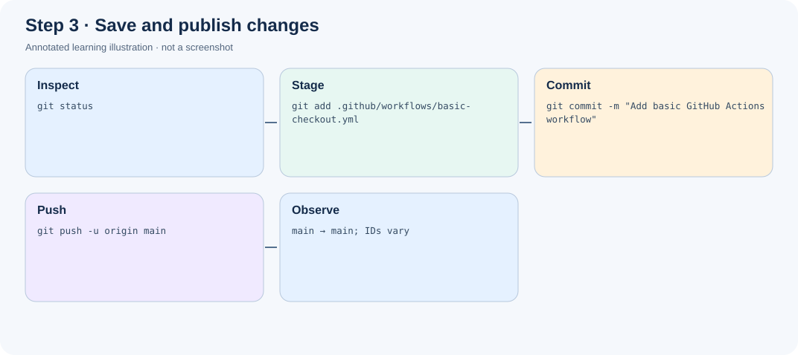
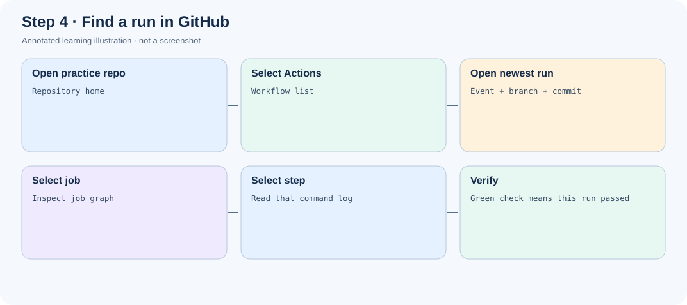
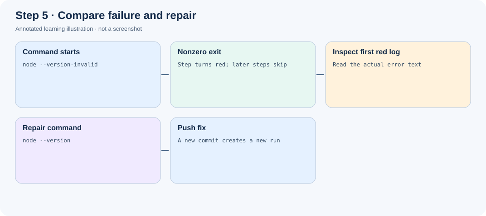

# Lab 01 — Introduction to GitHub Actions

Your first automated workflow checks out code, inspects the runner and reports results in GitHub. Actions is GitHub's automation platform: an event such as a push starts a workflow, which schedules jobs on runners. CI repeatedly checks changes; CD automates delivery or deployment. A workflow is YAML; jobs contain ordered steps; steps call actions or shell commands.

## Estimated time

| Activity | Duration |
|---|---:|
| Concepts | 25 min |
| Environment setup | 20 min |
| Workflow implementation | 35 min |
| Push and inspect | 20 min |
| Debugging | 20 min |
| Practice | 20 min |
| **Total** | **2 h 20 min** |

Beginners may need longer, especially for Git setup.

## Objectives and concepts

Recognize events (`push`, `pull_request`, manual `workflow_dispatch`), workflow files, YAML indentation, jobs, steps, runners, `runs-on`, expressions, contexts, environment variables, conditions, logs and exit codes. `ubuntu-latest` is a moving label whose hosted image changes over time; use a fixed label when reproducibility matters. GitHub-hosted runners are temporary remote machines, unlike your local terminal. Self-hosted runners are machines you manage and secure (Lab 04).



*The event starts the workflow; GitHub assigns its job to a runner, which executes the job steps.*



*Conceptual comparison: GitHub manages hosted VM lifecycle; owners secure and maintain self-hosted machines.*

## Prerequisites

Git, a GitHub account, internet and an editor with project/file and terminal support (VS Code is the illustrated option). Follow [Start Here](../docs/START-HERE.md). On macOS/Linux use Terminal; on Windows use PowerShell or Git Bash. Create a *separate* practice repository named `github-actions-lab`; do not edit/push this course repo for exercises.



*Lifecycle map: the next steps create, push and inspect this exact flow.*

## Implementation

### Step 01 — Create and clone a practice repository

**Objective:** make a personal remote to receive your experiment. **Where:** GitHub website, then your computer terminal. Create an empty repository, then clone it. **Command:** `git clone https://github.com/YOUR-USERNAME/github-actions-lab.git` then `cd github-actions-lab`; **Working directory:** the parent folder for the clone. **Expected output:** `Cloning into 'github-actions-lab'...`; exact progress differs. Open the folder in your editor (VS Code: **File → Open Folder**), then open its integrated terminal or a separate terminal at that folder. Other IDEs use equivalent open-project and terminal commands. Run `git config --global user.name "Your Name"` and `git config --global user.email "you@example.com"`; these configure identity on your computer (choose the email you want on commits). `git config --get user.name` and `git config --get user.email` verify them. To avoid changing global config, run those commands without `--global` inside this practice repository. **Troubleshooting:** ensure the GitHub repository is empty and your account can authenticate. **Next:** create workflow path.



*Illustration: the workflow must be inside the practice repository root under `.github/workflows/`.*

### Step 02 — Create the workflow file

**Objective:** put the sample under the required repository path. **Where:** your editor project/file explorer (VS Code in this walkthrough); use New Folder twice to create `.github/workflows`, then New File. Any editor that can create folders and text files works. **File path:** `.github/workflows/basic-checkout.yml` relative to your *practice repository root*. **Content to paste:** copy the complete [`basic-checkout.yml`](.github/workflows/basic-checkout.yml) shown below. The hidden `.github` directory is normal; type the leading dot.

```yaml
name: Basic checkout
on:
  push:
    branches: [main]
  pull_request:
  workflow_dispatch:
permissions:
  contents: read
jobs:
  inspect:
    name: Inspect the repository on Ubuntu
    runs-on: ubuntu-latest
    steps:
      - name: Check out this commit
        uses: actions/checkout@v6
      - name: List repository files
        run: ls -la
      - name: Show system and tool versions
        run: |
          echo "Runner OS: $RUNNER_OS"
          uname -a
          node --version
          python3 --version
          git --version
      - name: Set and read a custom environment variable
        env:
          LAB_GREETING: Hello from the workflow
        run: echo "$LAB_GREETING"
      - name: Run only on main branch
        if: github.ref == 'refs/heads/main'
        run: echo "This run is on main"
```

**Code explanation:** `on` selects events; `workflow_dispatch` adds a Run workflow button. `permissions` limits the automatic `GITHUB_TOKEN` to read repository contents. `jobs.inspect` is an ID; `runs-on` chooses the runner. `checkout@v6` downloads the triggering commit into the remote runner workspace (the action's current version is checked against its official release page when this course was prepared; use maintained releases). Each `run` is a shell command. `|` preserves a multiline script. `env` sets a value for one step. `github.ref` is a context; `if` skips the final step outside main. Failed commands generally return nonzero exit codes, failing the step/job.



*Illustration: create `.github`, then `workflows`, then the YAML file in Explorer. This is not a VS Code screenshot.*



*The runner checks out source before executing each shell step in order.*



*Illustration: the labeled sections correspond to the complete YAML immediately above.*

### Step 03 — Commit and push

**Where:** your IDE integrated terminal or a system terminal. **Working directory:** practice repository root (`pwd` or PowerShell `Get-Location`). Execute:

```sh
git status
git add .github/workflows/basic-checkout.yml
git commit -m "Add basic GitHub Actions workflow"
git push -u origin main
```

**Example output:** status lists the new file as untracked; commit reports one file changed; push reports `main -> main`. Names and commit IDs vary. If the branch is `master`, rename with `git branch -M main` before pushing. Git identity missing? rerun the config commands from Step 01. **Security:** never put credentials in workflow YAML or print environment variables wholesale.



*Illustration: expected command order; names and Git output IDs vary.*

### Step 04 — Inspect the run

**Where:** browser, your practice repo → **Actions** → **Basic checkout** → newest run → `Inspect the repository on Ubuntu` → individual step. A push to `main` creates a run; a pull request also creates a run. GitHub's runner runs the commands remotely. Success is a green check and each step marked completed. The file listing and OS/tool versions appear in their logs; timestamps and versions may vary because `ubuntu-latest` moves. **Verification:** use the Actions job graph and compare each step to the YAML. A missing workflow usually means wrong path, extension, branch or no push. Confirm Actions is enabled and that workflow is in the repository's default branch.

**Genuine screenshot:** [course-checks-actions-run.png](images/screenshots/course-checks-actions-run.png) shows an actual successful GitHub Actions run for this course repository. It runs the CRUD tests, Ruff, SVG parsing and local-link checks; it is not a run of your `basic-checkout.yml`. The public summary is visible without sign-in; sign in to inspect step logs.



*Interface map only, not a captured GitHub page. Capture your real run using the checklist below.*

### Step 05 — Practice a controlled failure

In the practice repo, temporarily change `node --version` to `node --version-invalid`, commit and push. The version step fails and later steps are skipped. Read the first red step's log, restore the command, commit and push again. This demonstrates failure through exit status; don't create a failure in a production workflow.



*Expected behavior illustration: inspect the actual first failing step and then the repaired run in your practice repository.*

## Detailed outputs and screenshots

**Example output** for the version step includes `Runner OS: Linux`, a kernel string, Node/Python/Git version lines and `Hello from the workflow`. These are illustrative and vary by runner image. In Actions, event name and commit SHA identify the trigger and code revision. The genuine course-check Actions summary is linked above; it validates the course repository checks and does not prove this lab workflow ran. Capture your own screenshots of Explorer, YAML, terminal, run graph, step logs and failure/success in your practice repository.


## Visual coverage checklist and screenshot capture

The illustrations above are diagrams of the implementation, not editor or execution screenshots. Follow the capture cards in [`images/screenshots/README.md`](images/screenshots/README.md) to save genuine VS Code, terminal, repository, Actions, success and failure captures beside this lab. The two current public captures show the course repository page and a genuine course-check Actions run; they prove publication and repository checks only.

| Step | Learning aid | What it explains |
|---|---|---|
| Create practice repo and path | `step-project-location.svg` | Exact nested workflow path |
| Create file in VS Code | `step-vscode-file-creation.svg` | Explorer actions and filename |
| Configure workflow | `step-yaml-anatomy.svg` + complete YAML | Trigger, job, runner, steps, condition |
| Commit and push | `step-git-publish.svg` | Command order and expected branch update |
| Inspect execution | `step-actions-inspection.svg` | GitHub navigation from run to step log |
| Debug failure | `step-run-outcome.svg` | Nonzero exit, red step, repair run |

## Exercises

**Guided:** (1) Add `date -u` on the runner. (2) Add `df -h` to display disk space. (3) Add `echo "Repo: ${{ github.repository }}"`. Hints: add a named step under `steps`; expressions use `${{ }}`. **Independent:** add a manual-only workflow step gated on `github.event_name`; show runner OS and repository name. **Concept questions:** What starts a workflow? Where does `run` execute? What does checkout do? Why can `ubuntu-latest` change? What indicates command failure? **Debugging:** intentionally misspell `runs-on`, inspect the annotation, restore it. **Integration challenge:** build a workflow triggered by push, PR and manual dispatch that prints repo, branch/ref and UTC date, with `contents: read`. **Solutions:** `date -u`, `df -h`, and `echo "Repo: ${{ github.repository }}"`; manual gate `if: github.event_name == 'workflow_dispatch'`. Do not print secrets or dump contexts wholesale.

## Troubleshooting, security and cleanup

Workflow absent: check `.github/workflows/*.yml`, branch filters, push, Actions tab/settings. `node` missing: confirm Linux hosted runner label. YAML error: spaces and indentation. A local command works but runner fails: they are different environments. Do not enable verbose debug logging that could expose values; add targeted safe diagnostics. This lab creates no long-lived infrastructure; optionally delete the practice repository after saving your notes.

## Further reading and next lab

[Actions overview](https://docs.github.com/en/actions), [workflow syntax](https://docs.github.com/en/actions/reference/workflows-and-actions/workflow-syntax), [hosted runners](https://docs.github.com/en/actions/how-tos/manage-runners/github-hosted-runners), [checkout releases](https://github.com/actions/checkout/releases). Continue to [Lab 02](../02-multiple-jobs-and-workflow-data/README.md) to coordinate jobs and move data.
