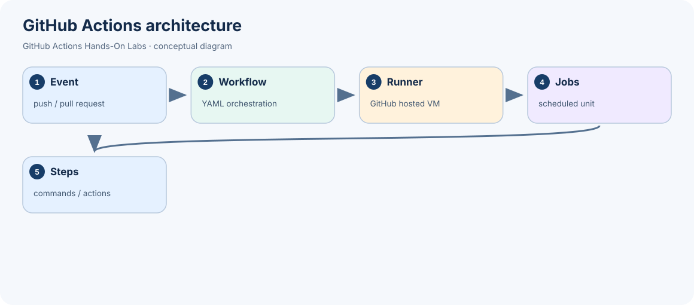
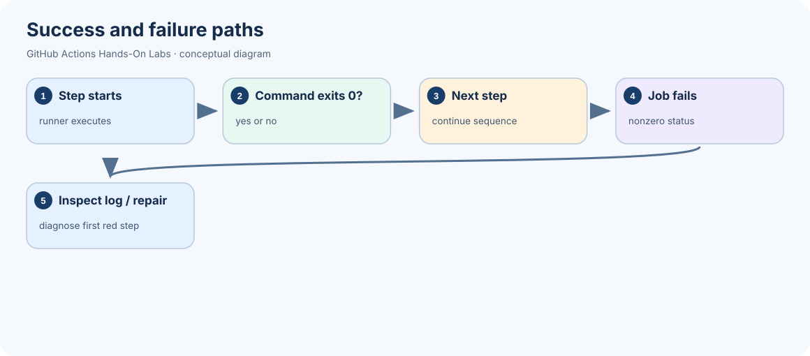
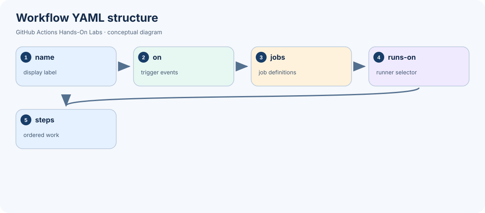
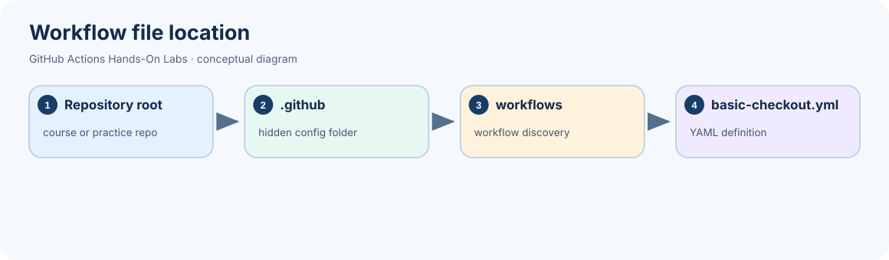
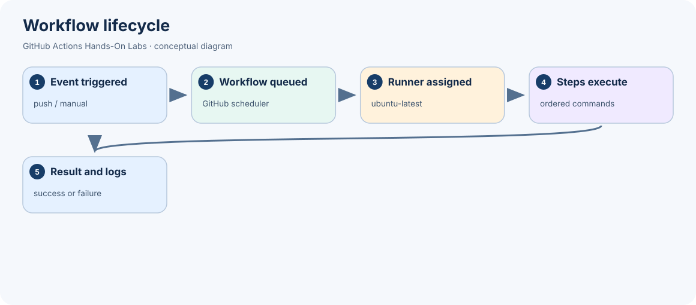
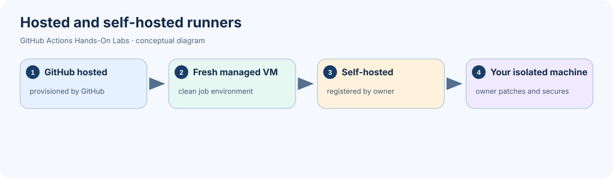
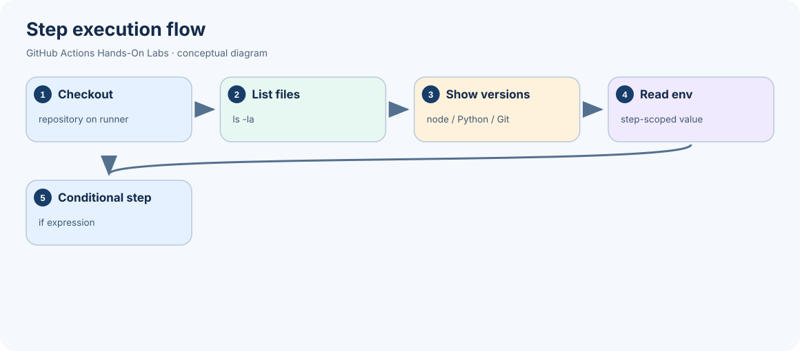

# Visual index

## Original technical diagrams

### Github Actions Architecture

[Open editable SVG source](diagrams/github-actions-architecture.svg).

### Success Failure Flow

[Open editable SVG source](diagrams/success-failure-flow.svg).

### Workflow Yaml Structure

[Open editable SVG source](diagrams/workflow-yaml-structure.svg).

### Workflow File Location

[Open editable SVG source](diagrams/workflow-file-location.svg).

### Workflow Lifecycle

[Open editable SVG source](diagrams/workflow-lifecycle.svg).

### Runner Comparison

[Open editable SVG source](diagrams/runner-comparison.svg).

### Step Execution Flow

[Open editable SVG source](diagrams/step-execution-flow.svg).

## Genuine screenshots

Place real captures from your own practice execution in `screenshots/`. The authoring checkout does not include real workstation or GitHub UI captures, so none are presented as execution evidence.

[Screenshot capture guide](screenshots/README.md).
