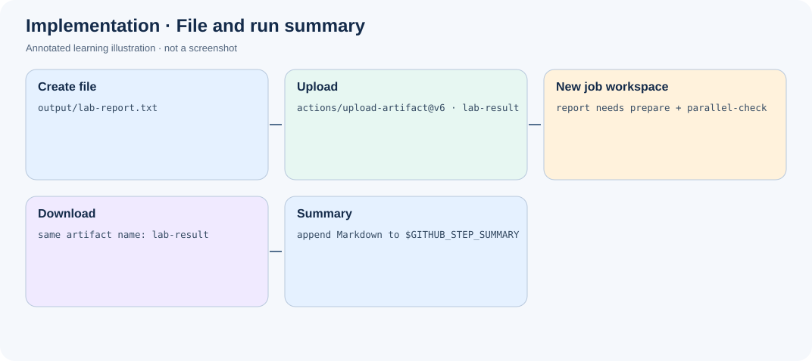
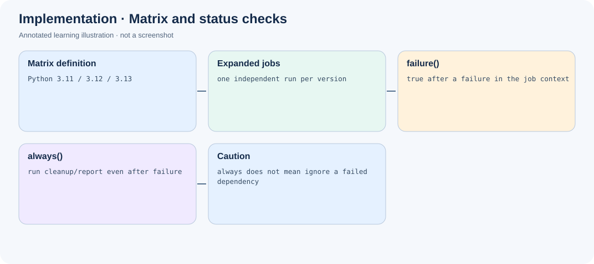

# Lab 02 — Multiple Jobs and Workflow Data

Split a workflow into independently scheduled jobs, pass small values as outputs, and move files with artifacts. You will inspect why job order can differ, how `needs` creates dependencies, and how a matrix repeats the same test over several Python versions.

## Estimated time and outcomes

| Activity | Duration |
|---|---:|
| Concepts | 35 min |
| VS Code setup and copy files | 20 min |
| Implementation | 75 min |
| Inspect graph, outputs and artifacts | 25 min |
| Debugging | 20 min |
| Exercises | 25 min |
| **Total** | **2 h 40 min** |

Beginners may need more time. Prerequisites: Lab 01, Git, VS Code, GitHub practice repository. At the end, you can explain parallel jobs, `needs`, step/job outputs, artifacts, summaries, status functions, matrix expansion, concurrency and timeouts.

## Architecture

A job runs on its own runner, so its files are not automatically visible in another job. Jobs without `needs` may run in parallel. A matrix creates one job run per value. The diagram below maps directly to `multiple-jobs.yml`; `matrix-build.yml` is a separate workflow.


*Conceptual execution map; actual order and duration appear in the GitHub run graph and vary.*

## Step 1 — Add workflows to your practice repository

**Where:** Open your separate practice repository in VS Code. Use Explorer to create `.github/workflows` if it does not exist. **Working directory:** practice repository root. Copy both complete files from this lab's `.github/workflows/` folder into the matching paths:

- [`multiple-jobs.yml`](.github/workflows/multiple-jobs.yml)
- [`matrix-build.yml`](.github/workflows/matrix-build.yml)

The course examples live in subfolders and are not automatically active in the course repository. GitHub discovers workflow YAML only in the repository-root `.github/workflows/` directory. Read the files in VS Code and compare their structure to these annotated learning aids.


*`prepare` and `parallel-check` can run independently; `report` waits for both. The scheduler does not promise which independent job starts first.*


*The step ID and output key must match the expressions that expose and consume the value.*

The essential output pattern in `multiple-jobs.yml` is:

```yaml
outputs:
  greeting: ${{ steps.message.outputs.greeting }}
steps:
  - id: message
    run: echo "greeting=Hello from prepare" >> "$GITHUB_OUTPUT"
```

`$GITHUB_OUTPUT` is a runner-provided file. Appending `key=value` records an output for that step. `id: message` gives the expression a stable reference; the job maps that step output to a job output. Downstream jobs read it through `needs.prepare.outputs.greeting`.



*Artifacts preserve files across runner workspaces; `$GITHUB_STEP_SUMMARY` adds Markdown to a run summary page.*

The upload/download actions use artifact name `lab-result` in both jobs. The report must declare `needs: [prepare, parallel-check]` before it can consume the job output/artifact reliably. Avoid uploading `.env`, tokens or other secrets.



*Matrix variants are independent runs; status functions change whether later steps run after failures.*

`success()` is true when prior steps succeeded; `failure()` is true after a failed step in the relevant job; `always()` runs regardless of prior result, including failure. Use `always()` for cleanup/reporting and preserve failure visibility—do not accidentally turn a failed job green. In the sample, `failure()` is present as a teaching example, while no deliberate failure is induced.

## Step 2 — Commit, push, and inspect

**Where:** VS Code integrated terminal. **Working directory:** practice repository root.

```sh
git status
git add .github/workflows/multiple-jobs.yml .github/workflows/matrix-build.yml
git commit -m "Add multiple jobs and matrix workflows"
git push
```

**Example output:** `git status` lists two staged workflow files; push reports an updated branch. Exact commit IDs differ. On GitHub, open **Actions → Multiple jobs and workflow data → newest run**. The graph shows independent jobs and the dependent report. Open `prepare` to see the `$GITHUB_OUTPUT` and upload logs; open `report` to see download and file contents. Then inspect **Python matrix** and its three version variants.

**Verify:** the run graph is green, report log contains `Created by prepare`, and summary displays `Hello from prepare`. Example output varies by runner. A dependent job skipped after upstream failure is expected. If output is empty, compare step ID, output key and job mapping. If artifact is missing, compare upload/download names and confirm dependency.

## Step 3 — Failure and debugging exercise

Temporarily change the artifact name in the downloader only. Push and observe the report job fail at download. Open the first red step log, compare the exact artifact name, restore `lab-result`, commit, push and verify the repair run. This failure is intentional and confined to the practice repo.

## Exercises and review

Guided: add a build job; pass a second output; upload a generated report. Independent: add concurrency group `${{ github.workflow }}-${{ github.ref }}` with `cancel-in-progress: true`; run lint independently while test needs build. Questions: why do jobs need artifacts? What does `needs` do? Output vs artifact? What expands a matrix? When should `always()` run? Debugging: mismatch names and repair. Integration: build → test → report plus independent lint and a three-version matrix. Hint: workflow expressions use `${{ }}`. Do not upload secrets.

## Cleanup, further reading and next lab

Actions artifacts expire according to repository retention settings. Delete test runs/artifacts if desired. Read [workflow syntax](https://docs.github.com/en/actions/reference/workflows-and-actions/workflow-syntax), [workflow artifacts](https://docs.github.com/en/actions/using-workflows/storing-workflow-data-as-artifacts), [job outputs](https://docs.github.com/en/actions/using-jobs/defining-outputs-for-jobs). Continue to [Lab 03](../03-github-actions-docker-nginx/README.md).

## Visual coverage checklist

| Major stage | Aid type | Nearby visual |
|---|---|---|
| Architecture and dependency graph | Conceptual diagram | Job graph above |
| Workflow configuration | Annotated implementation diagram | Parallel jobs, output flow |
| Transfer files and summary | Data-flow diagram | Artifact lifecycle |
| Matrix and failure behavior | Execution illustration | Matrix/status diagram |
| GitHub graph and step logs | Genuine screenshot capture card | [`images/screenshots/README.md`](images/screenshots/README.md); no lab run claimed here |
