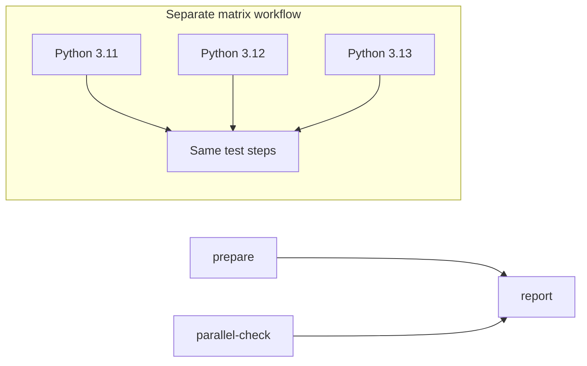

# Lab 02 — Multiple Jobs and Workflow Data

Learn to divide work into jobs that may run in parallel, make jobs wait with `needs`, share small outputs and transfer files as artifacts. This mirrors build/test/report pipelines and keeps expensive work organized.

## Estimated time

| Activity | Duration |
|---|---:|
| Concepts | 35 min |
| Setup | 20 min |
| Implementation | 75 min |
| Verification | 25 min |
| Debugging | 20 min |
| Exercises | 25 min |
| **Total** | **2 h 40 min** |

Beginners may need additional time. Prerequisites: Lab 01, Git, VS Code and a practice repository.

## Concepts and graph

A job runs on its own runner. Jobs with no dependency can execute concurrently; `needs` waits for required jobs. Step outputs go through `$GITHUB_OUTPUT`, job outputs expose step output via `needs.<job>.outputs`. Artifacts persist files between isolated jobs. `success()`, `failure()` and `always()` are status functions. Matrix expands one job into variants. Concurrency groups can cancel obsolete runs; timeout limits wasted runner time.

## Prepare and run

Copy the files in this lab to your practice repository under `.github/workflows/`. From the practice repository root, run `git status`, then `git add .github/workflows`, `git commit -m "Add jobs and matrix workflows"`, `git push`. In Actions, open **Multiple jobs and workflow data**. Inspect the graph: `parallel-check` and `prepare` have no dependency and can run concurrently; `report` waits for both. Then open **Python matrix** and compare Python versions.

### Workflow walkthrough

`prepare` writes a step output to `$GITHUB_OUTPUT`, maps it as a job output, writes a file and uploads it as `lab-result`. `report` declares `needs`, downloads the artifact and reads the file; job boundaries mean it cannot just read `prepare`'s filesystem. Its summary is written to `$GITHUB_STEP_SUMMARY`. `if: always()` runs even after earlier failure; `failure()` is shown as an example but in this simple report job no failing prior step is expected. `matrix-build.yml` creates three independent variants, and `timeout-minutes` caps each. A failure in a needed job normally skips dependent jobs; use `if: always()` carefully when you need a diagnostic report.

**Expected output (illustrative):** report log prints `Created by prepare`; summary shows `Hello from prepare`; matrix logs print selected Python version and `matrix test passed`. Exact scheduling order varies. A green job graph indicates success. If artifact download fails, verify names and dependency; if `needs` output is empty, verify step `id`, output key and mapping.

## Exercises

Guided: add a build job; pass a second output; upload a generated text report. Independent: add a concurrency group keyed by workflow/ref; make test run after build but lint run independently. Questions: why can't jobs share files directly? What does needs do? Difference between output and artifact? What expands matrix? When is `always()` useful? Debugging: mismatch artifact names then repair. Integration challenge: build→test→report plus independent lint and a three-version matrix. Hints/solutions: outputs use `$GITHUB_OUTPUT`; artifact names must match; concurrency uses `group: ${{ github.workflow }}-${{ github.ref }}` and `cancel-in-progress: true`.

## Security, cleanup and further reading

Use read-only permissions for these jobs. Do not upload secrets or `.env` files as artifacts. Runs/artifacts expire according to repository retention settings; delete test runs if desired. Further reading: [workflow syntax](https://docs.github.com/en/actions/reference/workflows-and-actions/workflow-syntax), [workflow artifacts](https://docs.github.com/en/actions/using-workflows/storing-workflow-data-as-artifacts), [job outputs](https://docs.github.com/en/actions/using-jobs/defining-outputs-for-jobs). Continue to [Lab 03](../03-github-actions-docker-nginx/README.md).

## Screenshot index

See `images/README.md`; capture a real graph and artifact log in your practice repository. No fabricated screenshots are included.
