# Lab 02 — Multiple Jobs and Workflow Data

Learn how GitHub Actions schedules independent jobs, waits for dependencies, passes small outputs, transfers files with artifacts, writes job summaries, handles failures, expands a matrix, limits duplicate runs, and stops jobs that exceed a timeout. You will inspect workflow graphs and deliberately break and repair the examples.

**Estimated time: 2 hours 50 minutes.** Beginners may need additional time.

| Activity | Duration |
|---|---:|
| Concepts and diagrams | 35 min |
| Editor and practice repository setup | 20 min |
| Multi-job workflow and data flow | 55 min |
| Matrix, conditions, concurrency and timeout | 30 min |
| Push, inspect graph/logs/artifacts/summary | 20 min |
| Debugging and exercises | 25 min |
| **Total** | **2 h 50 min** |

**Difficulty:** Beginner–Intermediate. **Editor:** VS Code is used in examples, but any IDE/editor with a project explorer and terminal works. **Prerequisites:** GitHub account, Git, Lab 01 basics, internet access, and a separate practice repository. No paid runner or local Python installation is required.

## What you will build

The main workflow has two independent jobs, then a report job that waits for both. The prepare job emits a short greeting as a step/job output and uploads a report file as an artifact. The report job downloads it and writes a GitHub Actions job summary. Separate workflows demonstrate Python matrix runs and conditions after an intentional failure.

~~~mermaid
flowchart LR
  E[push / pull_request / manual] --> W[Workflow run]
  W --> P[prepare job runner A]
  W --> V[parallel-check job runner B]
  P -->|greeting output + artifact| R[report job runner C]
  V -->|needs dependency| R
  P -. separate filesystem .-> V
  P -. separate filesystem .-> R
  V -. separate filesystem .-> R
~~~

*Conceptual diagram: each job has its own runner workspace. The scheduler can start prepare and parallel-check in either order; report waits for both.*

## 1. Prepare a separate practice repository

This directory is nested in the course repository. GitHub automatically discovers workflows only under the root path **.github/workflows/** of the repository being run. Copy this lab's sample workflows into a separate practice repository and push your exercises there. Do not push exercises to the course repository.

**Where:** terminal in VS Code or another editor. **Working directory:** parent folder where you keep projects.

Create an empty public GitHub repository, for example **github-actions-multiple-jobs-practice**. Clone it and configure commit identity:

~~~sh
git --version
git clone https://github.com/YOUR_GITHUB_USERNAME/github-actions-multiple-jobs-practice.git
cd github-actions-multiple-jobs-practice
git config user.name "Your Name"
git config user.email "you@example.com"
git status
git remote -v
~~~

Replace username/name/email with your own. Git name and email identify commits; they are not needed to clone. These settings apply only to this repository. A GitHub noreply address can keep your personal email private. Status should show a clean working tree; remote output should point to your practice repository.

Open the folder in an IDE. In VS Code choose **File → Open Folder…** and **Terminal → New Terminal**. Other editors have equivalent project and terminal panels. Confirm the terminal is in the practice repository root.

From the course folder copy these files to the matching locations in your practice repository:

- [Main workflow](.github/workflows/multiple-jobs.yml) to **.github/workflows/multiple-jobs.yml**
- [Matrix workflow](.github/workflows/matrix-build.yml) to **.github/workflows/matrix-build.yml**
- [Conditional workflow](.github/workflows/conditional-jobs.yml) to **.github/workflows/conditional-jobs.yml**
- [Sample input](examples/prepare/input.txt) to **examples/prepare/input.txt**
- [Report script](examples/scripts/generate-report.sh) to **examples/scripts/generate-report.sh**
- [Final integration workflow](examples/final-integration.yml) to **.github/workflows/integration-challenge.yml**

Create destination folders from the root:

~~~sh
mkdir -p .github/workflows examples/prepare examples/scripts
~~~

Windows PowerShell:

~~~powershell
New-Item -ItemType Directory -Force .github/workflows, examples/prepare, examples/scripts | Out-Null
~~~

Expected practice structure:

~~~text
practice-repository/
├── .github/workflows/
│   ├── multiple-jobs.yml
│   ├── matrix-build.yml
│   └── conditional-jobs.yml
└── examples/
    ├── prepare/input.txt
    └── scripts/generate-report.sh
~~~

VS Code and other editors may hide dot-folders; show hidden files if .github is not visible. Preserve YAML indentation with spaces, not tabs.

~~~mermaid
flowchart LR
  C[Course repository 02-multiple-jobs-and-workflow-data/] -->|copy examples| P[Practice repository root]
  P --> W[.github/workflows/]
  W --> G[GitHub discovers workflows]
  C -. nested workflow isn't auto-run .-> X[No execution here]
~~~

*Folder-location diagram: the practice repository's workflow folder is the executable location.*

*Implementation illustration, not a screenshot. The course files are nested; your own workflows must be at the practice repository root.*

**Checkpoint:** run **git status --short** and verify the workflows are directly under the practice repository root's .github/workflows/.

*Placeholder card only. Capture your actual IDE/editor showing the practice root and a workflow file; use the [capture guide](images/screenshots/README.md). No editor screenshot is represented here.*

## 2. Workflow, job, step and runner

A **workflow** is the YAML automation. An **event** starts it. A **job** is a unit of work assigned to a runner. A **step** is a command or action inside one job. **runs-on** chooses a runner image such as ubuntu-latest. A GitHub-hosted runner is a temporary virtual machine managed by GitHub.

~~~mermaid
flowchart TB
  WF[Workflow YAML] -->|event starts| RUN[Workflow run]
  RUN --> J1[Job: build]
  RUN --> J2[Job: test]
  J1 --> S11[Step: checkout]
  J1 --> S12[Step: build]
  J2 --> S21[Step: checkout]
  J2 --> S22[Step: test]
  J1 --- R1[Runner VM A]
  J2 --- R2[Runner VM B]
  R1 -. separate workspace .-> R2
~~~

*Job hierarchy and filesystem isolation. Each job that needs source must check it out separately.*

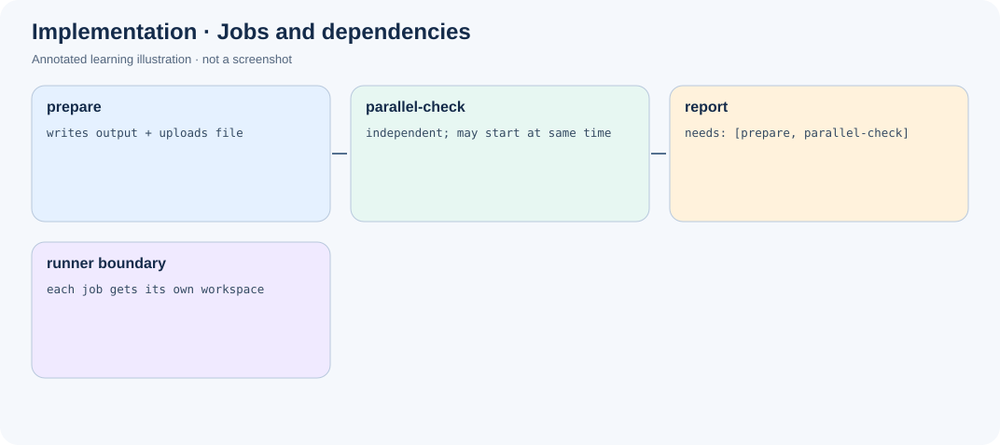

*Annotated YAML illustration; it is not an IDE screenshot.*

Jobs without **needs** are eligible to execute in parallel. The order and overlap depend on runner availability; YAML order does not guarantee order. Every job receives a separate runner environment. A file created in one job is not automatically available in another.

~~~yaml
jobs:
  build:
    runs-on: ubuntu-latest
    steps:
      - run: echo "build can run independently"
  lint:
    runs-on: ubuntu-latest
    steps:
      - run: echo "lint can run independently"
~~~

~~~mermaid
flowchart LR
  W[Workflow starts] --> B[build job]
  W --> L[lint job]
  B -. may overlap .-> L
~~~

The root **jobs** key contains unique job IDs. Each job needs **runs-on** and **steps**. Since build and lint have no dependency, either can start first.

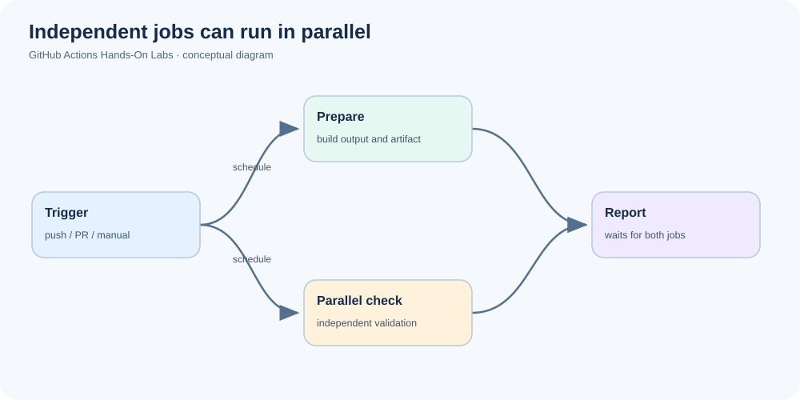

*Instructional diagram with independent jobs and a dependent report.*

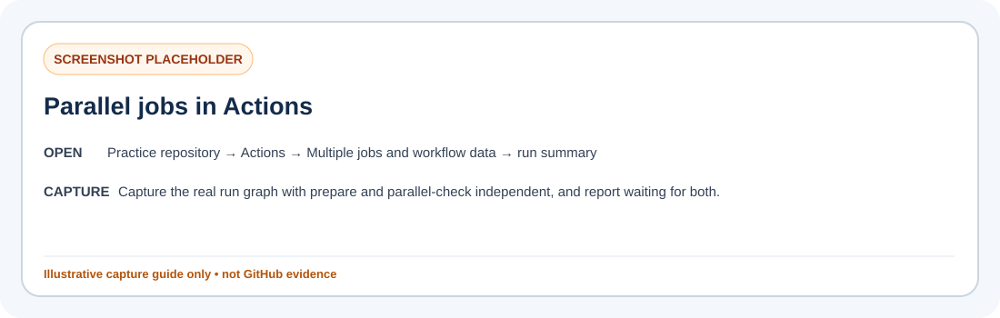

*Placeholder card, not GitHub evidence. Capture the genuine graph after running the workflow in your practice repository.*

**Checkpoint:** the main workflow's prepare and parallel-check jobs have no dependency on each other.

## 3. Job dependencies using needs

The sample uses prepare, parallel-check, and report. The first two are independent; report waits for both:

~~~yaml
report:
  needs: [prepare, parallel-check]
~~~

The listed strings must match job IDs exactly. If either dependency fails or is skipped, report is skipped by default. **needs** controls scheduling and makes dependency outputs accessible; it does not share runner files.

~~~mermaid
flowchart LR
  T[Trigger] --> P[prepare]
  T --> C[parallel-check]
  P --> R[report]
  C --> R
~~~

*Dependency graph: report has two prerequisite edges. The two upstream jobs may run in either order.*

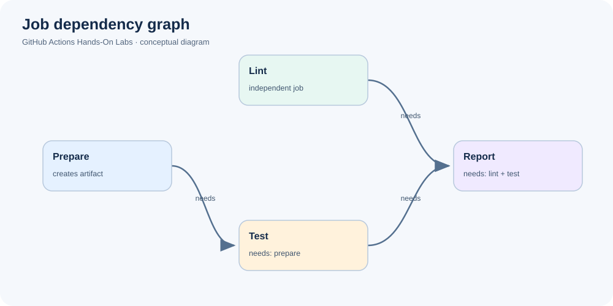

*Preserved generalized diagram: its example uses Prepare, Lint, Test, and Report labels to illustrate fan-in. The executable workflow above uses prepare and parallel-check → report; this SVG is conceptual and is not a screenshot or a different workflow file.*

**Where to inspect:** after pushing in Section 9, open practice repo **Actions → Multiple jobs and workflow data → run**. The graph will show job cards and dependency lines. Expand each card for step details.

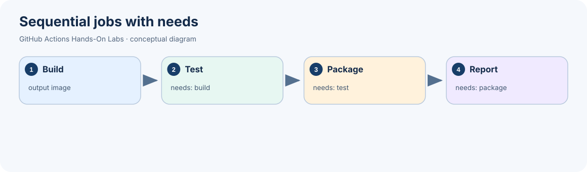

*Conceptual image showing a consumer waiting for prerequisites.*

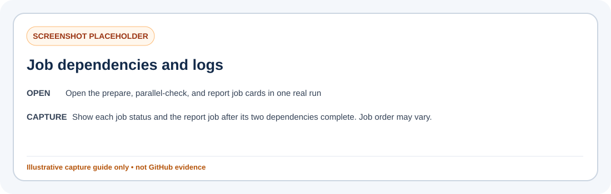

*Placeholder card only. Capture the real graph and job status cards from your Actions run.*

## 4. Step outputs and GITHUB_OUTPUT

Outputs pass small text values such as a greeting or computed version. In the prepare job, the step has an ID and appends a key/value to the runner-provided file:

~~~yaml
- name: Create a small step output
  id: message
  shell: bash
  run: |
    echo "greeting=Hello from prepare" >> "$GITHUB_OUTPUT"
~~~

The ID **message** is referenced by the job's output mapping:

~~~yaml
outputs:
  greeting: ${{ steps.message.outputs.greeting }}
~~~

A downstream job reads the job output:

~~~yaml
env:
  GREETING: ${{ needs.prepare.outputs.greeting }}
run: echo "Job output: $GREETING"
~~~

~~~mermaid
flowchart LR
  A[Step id message] -->|key=value line| B[$GITHUB_OUTPUT]
  B -->|steps.message.outputs.greeting| C[prepare job output]
  C -->|needs.prepare.outputs.greeting| D[report environment]
  D --> E[Use small value]
~~~

*The key, step ID, mapping, producer job ID, and downstream reference must agree. Outputs are for small strings, not files or secrets.*

*Annotated code illustration for the real output path in the example workflow.*

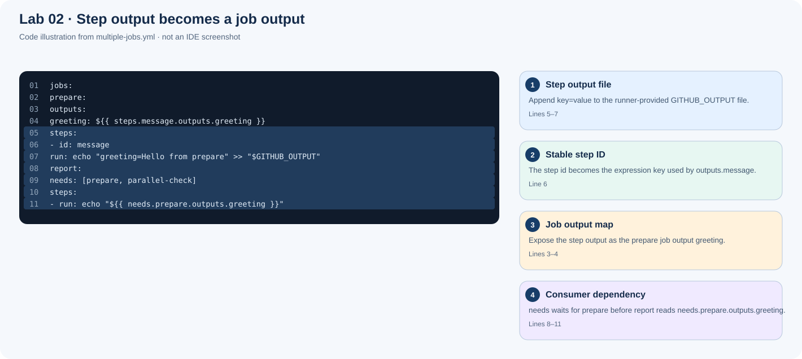

*This preserved code visual annotates the step ID, GITHUB_OUTPUT file, job output mapping, and downstream needs reference.*

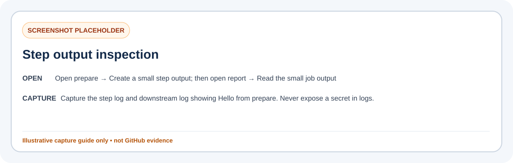

*Placeholder card only. Capture the producer step and downstream consumer logs from a real run.*

In the run logs, open **Create a small step output** to see the step ran. The value may not be printed by GitHub automatically, so the report step explicitly echoes the downstream environment variable. Never echo sensitive values.

**Checkpoint:** confirm step ID is message, output key is greeting, producer is prepare, and consumer uses needs.prepare.outputs.greeting.

## 5. Artifacts and isolated filesystems

Each job has its own runner and temporary workspace. The report file written in prepare is not present in report unless transferred. Artifacts provide that transfer.

~~~yaml
- name: Upload report
  uses: actions/upload-artifact@v6
  with:
    name: lab-result
    path: output/lab-report.txt
    if-no-files-found: error
    retention-days: 7
~~~

The report job downloads the same artifact name:

~~~yaml
- name: Download report
  uses: actions/download-artifact@v6
  with:
    name: lab-result
    path: downloaded-report
~~~

~~~mermaid
sequenceDiagram
  participant P as prepare runner
  participant S as Artifact storage
  participant R as report runner
  P->>P: Generate output/lab-report.txt
  P->>S: upload name lab-result
  Note over P,R: Separate job filesystems
  R->>S: download name lab-result
  S-->>R: downloaded-report/lab-report.txt
  R->>R: Read report
~~~

*Artifact names must match. The sample retains it for seven days. Never upload tokens, .env files, credentials, or confidential data.*

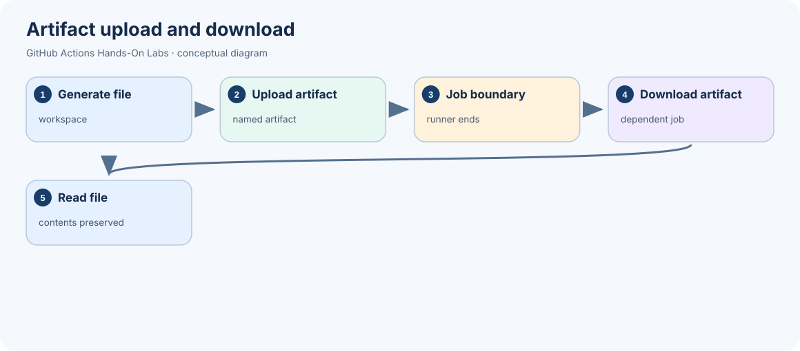

*Implementation diagram for file transfer between isolated runners.*

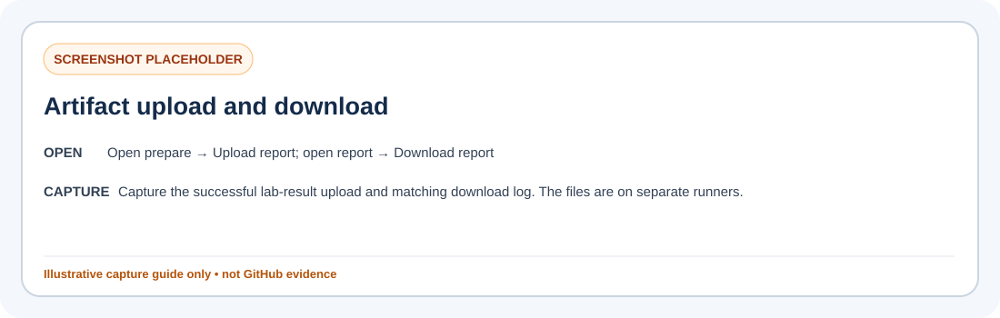

*Placeholder card only. Capture the real upload and download action logs with the matching artifact name.*

Use outputs for small values and artifacts for files. If download says not found, check exact artifact name and upload logs. If upload reports no files, inspect the generate-report step and working directory. Official actions are checkout v7, upload-artifact v6, download-artifact v6; major tags are convenient but production teams may pin reviewed action commits by full SHA.

The report script at [examples/scripts/generate-report.sh](examples/scripts/generate-report.sh) reads the sample input and creates **output/lab-report.txt**. The workflow uploads this file, and the report job downloads and displays it.

## 6. Job summaries

The runner path **$GITHUB_STEP_SUMMARY** accepts Markdown. Appended content is shown on the workflow run summary page. Regular stdout/stderr stays in individual step logs; an artifact is a downloadable file.

~~~bash
{
  echo "## Workflow data report"
  echo ""
  echo "- Upstream greeting: **$GREETING**"
  echo "- Artifact downloaded: lab-result"
  echo ""
  echo "### Artifact contents"
  cat downloaded-report/lab-report.txt
} >> "$GITHUB_STEP_SUMMARY"
~~~

~~~mermaid
flowchart LR
  O[stdout / stderr] --> L[Step logs]
  M[Markdown to GITHUB_STEP_SUMMARY] --> S[Run summary page]
  F[File artifact] --> A[Artifact storage/download]
~~~

*Logs explain execution; summaries present a concise report; artifacts transfer files.*

*Implementation illustration of the generated file, artifact, and run summary.*

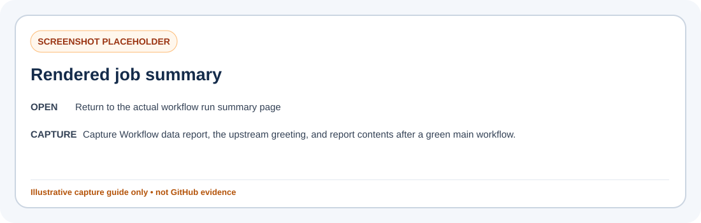

*Placeholder card only. Capture the rendered Actions summary after the report job succeeds.*

**Verify:** open the run summary after completion and find “Workflow data report” plus the artifact contents. If empty, check that the writing step ran and appended to the correct environment path.

## 7. Matrix strategy

A matrix expands one job definition into one execution per value. The [Python matrix example](.github/workflows/matrix-build.yml) selects 3.11, 3.12, and 3.13 using actions/setup-python v7.

~~~yaml
strategy:
  fail-fast: false
  max-parallel: 3
  matrix:
    python-version: ['3.11', '3.12', '3.13']
~~~

~~~mermaid
flowchart LR
  M[matrix values] --> A[Python 3.11 execution]
  M --> B[Python 3.12 execution]
  M --> C[Python 3.13 execution]
  A --> T[Same test]
  B --> T
  C --> T
~~~

*Each variant is a separate job execution with its own runner. The workflow prints the selected interpreter and runs a small assertion.*

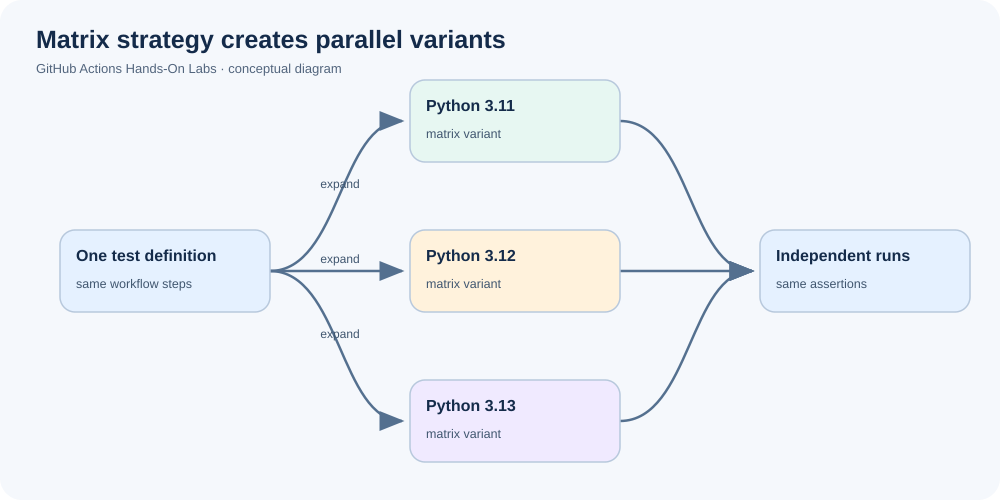

*Annotated matrix configuration and expanded executions.*

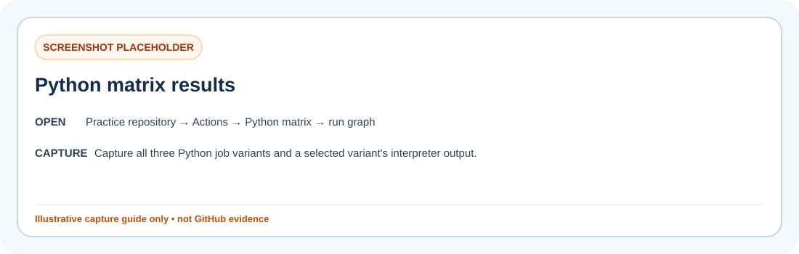

*Placeholder card only. Capture all three actual variants and one selected Python version log.*

**fail-fast: false** lets remaining variants complete if one fails. **max-parallel** limits concurrent variants. Actual schedule may vary based on runner availability. The configuration is not evidence of success; execute and inspect all three versions in Actions. In the graph, compare job names and logs.

## 8. Conditions and status functions

The [conditional workflow](.github/workflows/conditional-jobs.yml) is manual-only and deliberately contains a failing job. **if:** controls whether a job or step runs. Status functions describe prior job/step states:

- **success()** — preceding work succeeded.
- **failure()** — preceding work failed.
- **always()** — run even after failure or cancellation.
- **cancelled()** — cancellation occurred.

~~~mermaid
flowchart TD
  P[Successful prerequisite] --> D{Default dependent condition}
  F[Intentional failure] --> D
  D -->|default success check is false| SK[Dependent job skipped]
  D -->|always condition| O[Observer runs]
  O -->|failure condition| DI[Failure message]
  O -->|success condition| SU[Success-only step skipped]
  O -->|always condition| SM[Summary written]
  F --> RED[Workflow remains failed]
  SM --> RED
~~~

*An observer can report a failed dependency while preserving the red workflow result. always() changes whether work is attempted; it does not make failed work successful.*

*Conceptual illustration of failure and always behavior; the manual workflow intentionally ends red.*

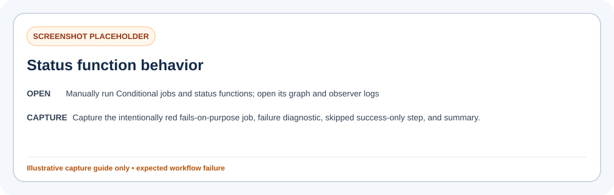

*Placeholder card only. Capture the intentionally failed job, observer logs, skipped success-only step, and summary from a real run.*

At job level, **if: always()** can allow a dependent job to run after a failed dependency. At step level, **if: failure()** runs a diagnostic step after a failed step/job context. The sample captures upstream results and writes a summary. It does not hide the intentionally failed job. Use always() carefully; cancellation/cleanup steps should be bounded and should not mask the original failure. The example does not trigger cancelled(); use it in an optional safe diagnostic if practicing cancellation.

Expected behavior: the manual run ends red because **fails-on-purpose** exits 1. **observe-failure** still runs, reports the failed job, and writes a summary. Do not leave this as a required check in a real project.

## 9. Concurrency and timeouts

Workflows use a concurrency group similar to:

~~~yaml
concurrency:
  group: ${{ github.workflow }}-${{ github.ref }}
  cancel-in-progress: true
~~~

Runs of the same workflow/ref share a group. A newer run may cancel an older in-progress run. This is useful for fast validation of the newest commit; it may be inappropriate for releases or deployments that must finish.

~~~mermaid
flowchart LR
  OLD[Older run in same group] --> NEW{New run starts}
  NEW -->|cancel-in-progress true| STOP[Older run cancelled]
  NEW --> KEEP[Newest run continues]
  OTHER[Different workflow/ref group] --> ISOLATE[Unaffected]
~~~

**timeout-minutes** is set on jobs (5 or 10 minutes here). If the limit is reached, the runner terminates the job and it is marked failed/timed out. Choose a practical limit above expected download/test time.

~~~mermaid
flowchart LR
  J[Job running] --> Q{Finished before limit?}
  Q -->|yes| OK[Result recorded]
  Q -->|no| X[Runner terminates job]
  X --> BAD[Job fails: timeout]
~~~

Inspect the last step log and timeout message. Look for hangs, network delays, retry loops, or an unrealistically small limit.

## 10. Push and inspect all workflows

**Where:** terminal; **working directory:** practice repository root.

~~~sh
git status
git add .github/workflows/ examples/
git status
git commit -m "Add multiple jobs and workflow data examples"
git push -u origin main
~~~

If the branch already tracks main, plain **git push** is sufficient. Check the current branch if your default differs. Before staging, status lists new files; after staging, they appear under “Changes to be committed.” Commit IDs and file counts vary.

~~~mermaid
sequenceDiagram
  participant E as Editor/terminal
  participant G as Git
  participant H as GitHub
  participant R as Actions runner
  E->>G: add and commit files
  G->>H: push branch
  H->>R: event schedules workflows
  R-->>H: graph, logs, artifacts, summary
  H-->>E: Actions UI
~~~

Open your practice repository → **Actions**:

1. Select **Multiple jobs and workflow data** and open the newest run.
2. Confirm prepare and parallel-check have no dependency edge; report waits for both.
3. Open prepare logs and check output step and artifact upload.
4. Open report logs and confirm greeting plus downloaded report content.
5. Return to run summary and inspect the Markdown summary.
6. Open **Python matrix** and compare three named variants and version outputs.
7. Select **Conditional jobs and status functions** → **Run workflow**. Choose the branch containing the workflow. Expect red overall status and a completed observer report.

**Example result:** the main workflow is green when all three jobs complete, the report contains “Hello from prepare,” and artifact upload/download succeed. Independent job ordering and durations vary. The matrix has three executions. The conditional workflow is expected to be red. No run IDs or results are claimed by this course material.

## 11. Break and repair the workflow

Perform each in the practice repository, one change at a time. Push, inspect the first failing step, repair, push again, and confirm recovery.

**A — Artifact name mismatch.** Change only the download name to wrong-name. Download fails because it cannot find the uploaded artifact. Compare both action names and upload logs; restore lab-result.

**B — Output ID mismatch.** Change the output mapping to reference steps.wrong.outputs.greeting. The step still writes its value, but the job maps the wrong step. Compare the step ID, output mapping, producer job, and consumer expression; restore message.

**C — Remove a needs dependency.** Remove parallel-check from report.needs. Report can start before validation finishes. The artifact may still work because prepare remains a dependency, but the intended graph is lost. Restore both job IDs.

**D — Status functions.** Run the conditional workflow. Inspect the failed job, observer steps, and summary. Confirm failure() diagnostic runs and success()-only work is skipped. The overall run remains red by design.

~~~mermaid
flowchart TD
  START[Workflow fails] --> GRAPH[Check graph: skipped or failed job?]
  GRAPH --> STEP[Open first red job and failing step]
  STEP --> TYPE{Failure category}
  TYPE -->|missing file| ART[Check artifact name, path, upload result]
  TYPE -->|empty value| OUT[Check step ID and output mapping]
  TYPE -->|unexpected schedule| NEEDS[Check needs job IDs]
  TYPE -->|status logic| IF[Check if expression and upstream result]
  ART --> FIX[Repair one value]
  OUT --> FIX
  NEEDS --> FIX
  IF --> FIX
  FIX --> PUSH[Push repair and verify green run]
~~~

*Debug in order: graph, first failing step, exact names/paths, then repair and rerun.*

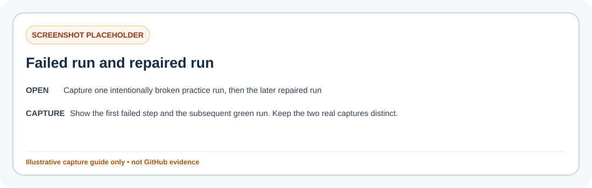

*Placeholder card only. Capture the failed practice run and the later green repair run as two separate genuine screenshots.*

## 12. Integration challenge

Copy [examples/final-integration.yml](examples/final-integration.yml) to **.github/workflows/integration-challenge.yml** in your practice repository. This complete workflow implements **prepare → build → test matrix → report**, plus an independent lint job. It generates and transfers files, exposes a small output, writes a job summary, sets timeouts and concurrency, and preserves failure visibility.

~~~mermaid
flowchart LR
  P[prepare output + artifact] --> B[build]
  B --> T[test matrix]
  T --> R[report artifact + summary]
  P --> R
  L[lint independent] --> R
~~~

*Keep each job's purpose obvious. Start with one test version, then expand to matrix after it passes.*

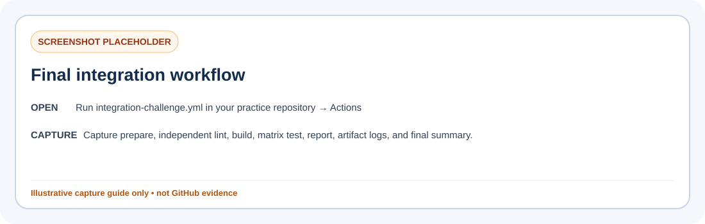

*Placeholder card only. Capture the final real job graph, artifact download, and report summary.*

Push this integration workflow only after copying its required examples directory. Inspect the graph, each Python test variant, artifact download logs, and final summary. To practice building it yourself, follow the listed order: prepare, build, test, independent lint, report, matrix, timeout and concurrency. Do not assume runner workspaces are shared.

## Troubleshooting, safety and further reading

| Symptom | First check |
|---|---|
| Workflow absent | YAML is in root .github/workflows, committed/pushed, Actions enabled. |
| YAML invalid | Indentation uses spaces; inspect the line GitHub identifies. |
| Report starts too soon | Add producer job IDs to needs. |
| Empty output | Compare step ID, output name, job mapping, needs reference. |
| Artifact not found | Upload/download names match and upload succeeded. |
| Report skipped | Check all needs jobs; default behavior requires success. |
| Summary empty | Writing step ran and appended to GITHUB_STEP_SUMMARY. |
| Matrix setup fails | Inspect version selected and setup-python logs. |
| Older run cancelled | Review concurrency group and cancel-in-progress. |
| Timeout | Inspect final log lines, network delays, hangs and timeout value. |

Keep **permissions: contents: read** unless a job has a demonstrated need for more. Never upload tokens, .env files, private keys, or confidential data. Workflow output and summaries are visible to people who can access the run.

**Practice:** pass a second output; add report text; add a build dependency; add a second artifact; add a safe cancelled() diagnostic. Questions: why are job files isolated? What does needs control? When output vs artifact? What does fail-fast change? Why can always() be useful? Why does the conditional workflow end red? How do matrix values become job runs? What cancels a concurrency group? What does timeout-minutes do?

Further reading: [workflow syntax](https://docs.github.com/en/actions/reference/workflows-and-actions/workflow-syntax), [job dependencies](https://docs.github.com/en/actions/using-jobs/using-jobs-in-a-workflow), [job outputs](https://docs.github.com/en/actions/using-jobs/defining-outputs-for-jobs), [artifacts](https://docs.github.com/en/actions/using-workflows/storing-workflow-data-as-artifacts), [workflow commands and summaries](https://docs.github.com/en/actions/using-workflows/workflow-commands-for-github-actions), [matrix jobs](https://docs.github.com/en/actions/using-jobs/using-a-matrix-for-your-jobs), [concurrency](https://docs.github.com/en/actions/using-jobs/using-concurrency), [status functions](https://docs.github.com/en/actions/learn-github-actions/expressions#status-check-functions), [setup-python](https://github.com/actions/setup-python), [checkout](https://github.com/actions/checkout), [upload-artifact](https://github.com/actions/upload-artifact), [download-artifact](https://github.com/actions/download-artifact).

Continue to [Lab 03 — Docker and NGINX](../03-github-actions-docker-nginx/README.md).

## Visual coverage checklist — diagrams AND instructional images

| Learning stage | Conceptual diagram | Instructional image or genuine capture prompt |
|---|---|---|
| Workflow fundamentals | Workflow/job/step/runner Mermaid hierarchy | [Workflow/jobs YAML illustration](images/diagrams/step-workflow-jobs.svg) and [editor capture placeholder](images/screenshots/PLACEHOLDER-workflow-editor.svg) |
| Parallel jobs | Mermaid parallel execution | [Parallel jobs illustration](images/diagrams/parallel-jobs.svg) and [real graph capture placeholder](images/screenshots/PLACEHOLDER-parallel-graph.svg) |
| Dependencies | Mermaid needs graph | [Sequential needs illustration](images/diagrams/sequential-needs.svg), [supplemental fan-in graph](images/diagrams/job-dependency-graph.svg), and [job logs capture placeholder](images/screenshots/PLACEHOLDER-job-dependency-logs.svg) |
| Job outputs | Mermaid step → job → consumer data flow | [Output code illustration](images/diagrams/workflow-output-passing.svg) and [log capture placeholder](images/screenshots/PLACEHOLDER-output-log.svg) |
| Artifacts | Mermaid upload/download sequence | [Artifact lifecycle illustration](images/diagrams/artifact-lifecycle.svg) and [upload/download capture placeholder](images/screenshots/PLACEHOLDER-artifact-transfer.svg) |
| Job summaries | Mermaid logs/summary/artifact comparison | [Summary implementation illustration](images/diagrams/step-artifact-summary.svg) and [rendered summary capture placeholder](images/screenshots/PLACEHOLDER-summary-page.svg) |
| Matrix | Mermaid matrix expansion | [Matrix implementation illustration](images/diagrams/matrix-strategy.svg) and [matrix results capture placeholder](images/screenshots/PLACEHOLDER-matrix-results.svg) |
| Conditional execution | Mermaid status-function flow | [Status behavior illustration](images/diagrams/step-matrix-status.svg) and [conditional logs capture placeholder](images/screenshots/PLACEHOLDER-conditional-failure.svg) |
| Debugging | Mermaid debugging decision tree | [Failed/repaired workflow capture placeholder](images/screenshots/PLACEHOLDER-failure-repair.svg) |
| Integration challenge | Mermaid final integration architecture | [Final run capture placeholder](images/screenshots/PLACEHOLDER-integration-run.svg) |

Placeholder cards are instructional images, not screenshots or execution evidence. Capture genuine GitHub/editor evidence in your own practice repository and follow [the screenshot guide](images/screenshots/README.md). The [image index](images/README.md) separates editable diagrams, retained implementation illustrations, and screenshot prompts.
