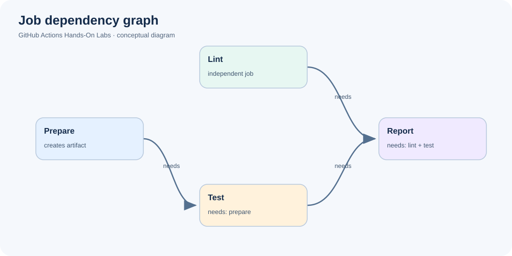
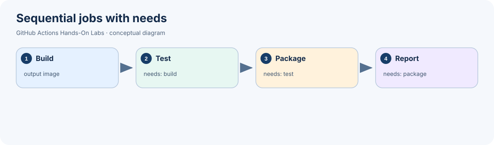
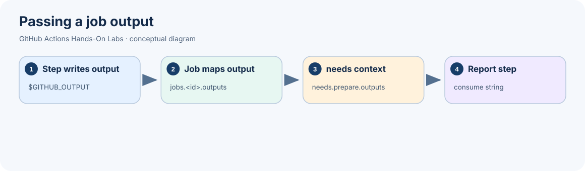
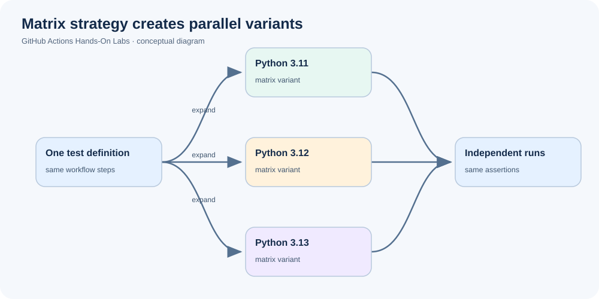
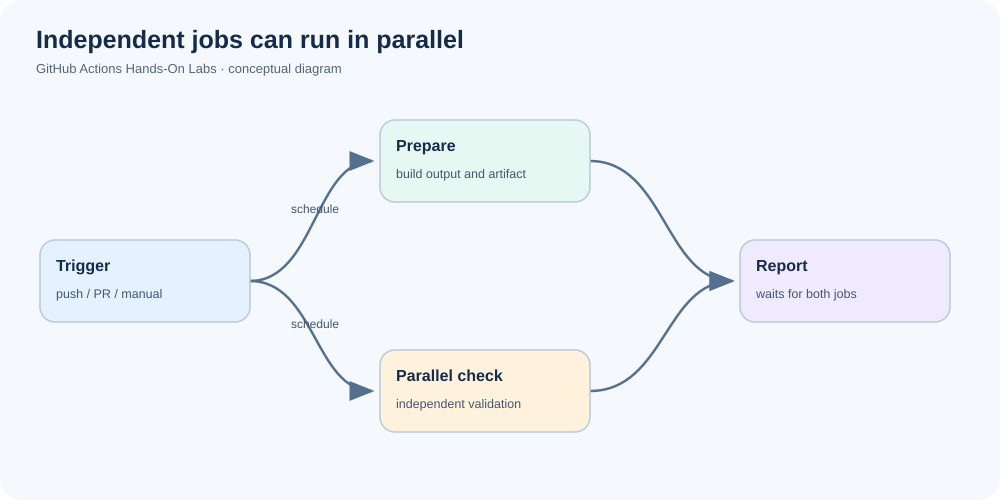
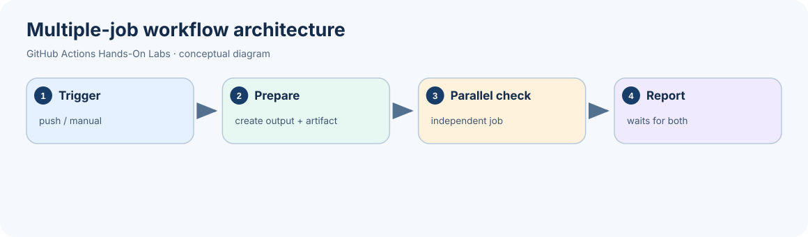
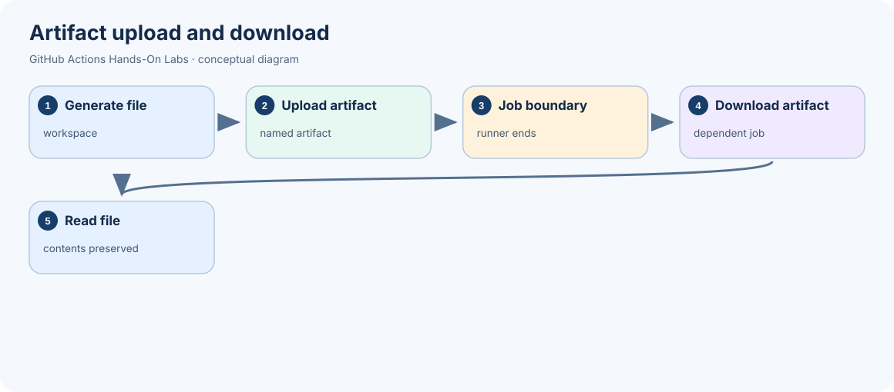

# Visual index

## Original technical diagrams

### Job Dependency Graph

[Open editable SVG source](diagrams/job-dependency-graph.svg).

### Sequential Needs

[Open editable SVG source](diagrams/sequential-needs.svg).

### Workflow Output Passing

[Open editable SVG source](diagrams/workflow-output-passing.svg).

### Matrix Strategy

[Open editable SVG source](diagrams/matrix-strategy.svg).

### Parallel Jobs

[Open editable SVG source](diagrams/parallel-jobs.svg).

### Multiple Job Architecture

[Open editable SVG source](diagrams/multiple-job-architecture.svg).

### Artifact Lifecycle

[Open editable SVG source](diagrams/artifact-lifecycle.svg).

## Genuine screenshots

Place real captures from your own practice execution in `screenshots/`. The authoring checkout does not include real workstation or GitHub UI captures, so none are presented as execution evidence.

[Screenshot capture guide](screenshots/README.md).
