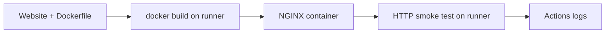

# Lab 03 — GitHub Actions with Docker and NGINX

Build a static site image, run NGINX locally and in CI, and verify HTTP without publishing an image. Docker packages a filesystem and runtime configuration as an image; a container is a running instance. Build context `.` supplies files to `docker build`; port mapping `8080:80` maps host port 8080 to container port 80. NGINX serves the static page.

## Estimated time

| Activity | Duration |
|---|---:|
| Concepts | 35 min |
| Docker/VS Code setup | 30 min |
| Implementation | 75 min |
| Verification | 25 min |
| Debugging | 20 min |
| Exercises | 25 min |
| **Total** | **3 h 30 min** |

Need Git, VS Code, Docker Desktop or Docker Engine and Lab 01 knowledge. Verify `docker --version` and `docker info`.

## Implementation

From your practice repository, copy this lab's `Dockerfile`, `.dockerignore`, `website/index.html` and workflow. The Dockerfile uses a maintained NGINX Alpine image, copies only website assets and declares HTTP port. `docker build -t actions-nginx:local .` builds locally. `docker run --detach --name lab-nginx -p 8080:80 actions-nginx:local` starts it. Visit `http://localhost:8080`; verify with `curl http://localhost:8080` (PowerShell: `Invoke-WebRequest http://localhost:8080`). Inspect using `docker ps` and `docker logs lab-nginx`. Stop/remove with `docker rm -f lab-nginx`; remove image using `docker image rm actions-nginx:local`.

The workflow builds `actions-nginx:ci` in GitHub's runner, starts a container and retries HTTP using curl. Its port is exposed only within the runner's environment; **it is not automatically available in your local browser**. The `always()` cleanup runs even if the HTTP check fails. Push workflow and inspect Actions logs; a page response and green job mean success. This sample intentionally does not publish to a registry. Optional GHCR publishing needs package write permission and authenticated login with `GITHUB_TOKEN`; see official docs before adding.

**Example output:** `docker build` ends with `Successfully tagged actions-nginx:ci` (builder wording can differ); curl prints HTML. If port 8080 is taken locally, change host port to 8081. If Docker daemon is unavailable, start Docker Desktop. Image layers can be cached by the daemon; Buildx and `cache` actions are useful in larger builds, but this basic smoke test avoids cache complexity. Image scanning is an important follow-on; don't treat a successful build as a security audit.

## Exercises, security and cleanup

Guided: change page title; map port 8081; add an NGINX health-check request. Independent: build with a commit-derived tag; add a second page. Questions: image vs container? What does build context mean? Why port mapping? Why can't local browser reach runner container? What does cleanup do? Debugging: rename copied website folder then read build failure. Integration: CI builds, starts, checks unique page content and always cleans up. Hints: `docker build -t actions-nginx:$tag .`; `grep` or `curl | grep`. Do not put credentials in image layers or context; `.dockerignore` excludes repo metadata. Clean up container/image after local work.

Further reading: [Docker docs](https://docs.docker.com/), [NGINX image](https://hub.docker.com/_/nginx), [GitHub container registry](https://docs.github.com/en/packages/working-with-a-github-packages-registry/working-with-the-container-registry). Next: [Lab 04](../04-self-hosted-github-actions-runner/README.md).

## Screenshot index

See `images/README.md` for genuine capture suggestions; no run is claimed here.
