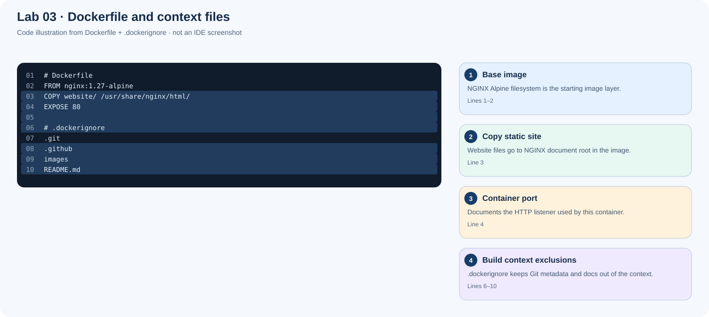
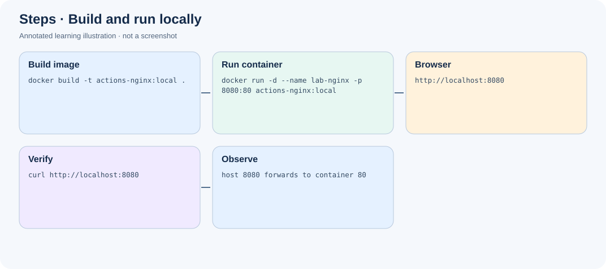
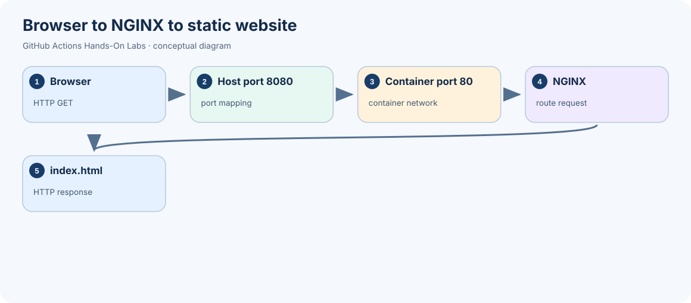
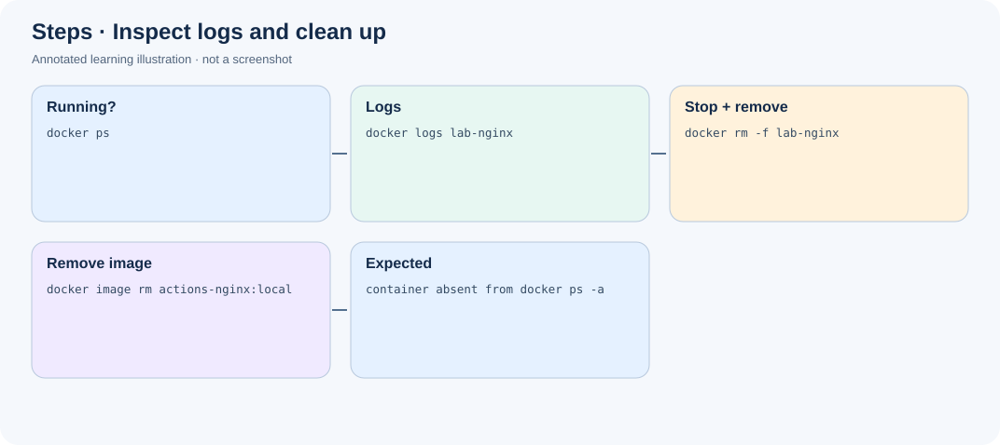
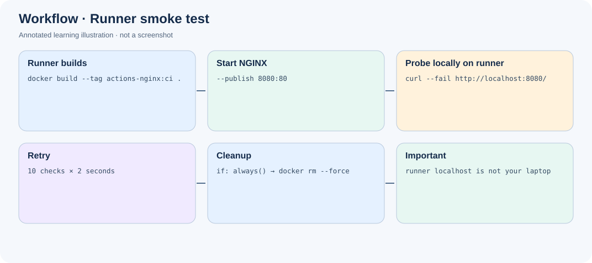

# Lab 03 — GitHub Actions with Docker and NGINX

Build a small static site image, run it locally in NGINX, then repeat the build and an HTTP smoke test on GitHub's runner. The workflow does not publish the image or expose a port on your computer.

## Estimated time and outcomes

| Activity | Duration |
|---|---:|
| Docker and networking concepts | 35 min |
| Docker/editor setup | 30 min |
| Website and container implementation | 75 min |
| Local and Actions verification | 25 min |
| Debugging | 20 min |
| Exercises | 25 min |
| **Total** | **3 h 30 min** |

Beginners may need extra time. Need Git, any file/project editor, Docker Desktop/Engine and Lab 01. Verify `docker --version` and `docker info` before continuing.

## Step 1 — Understand the image and request path

A Dockerfile describes how to assemble an image. The image is an immutable template; a container is a running instance. The build context is the set of local files available to Docker during build, filtered by `.dockerignore`.



*Annotated illustration of the actual Dockerfile and `.dockerignore`; not an editor screenshot.*

The project files are [`Dockerfile`](Dockerfile), [`.dockerignore`](.dockerignore), [`website/index.html`](website/index.html), and [`.github/workflows/docker-nginx.yml`](.github/workflows/docker-nginx.yml). Keep these at the practice repository root in those paths.


*An image is the built template; `docker run` creates a container from it.*

## Step 2 — Build and run locally

**Where:** your editor integrated or system terminal. **Working directory:** practice repository root containing the Dockerfile.

```sh
docker build -t actions-nginx:local .
docker run --detach --name lab-nginx --publish 8080:80 actions-nginx:local
```



*Command illustration: host port `8080` maps to NGINX container port `80`.*



*The browser reaches host port 8080; Docker forwards to NGINX port 80 inside the container.*

**Example output:** build output ends with an image ID/tag; run returns a long container ID. Exact text varies by Docker version. Open `http://localhost:8080` in your browser. Verify in another terminal with `curl http://localhost:8080`; on PowerShell use `Invoke-WebRequest http://localhost:8080`. The returned HTML includes “Hello from NGINX in Docker.”

Inspect with `docker ps` and `docker logs lab-nginx`. To clean up run `docker rm --force lab-nginx`, then `docker image rm actions-nginx:local`.



*Expected local checks; capture actual browser, `docker ps`, and logs using the screenshot guide.*

## Step 3 — Run the same smoke test in Actions

Copy the complete workflow file into the practice repository at `.github/workflows/docker-nginx.yml`. It checks out source, builds `actions-nginx:ci`, starts NGINX, retries `curl --fail` up to ten times, and removes the container from an `if: always()` cleanup step. The runner's Docker engine and loopback network belong to the GitHub-hosted VM.



*The curl request runs inside the GitHub runner. Its `localhost:8080` is not your laptop's browser address.*

Commit and push from the practice repo root:

```sh
git add Dockerfile .dockerignore website/index.html .github/workflows/docker-nginx.yml
git commit -m "Add Docker NGINX smoke test"
git push
```

Open the practice repository's **Actions → Docker NGINX → newest run → build-and-smoke-test**. A successful HTTP step prints the HTML response; cleanup runs even after an earlier failure. The green check confirms this workflow run passed. This repository's examples are nested course material and do not run automatically until copied to a repository root.

## Troubleshooting, security and exercises

Port busy: map `8081:80` and browse `localhost:8081`. Docker unavailable: start Docker Desktop and retry `docker info`. Build cannot find website: verify context is `.` and `website/index.html` exists. HTTP fails: inspect container logs before cleanup, verify mapping and retry delay. A green image build is not a vulnerability scan. Never pass credentials through Docker build args or copy `.env` into an image. `.dockerignore` excludes Git metadata, workflows and docs from context.

Guided: edit page title; change host port; add a page. Independent: tag by commit SHA; add HTTP body assertion. Questions: image vs container? What is build context? What do `-p 8080:80` ports mean? Why cannot a local browser reach runner localhost? Why `always()` cleanup? Debug: rename `website/` and inspect build error, then repair. Integration: build, start, assert unique page text and cleanup.

Optional GHCR publishing requires `packages: write`, login and package policy; the basic lab needs no registry. See the [optional GHCR flow](images/diagrams/ghcr-publishing-flow.svg) for the conceptual sequence; this course does not include or claim a publishing workflow. Read [Docker docs](https://docs.docker.com/), [NGINX image](https://hub.docker.com/_/nginx), [GHCR](https://docs.github.com/en/packages/working-with-a-github-packages-registry/working-with-the-container-registry). Next: [Lab 04](../04-self-hosted-github-actions-runner/README.md).

## Visual coverage checklist

| Stage | Aid | Verification evidence |
|---|---|---|
| Dockerfile/context | Annotated implementation diagram | [`step-dockerfile-anatomy.svg`](images/diagrams/step-dockerfile-anatomy.svg) |
| Build/run and port map | Command illustration | [`step-local-docker-commands.svg`](images/diagrams/step-local-docker-commands.svg) |
| Browser, curl, logs, cleanup | Expected-output illustration | [`step-container-inspect-cleanup.svg`](images/diagrams/step-container-inspect-cleanup.svg) |
| Runner smoke test | Workflow sequence illustration | [`step-runner-http-check.svg`](images/diagrams/step-runner-http-check.svg) |
| Genuine Docker/browser/Actions captures | Screenshot capture cards | [`images/screenshots/README.md`](images/screenshots/README.md) |
