# Lab 03 — GitHub Actions with Docker, NGINX, and Docker Hub

Build a static website, serve it with NGINX inside Docker, test the same image locally and on a GitHub-hosted runner, then publish a tested image to Docker Hub from a trusted main-branch workflow.

**Estimated time: 3 hours 45 minutes.** Beginners may need another 30–60 minutes for account setup and image downloads.

| Activity | Time |
|---|---:|
| Repository, editor and tool setup | 25 min |
| HTTP, NGINX and project structure | 30 min |
| HTML, NGINX config and Dockerfile | 45 min |
| Local image build, container, HTTP test and cleanup | 35 min |
| GitHub Actions CI and run inspection | 35 min |
| Docker Hub repository, secrets and publishing | 35 min |
| Troubleshooting and exercises | 20 min |
| **Total** | **3 h 45 min** |

**Difficulty:** Intermediate. **Editor:** VS Code is used for menu examples, but any IDE/editor with a file explorer and terminal works. **Prerequisites:** Git, Docker Desktop/Engine, GitHub account, Docker Hub account for publishing, and Lab 01 basics.

## What you will build

The Dockerfile packages the custom NGINX configuration and static HTML site. Locally, you will run the image on host port 8000. Pull requests use a secret-free CI workflow. A separate workflow runs only after code is pushed or merged to main, builds and tests again, then logs in and pushes two Docker Hub tags.

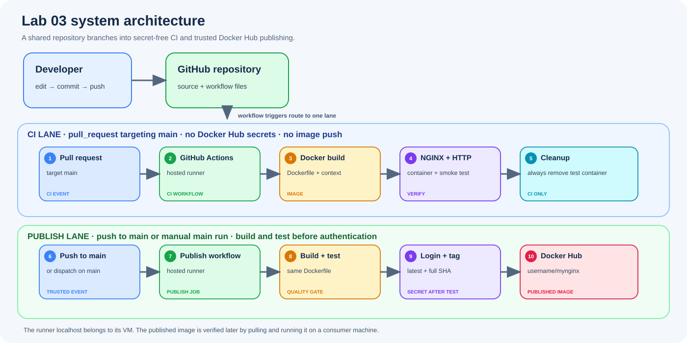

*Conceptual architecture, not execution evidence. CI validates proposed changes without Docker Hub credentials. Trusted publishing has its own build/test gate before login.*

### Course folder and practice repository

The lab files are nested in this course repository, so GitHub will not execute these workflow files here. Create a separate practice repository and copy the listed files into its root. Push exercises to your practice repository, not the course repository.

| Course file | Copy into practice repo |
|---|---|
| Dockerfile | Dockerfile |
| nginx.conf | nginx.conf |
| .dockerignore | .dockerignore |
| website/index.html | website/index.html |
| .github/workflows/docker-nginx.yml | .github/workflows/docker-nginx.yml |
| .github/workflows/docker-publish.yml | .github/workflows/docker-publish.yml |

## 1. Create and prepare your practice repository

### Create a repository

On GitHub, choose **New repository**, name it **docker-nginx-actions-lab**, choose Public if you want anyone to pull the published image without logging in, and create it empty. Leave README initialization unchecked so your first push has no unrelated files.

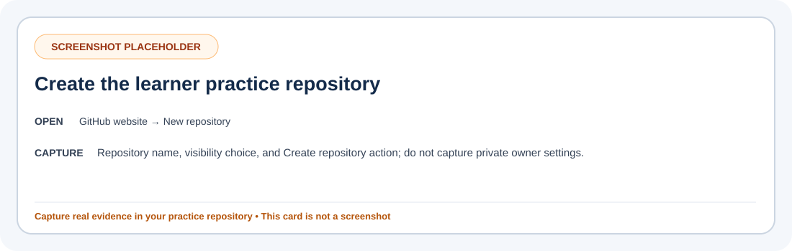

*Capture card only, not a GitHub screenshot. Capture the real repository creation page after completing this step; see the [screenshot guide](images/screenshots/README.md).*

### Clone and configure Git

**Where:** terminal in VS Code or your preferred editor. VS Code menu: **Terminal → New Terminal**. **Working directory:** the parent directory where you store projects.

~~~sh
git --version
git clone https://github.com/YOUR_GITHUB_USERNAME/docker-nginx-actions-lab.git
cd docker-nginx-actions-lab
git config user.name "Your Name"
git config user.email "you@example.com"
git status
git remote -v
docker --version
docker info
~~~

Replace username and identity values. Git identity identifies commits; it is not needed to clone. These settings apply to this repository. Use a GitHub noreply address if you do not want your personal email shown.

**Example output:** Git prints a version. Clone reports it created the folder. For an empty repository, status reports a branch with no commits yet; that is expected. The remote should point to your practice repository. Docker info must include a Server section; if the daemon is unavailable, start Docker Desktop or the Linux Docker service and retry.

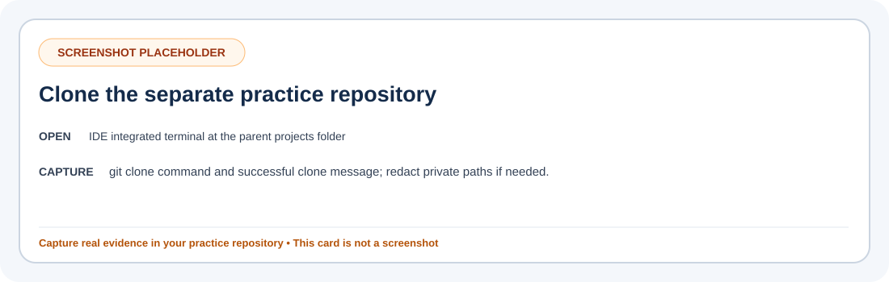

*Capture card only. Capture your terminal after a real clone; paths and usernames can be redacted.*

Open the cloned folder using **File → Open Folder…** in VS Code or the equivalent in your IDE. Confirm the integrated terminal is at the practice repository root.

## 2. Understand HTTP and NGINX

A web server accepts HTTP requests and returns HTTP responses. NGINX is a web server that can serve static files. Static hosting means NGINX reads files such as HTML, CSS, and images and sends their contents to the browser. It does not build a new page from application code for every request.

The browser requests the root path. NGINX checks its server configuration, finds the document root, selects the configured index file, and returns it. The server listens on container port 80. Later, Docker maps a port on your computer to that container port.

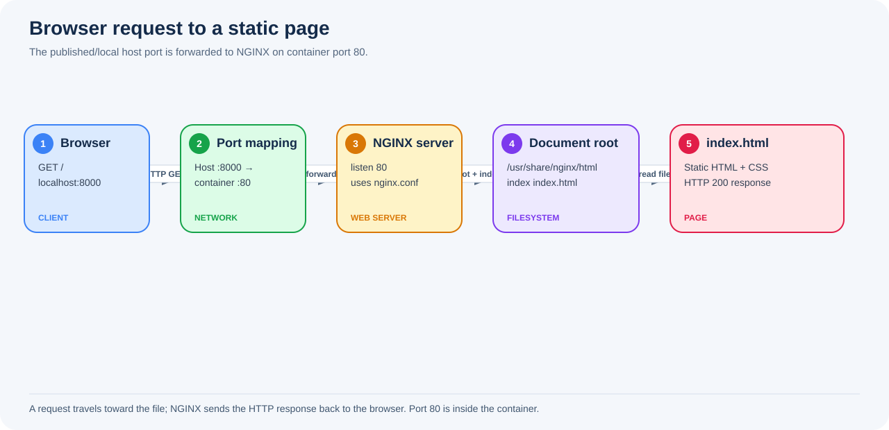

*The NGINX document root is a filesystem path inside the container. It is unrelated to the Linux root user.*

A preserved [browser-to-NGINX request illustration](images/diagrams/browser-nginx-request-flow.svg) adds the request/response relationship and host-port mapping.

### Project structure

Create these folders in the practice repository root. The workflow path must be rooted at the practice repository, not inside a nested lab folder.

~~~text
docker-nginx-actions-lab/
├── .dockerignore
├── Dockerfile
├── nginx.conf
├── website/
│   └── index.html
└── .github/
    └── workflows/
        ├── docker-nginx.yml
        └── docker-publish.yml
~~~

**macOS/Linux:**

~~~sh
mkdir -p website .github/workflows
~~~

**Windows PowerShell:**

~~~powershell
New-Item -ItemType Directory -Force website, .github/workflows | Out-Null
~~~

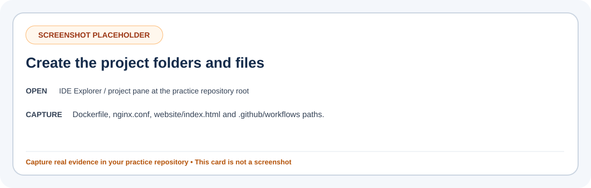

*Capture card only. Capture the actual file tree in your IDE or terminal after creating the folders.*

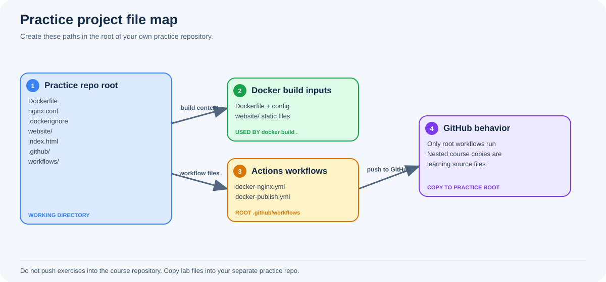

*This project map separates Docker build inputs from Actions workflow files. Workflows are executable only from the practice repository root.*

**Checkpoint:** the practice repository root contains the Dockerfile and nginx.conf; the page is inside website; workflows are inside root .github/workflows.

## 3. Create the static website

**File:** website/index.html. Use your editor to create the file and paste the following complete page. It has inline styling to keep this first example self-contained.

~~~html
<!doctype html>
<html lang="en">
<head>
  <meta charset="utf-8">
  <meta name="viewport" content="width=device-width, initial-scale=1">
  <meta name="description" content="A hands-on Docker, NGINX, and GitHub Actions lab.">
  <title>Docker + NGINX Learning Lab</title>
  
</head>
<body>
  <main>
    
GitHub Actions Hands-On Labs · Lab 03

    <h1>Docker + NGINX</h1>
    
This static website is served by NGINX inside Docker. GitHub Actions builds and checks the same image before a trusted main-branch workflow publishes it to Docker Hub.

    
Container response verified

    
Smoke-test marker: <code>NGINX_DOCKER_HUB_LAB_READY</code>

  </main>
</body>
</html>
~~~

The marker gives automation an exact assertion. A generic NGINX welcome page will not pass the test. NGINX serves this file from the document root configured in nginx.conf.

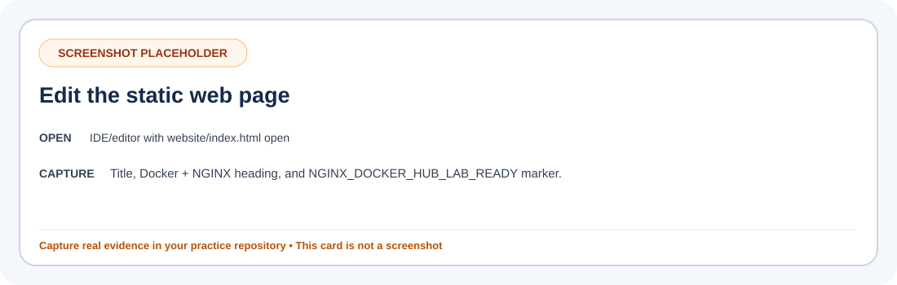

*Capture card only. Capture the real editor showing the marker and heading; this does not depict an editor.*

The complete source is in [website/index.html](website/index.html).

**Checkpoint:** verify the file is at website/index.html and the marker spelling is exact.

## 4. Configure NGINX

**File:** nginx.conf at the practice repository root. Paste:

~~~nginx
server {
    listen 80;
    server_name _;

    root /usr/share/nginx/html;
    index index.html;

    location = /healthz {
        default_type text/plain;
        return 200 "healthy\n";
    }

    location / {
        try_files $uri $uri/ =404;
    }
}
~~~

*This architecture diagram relates the listener, configuration, document root, and index file. The actual file is copied into the official image's conf.d directory by the Dockerfile.*

- **server** starts a virtual server block.
- **listen 80** accepts HTTP on container port 80.
- **server_name _** is a catch-all server name for this small example.
- **root** is the path where the static website lives inside the container.
- **index** chooses which file to serve for a directory request.
- **location = /healthz** defines an exact health-check URL that returns plain text.
- **location /** handles normal site paths; try_files returns 404 when a file does not exist.

The Dockerfile copies this file to /etc/nginx/conf.d/default.conf, the location loaded by the official NGINX image.

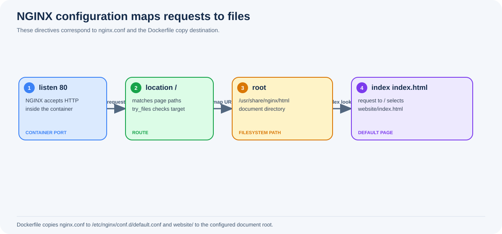

*The diagram maps the exact directives to the request path and Dockerfile copy destinations.*

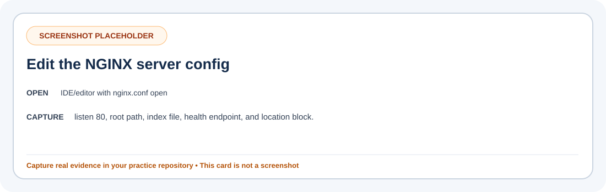

*Capture card only. Capture the real configuration file with directives visible.*

**Checkpoint:** check braces, paths, and semicolons. NGINX directives end in semicolons.

## 5. Write the Dockerfile and filter the build context

A Dockerfile describes how to assemble an image. Docker sends the build context to the builder; the final dot in the build command means the current directory. COPY paths are relative to this context. .dockerignore excludes files Docker does not need.

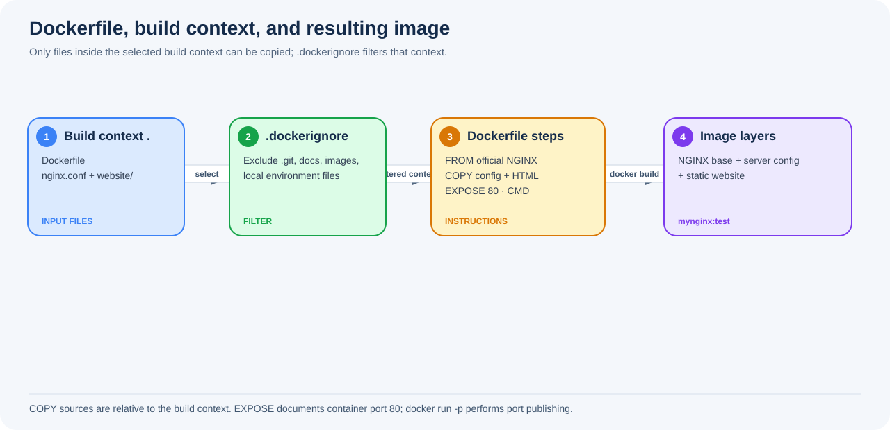

*The actual Dockerfile copies nginx.conf and website into the locations used by the NGINX server configuration.*

**File:** Dockerfile in the practice repository root.

~~~dockerfile
FROM nginx:stable-alpine3.24

# Replace the image's default virtual host with this lab's static-site config.
COPY nginx.conf /etc/nginx/conf.d/default.conf

# The official image serves site files from this document root.
COPY website/ /usr/share/nginx/html/

EXPOSE 80

# Keep the server in the foreground so it remains the container's main process.
CMD ["nginx", "-g", "daemon off;"]
~~~

- **FROM** selects the official NGINX stable Alpine base image. Tags can move as maintainers update the image; production builds may pin a reviewed digest.
- **COPY nginx.conf …** replaces the default virtual-host configuration.
- **COPY website/ …** places static files in the document root.
- **EXPOSE 80** documents the container's listening port. It does not publish a host port.
- **CMD** keeps NGINX in the foreground so the main process keeps the container running.

The current official image listing includes the stable-alpine3.24 tag; check the [NGINX official image tags](https://hub.docker.com/_/nginx) before starting if a tag has changed.

**File:** .dockerignore.

~~~text
.git
.github
images
docs
README.md
.env
.env.*
!.env.example
~~~

This prevents Git metadata, workflows, visual assets, docs, and local environment files from being sent to the Docker builder. Never put secrets into the Dockerfile or image.

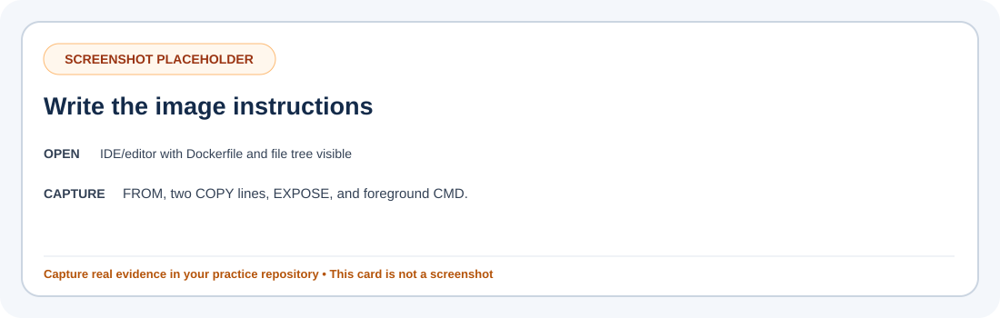

The [preserved annotated Dockerfile illustration](images/diagrams/step-dockerfile-anatomy.svg) shows the build instructions and ignore-file purpose. It was authored for an earlier NGINX tag; the current complete Dockerfile above is authoritative.

*Capture card only. Capture your actual file and project tree, not a generated editor image.*

**Checkpoint:** Dockerfile, nginx.conf, and website/ are all inside the build context. Do not exclude those files in .dockerignore.

## 6. Build and inspect the local image

**Where:** terminal in your IDE or system terminal. **Working directory:** practice repository root.

~~~sh
docker build -t actions-nginx:local .
docker images actions-nginx:local
docker image inspect actions-nginx:local
~~~

Docker executes the Dockerfile instructions and may reuse cached layers. The tag option names the image; local means this is the local test version. The final dot selects the current directory as build context.

**Example output:** the build completes with an image ID and a tag such as actions-nginx:local. Image ID, layer messages, size, and duration vary. docker images shows the repository/tag; inspect prints detailed JSON. These are expected-output descriptions, not a record of a build run in this workspace.

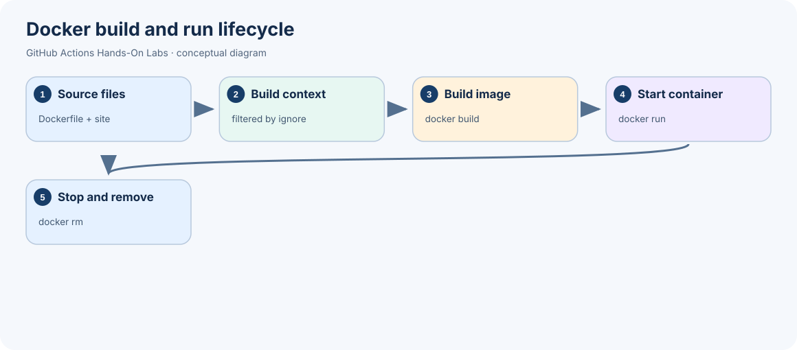

The [Docker image architecture diagram](images/diagrams/docker-architecture.svg) shows the Dockerfile → image → container relationship.

*Preserved original illustration: Dockerfile and context build a reusable image, which can then start a container.*

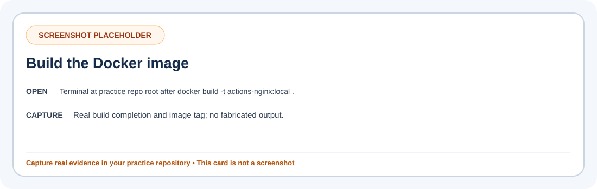

*Capture card only. Capture the actual build command and successful terminal output.*

**Checkpoint:** docker images lists actions-nginx:local. If Docker cannot connect, start the engine and retry docker info before rebuilding.

## 7. Run, browse, inspect, and clean up the container

Run the image:

~~~sh
docker run --detach --name lab-nginx --publish 8000:80 actions-nginx:local
~~~

Detached mode returns control to the terminal. The name makes the container easier to inspect. Port mapping follows host:container, so host 8000 forwards to NGINX's container port 80.

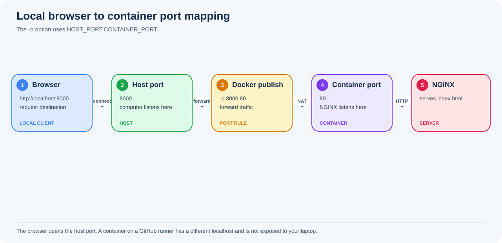

The [preserved port mapping image](images/diagrams/port-mapping.svg) gives another view of the host-to-container rule. The [container networking illustration](images/diagrams/container-networking.svg) shows runner and local loopback boundaries.

*The browser connects to your computer's port 8000. Docker forwards that request to port 80 inside the container.*

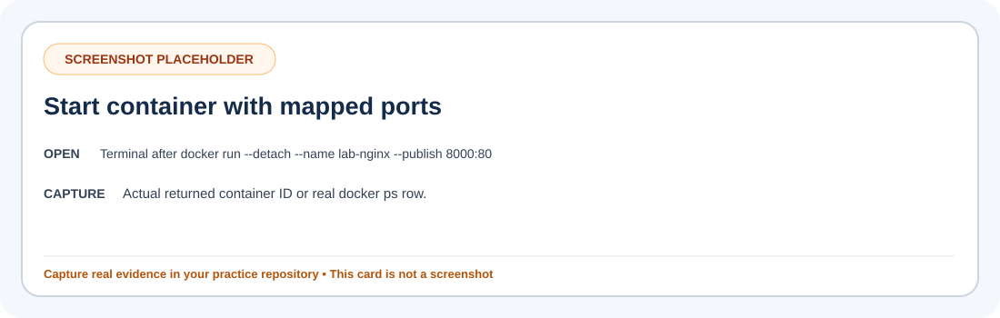

*Capture card only. Capture the real docker run result or the corresponding docker ps row.*

Open **http://localhost:8000** in a browser. The page should show “Docker + NGINX” and the unique marker.

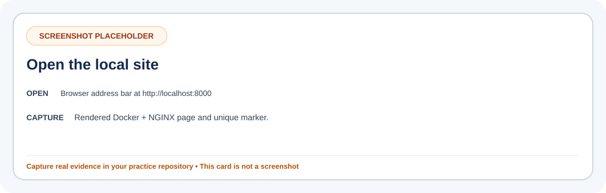

*Capture card only. Capture the actual browser response from your local container.*

Verify with curl:

~~~sh
curl --fail http://localhost:8000/
curl --fail http://localhost:8000/healthz
docker ps
docker logs lab-nginx
docker inspect lab-nginx
~~~

**PowerShell:**

~~~powershell
(Invoke-WebRequest -UseBasicParsing http://localhost:8000/).Content
(Invoke-WebRequest -UseBasicParsing http://localhost:8000/healthz).Content
docker ps
docker logs lab-nginx
docker inspect lab-nginx
~~~

**Example output:** the page response includes NGINX_DOCKER_HUB_LAB_READY; the health request prints healthy; docker ps shows an Up container and a port similar to 127.0.0.1:8000->80/tcp. Logs may include the request access record. Inspect is detailed JSON.

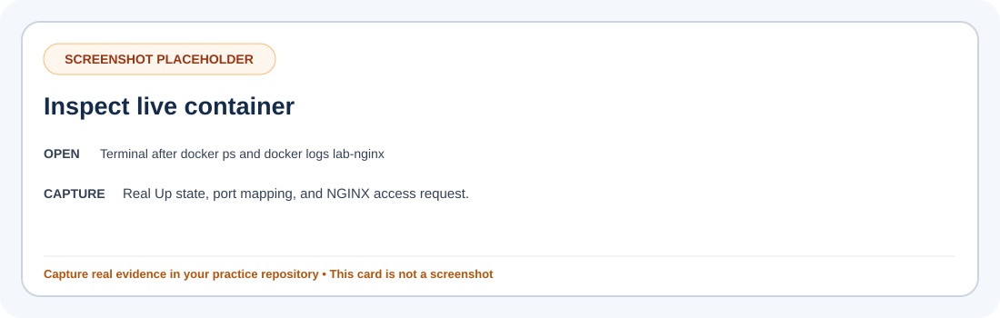

*Capture card only. Capture genuine terminal output after making a request.*

The preserved [container inspection and cleanup illustration](images/diagrams/step-container-inspect-cleanup.svg) shows the status/log/remove sequence.

Clean up:

~~~sh
docker stop lab-nginx
docker rm lab-nginx
docker image rm actions-nginx:local
~~~

Stop halts the process. Remove deletes the stopped container record and writable layer. Image removal is optional and does not happen automatically when a container is removed.

**Checkpoint:** after cleanup, docker ps -a no longer lists lab-nginx. If port 8000 is busy, use 8001:80 and browse localhost:8001.

## 8. Understand GitHub Actions before creating workflows

A workflow is a YAML file under .github/workflows. An event starts it. A job runs on a runner. Steps execute shell commands or actions. A GitHub-hosted runner is a temporary VM with its own Docker engine and network. The runner's localhost is not your laptop's localhost.

### CI workflow

The CI workflow runs on pull requests targeting main and can also be started manually. It checks out source, builds the image, starts NGINX bound to runner loopback, checks the page marker and health endpoint, prints diagnostics after failure, and always removes the test container. It does not log in or publish to Docker Hub.

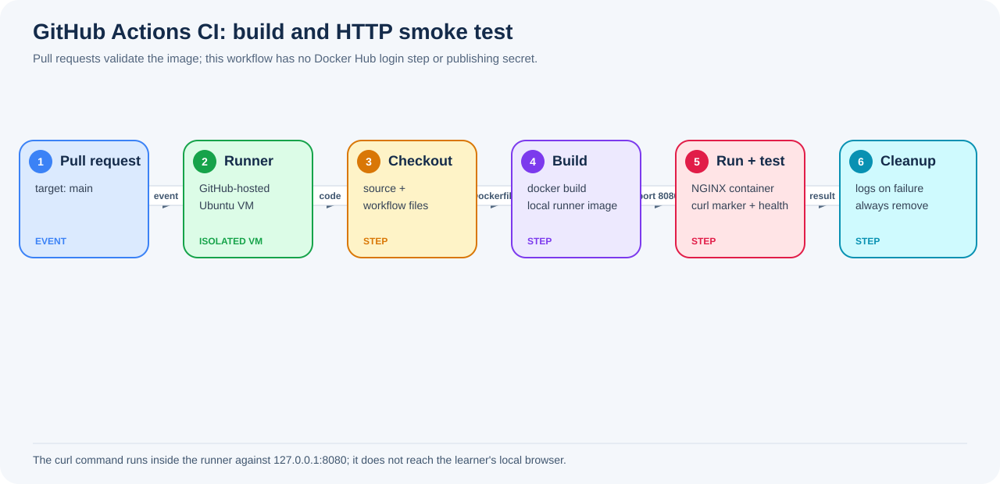

The [runner/Docker-engine diagram](images/diagrams/runner-docker-engine.svg) and [preserved CI command flow](images/diagrams/github-actions-docker-ci.svg) add the runner-to-engine relationship and exact test sequence.

*The HTTP smoke test runs inside the runner against 127.0.0.1:8080. It cannot be opened from your local browser.*

Copy the complete [CI workflow](.github/workflows/docker-nginx.yml) to the same path in your practice repository. Important settings include contents: read, timeout-minutes, the bounded retry loop, failure diagnostics, and cleanup with always(). The current workflow uses actions/checkout v7; check its [official releases](https://github.com/actions/checkout/releases) when maintaining the course.

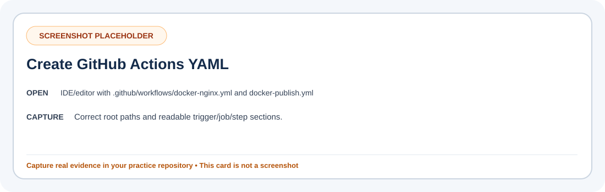

*Capture card only. Capture the actual YAML in your IDE at the practice repository's root .github/workflows path.*

Commit the site and CI file:

~~~sh
git status
git add Dockerfile nginx.conf .dockerignore website/index.html .github/workflows/docker-nginx.yml
git status
git commit -m "Add Docker NGINX CI"
git push -u origin main
~~~

If your branch already tracks origin/main, plain git push is enough. The first push to main does not trigger pull_request; open a pull request from a feature branch, or start CI from **Actions → Docker NGINX CI → Run workflow**.

After pushing, open the practice repo **Actions → Docker NGINX CI → newest run**. Expand the job and inspect Build, Verify, diagnostics if needed, and Cleanup. A successful marker grep and health assertion are the success signals.

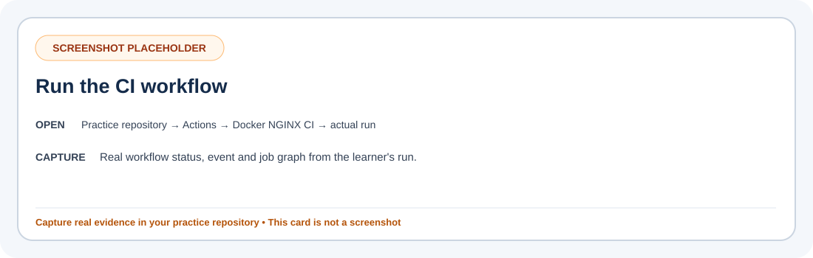

*Capture card only. Capture the Actions list, event type, status, and actual run graph.*

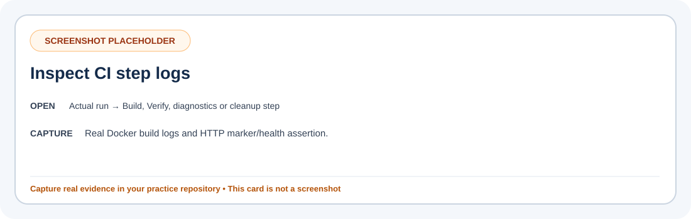

*Capture card only. Capture real Docker build and HTTP verification step logs.*

A failed smoke test prints Docker status, logs, and inspect output before cleanup. A green run is evidence only for that specific source revision and actual run.

## 9. Create Docker Hub repository and GitHub Secrets

### Create the Docker Hub repository

Sign in to [Docker Hub](https://hub.docker.com/), create a repository named **mynginx**, and choose Public if you want unauthenticated pulls in the verification section. Private repositories require Docker Hub authentication before pulling.

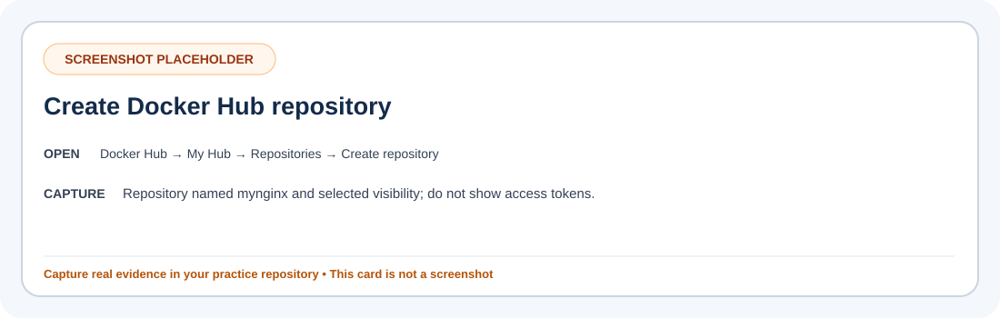

*Capture card only. Capture the real repository page/name; never include the token creation screen.*

### Create a Docker Hub access token

Create a Docker Hub access token with the minimum write/push permission available for the repository. Copy it once and store it in a password manager. Use this token instead of your Docker Hub account password.

In the **practice GitHub repository**, open **Settings → Secrets and variables → Actions → New repository secret**, then add:

| Secret name | Value |
|---|---|
| DOCKER_USERNAME | Your Docker Hub username |
| DOCKER_PASSWORD | The Docker Hub access token, not your account password |

Never put token values into source, terminal commands, Docker build arguments, screenshots, or logs. GitHub masking is not a security boundary. The pull-request workflow has no publishing secrets. The publish workflow does not run for pull requests.

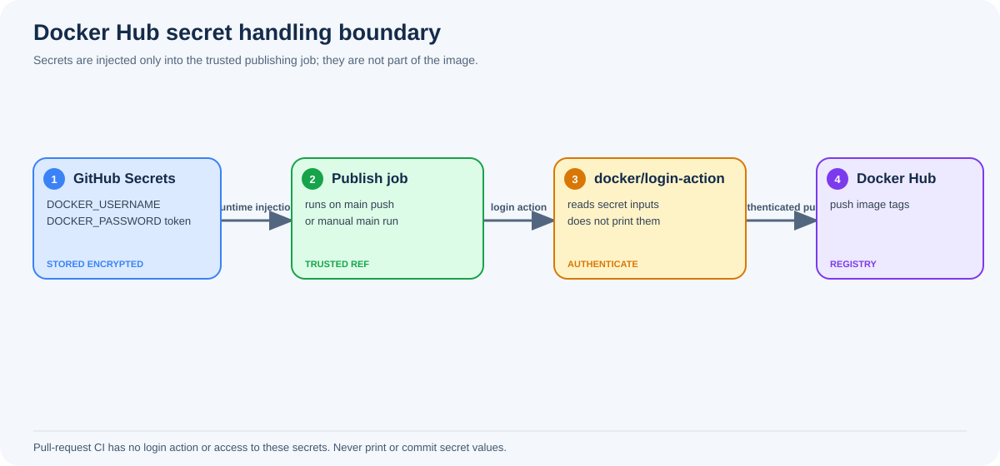

*The access token flows from a GitHub Actions secret into the login action. The credential field itself must remain private; use the screenshot prompt below to capture only the secret names if evidence is needed.*

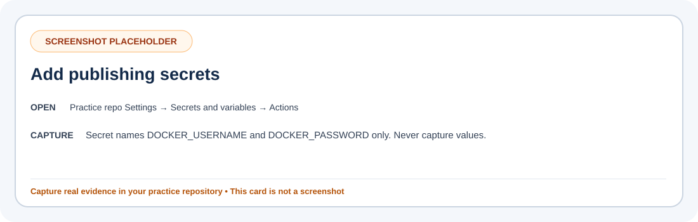

*Capture card only. Show secret names, never values. Prefer omitting this capture from a public repository if any account details remain visible.*

## 10. Publish a tested image to Docker Hub

The publish workflow runs after pushes to main (including merges) or a manual run from main. A job-level branch guard blocks publishing when manual dispatch selects another branch. It rebuilds and smoke-tests before authentication, then uses docker/login-action and pushes two tags.

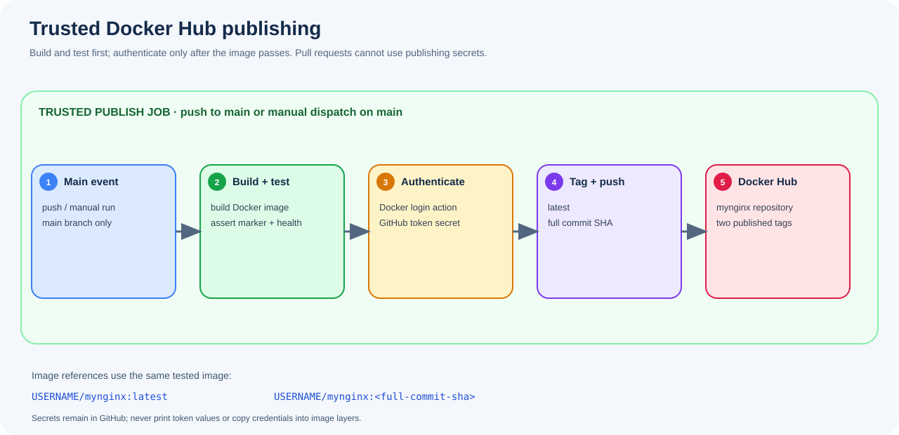

*The access token is supplied to the login action only in the trusted publisher job; it is not copied into the image.*

*Trusted path: main → build/test → login with GitHub Secrets → tag latest and full commit SHA → push.*

Copy the complete [Docker Hub publish workflow](.github/workflows/docker-publish.yml) to the matching path in the practice repository. It never listens to pull_request, so untrusted fork code cannot access its Docker Hub credentials. It grants contents: read only; a Docker Hub push does not need packages: write.

The actual workflow uses the maintained docker/login-action major version 4. See the [official action](https://github.com/docker/login-action) and [Docker's GitHub Actions guide](https://docs.docker.com/build/ci/github-actions/). Build/test happens before login. The tag step pushes the tested local image as:

~~~text
YOUR_DOCKERHUB_USERNAME/mynginx:latest
YOUR_DOCKERHUB_USERNAME/mynginx:<full-commit-sha>
~~~

The latest tag is convenient but moves whenever a later main commit publishes. A commit-SHA tag makes it easier to identify the source revision. Registry tags can be changed; production deployment references can use the image digest for stronger identity.

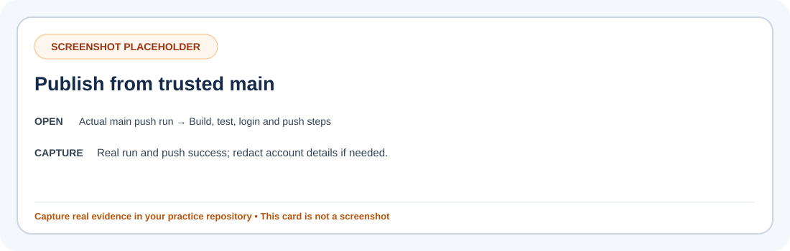

*Capture card only. Capture the real main-branch run after push success; redact private account information.*

**Example behavior:** the Actions run shows build, HTTP assertions, cleanup, Docker Hub login, and two push commands. Never infer success from workflow YAML alone.

## 11. Verify tags and pull the published image

Open Docker Hub → **mynginx → Tags**. After a real successful publish, both latest and a full commit-SHA tag should appear.

The publish diagram above shows both tags leaving the same tested image. The tag list capture below must come from your actual Docker Hub repository.

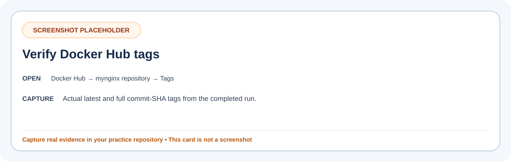

*Capture card only. Capture actual tag rows after a successful push; no tag screenshot is included as execution evidence.*

Pull and run the public image. Replace the placeholder username with your Docker Hub username.

~~~sh
docker pull YOUR_DOCKERHUB_USERNAME/mynginx:latest
docker run --detach --publish 8001:80 --name published-nginx YOUR_DOCKERHUB_USERNAME/mynginx:latest
curl --fail http://localhost:8001/
~~~

PowerShell:

~~~powershell
docker pull YOUR_DOCKERHUB_USERNAME/mynginx:latest
docker run --detach --publish 8001:80 --name published-nginx YOUR_DOCKERHUB_USERNAME/mynginx:latest
(Invoke-WebRequest -UseBasicParsing http://localhost:8001/).Content
~~~

Browse to **http://localhost:8001** and confirm the unique marker. A Docker Hub repository is remote storage; docker pull copies an image to your computer; docker run creates a container from that local image.

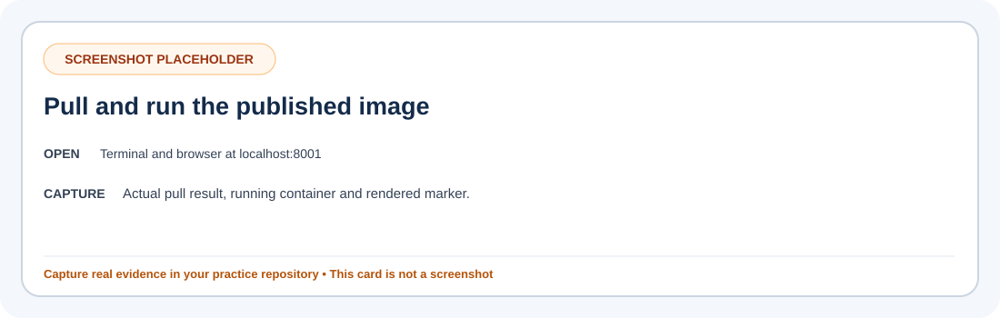

*Capture card only. Capture your actual pull/run output and browser page after verifying the tag.*

Cleanup:

~~~sh
docker stop published-nginx
docker rm published-nginx
docker image rm YOUR_DOCKERHUB_USERNAME/mynginx:latest
~~~

The Docker Hub copy remains published. Deleting the local image does not delete the registry image.

## 12. Troubleshooting

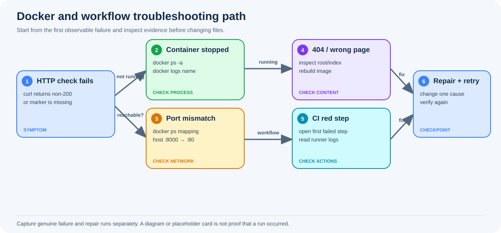

The [preserved container-inspection illustration](images/diagrams/step-container-inspect-cleanup.svg) shows local status, logs, and cleanup commands.

*Start with container status and logs, then inspect the first failing build or HTTP step. The workflow failure diagnostics are printed before cleanup.*

| Symptom | What to check |
|---|---|
| Docker command not found | Install Docker Desktop/Engine, reopen the terminal, run docker --version. |
| Docker daemon unavailable | Start the daemon and run docker info. |
| Port 8000 already allocated | Remove the old container or map another host port, such as 8001:80. |
| Docker cannot find website or config | Run build from practice repository root; check exact case-sensitive paths and build context dot. |
| NGINX exits immediately | Run docker logs lab-nginx; check nginx.conf braces, semicolons, and document-root path. |
| Browser shows 404/welcome page | Rebuild image after file edits; verify Dockerfile copied website and nginx.conf into expected locations. |
| Container not listed | Run docker ps -a; a stopped container is hidden by plain docker ps. |
| CI workflow does not appear | Confirm workflow is committed at root .github/workflows, Actions is enabled, and file is pushed. |
| Smoke test fails in Actions | Open Verify step; inspect preceding Start step and diagnostic logs; check marker spelling and /healthz response. |
| Docker Hub login fails | Confirm secret names exactly and token is valid with push permission; do not print token. |
| Push denied/repository missing | Confirm Docker Hub owner, repository name mynginx, and access permissions. |
| Publish job is skipped | Manual run must use main; the branch guard blocks other refs intentionally. |
| Local browser cannot see runner container | Expected: runner localhost is isolated. curl in the job is the verification. |

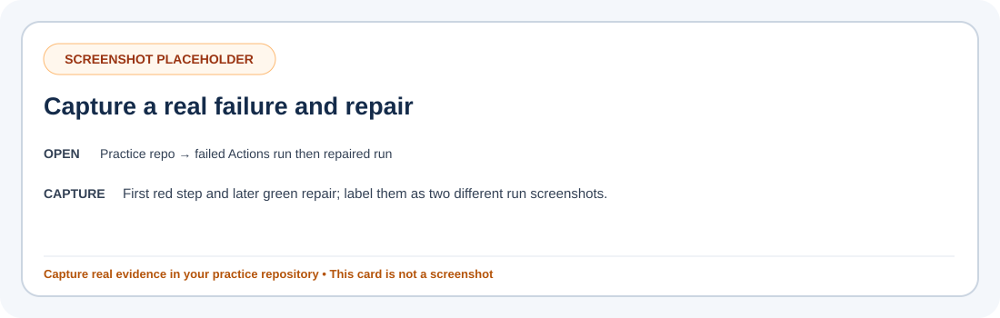

*Capture card only. Capture a real failed run and a distinct successful repair run; do not fabricate either result.*

## 13. Security, cleanup, and practice

- Use a Docker Hub access token rather than an account password; revoke it if exposed.
- Keep registry credentials in GitHub Secrets. Never echo them or pass them as Docker build args.
- The CI workflow uses read-only repository permission and no registry credentials.
- The publisher runs only on main push/manual dispatch from main, and logs in after tests pass.
- Do not run publishing workflows on untrusted pull requests.
- .dockerignore excludes Git metadata, documentation, workflow files, and local environment files.
- ubuntu-latest is a moving runner image; Docker base image tags can move too. Pin digests/revisions for controlled production builds.
- Remove local containers/images when done. Revoke unused Docker Hub tokens.

Guided practice: change the HTML heading and rebuild; use host port 8001; add a second static page; change the smoke-test marker and update the workflow assertion; intentionally break the NGINX root path and use logs to repair it.

Independent challenge: add a /version endpoint and assert it in both workflows; pull and run the commit-SHA tag; compare the remote tag and source commit. Do not publish credentials.

## Further reading

- [Official NGINX Docker image and tags](https://hub.docker.com/_/nginx)
- [NGINX beginner's guide](https://nginx.org/en/docs/beginners_guide.html)
- [Docker build context](https://docs.docker.com/build/concepts/context/)
- [Dockerfile reference](https://docs.docker.com/reference/dockerfile/)
- [Docker GitHub Actions](https://docs.docker.com/build/ci/github-actions/)
- [docker/login-action](https://github.com/docker/login-action)
- [GitHub workflow syntax](https://docs.github.com/en/actions/reference/workflows-and-actions/workflow-syntax)
- [GitHub hosted runners](https://docs.github.com/en/actions/how-tos/manage-runners/github-hosted-runners)
- [GitHub encrypted secrets](https://docs.github.com/en/actions/security-for-github-actions/security-guides/using-secrets-in-github-actions)

Continue to [Lab 04 — Self-Hosted GitHub Actions Runner](../04-self-hosted-github-actions-runner/README.md).

## Visual coverage checklist: concept diagram AND instructional image

All placeholder cards are explicitly labeled capture prompts. They do not claim a screenshot exists. Capture genuine evidence in a practice repository and follow [images/screenshots/README.md](images/screenshots/README.md).

| Lab stage | Conceptual/architecture diagram | Instructional image or screenshot prompt |
|---|---|---|
| Overall architecture | [system architecture](images/architecture/system-architecture.svg) | [workflow files placeholder](images/screenshots/PLACEHOLDER-11-workflow-files.svg) |
| Create repository and clone | [complete journey](images/workflows/complete-cicd-journey.svg) | [repository](images/screenshots/PLACEHOLDER-01-github-repository.svg), [clone](images/screenshots/PLACEHOLDER-02-clone-repository.svg) |
| Project structure | [Docker build context](images/implementation/dockerfile-build-context.svg) | [file structure](images/screenshots/PLACEHOLDER-03-project-structure.svg) |
| NGINX and HTTP | [request flow](images/architecture/nginx-http-flow.svg) | [HTML](images/screenshots/PLACEHOLDER-04-edit-index-html.svg), [NGINX config](images/screenshots/PLACEHOLDER-05-edit-nginx-config.svg) |
| Dockerfile and build context | [Dockerfile/context](images/implementation/dockerfile-build-context.svg) | [Dockerfile editor](images/screenshots/PLACEHOLDER-06-write-dockerfile.svg), [build output](images/screenshots/PLACEHOLDER-07-docker-build.svg) |
| Image/container lifecycle | [lifecycle](images/architecture/image-container-lifecycle.svg) | [run container](images/screenshots/PLACEHOLDER-08-run-container.svg), [status/logs](images/screenshots/PLACEHOLDER-10-container-logs-status.svg) |
| Local port mapping and testing | [port mapping](images/architecture/local-port-mapping.svg) | [browser page](images/screenshots/PLACEHOLDER-09-browser-page.svg) |
| GitHub Actions CI | [CI flow](images/workflows/github-actions-ci-flow.svg) | [workflow run](images/screenshots/PLACEHOLDER-14-actions-ci-run.svg), [step logs](images/screenshots/PLACEHOLDER-15-actions-step-logs.svg) |
| GitHub Secrets | [secret boundary](images/workflows/dockerhub-secret-handling.svg) | [secret names only](images/screenshots/PLACEHOLDER-12-configure-secrets.svg) |
| Docker Hub repository/authentication | [publish flow](images/workflows/dockerhub-publish-flow.svg) | [repository](images/screenshots/PLACEHOLDER-13-dockerhub-repository.svg), secret prompt above |
| Publishing and tags | [trusted publish](images/workflows/dockerhub-publish-flow.svg) | [publish run](images/screenshots/PLACEHOLDER-16-dockerhub-publish.svg), [Hub tags](images/screenshots/PLACEHOLDER-17-dockerhub-tags.svg) |
| Published image verification | [full journey](images/workflows/complete-cicd-journey.svg) | [pull and run](images/screenshots/PLACEHOLDER-18-pull-and-run.svg) |
| Troubleshooting | [container diagnostics](images/diagrams/step-container-inspect-cleanup.svg) | [failure/repair prompt](images/screenshots/PLACEHOLDER-19-troubleshooting.svg) |
