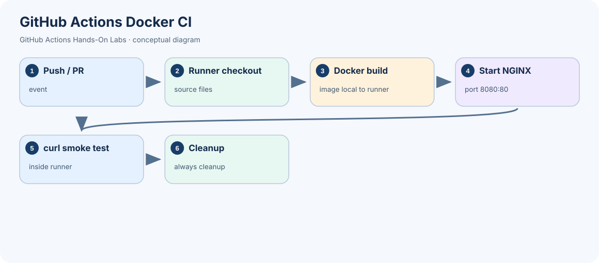
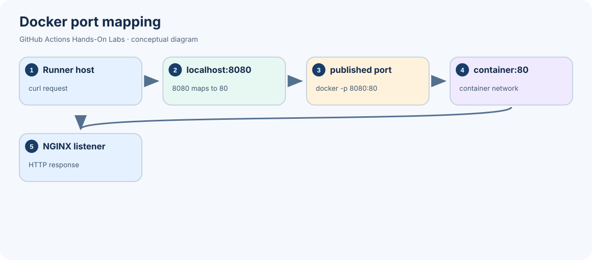
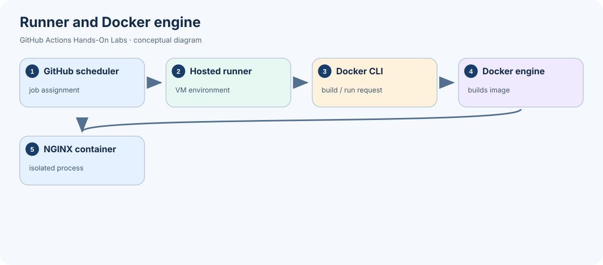
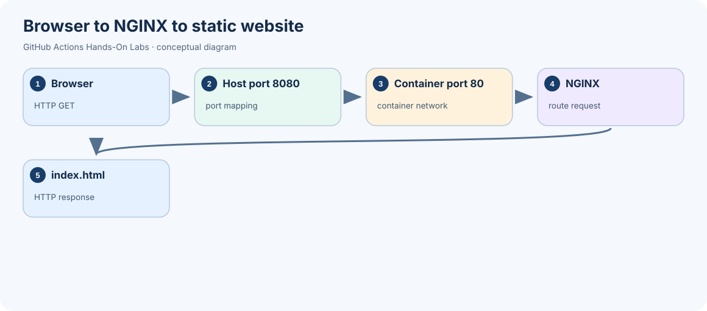
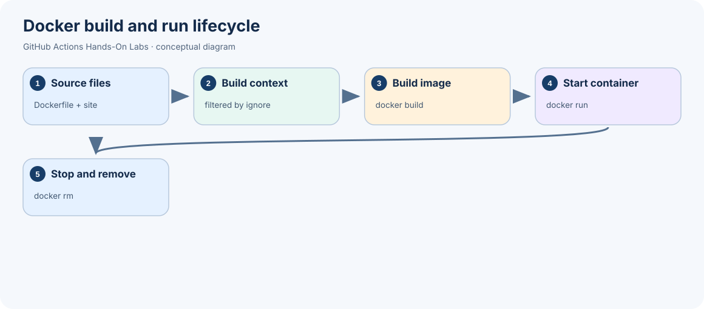
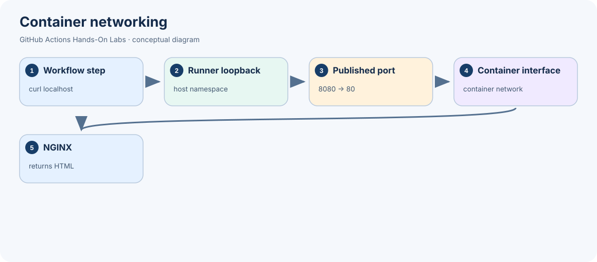
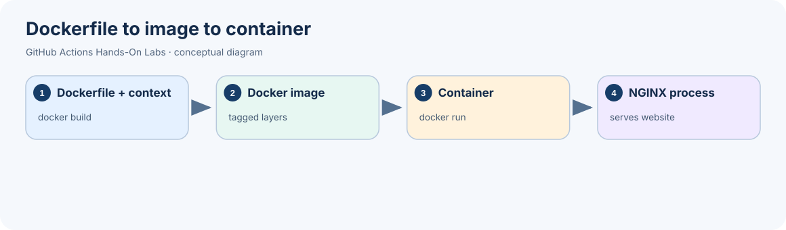
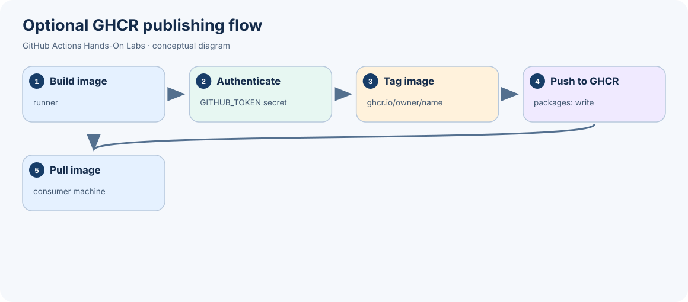

# Visual index

## Original technical diagrams

### Github Actions Docker Ci

[Open editable SVG source](diagrams/github-actions-docker-ci.svg).

### Port Mapping

[Open editable SVG source](diagrams/port-mapping.svg).

### Runner Docker Engine

[Open editable SVG source](diagrams/runner-docker-engine.svg).

### Browser Nginx Request Flow

[Open editable SVG source](diagrams/browser-nginx-request-flow.svg).

### Docker Build Run Lifecycle

[Open editable SVG source](diagrams/docker-build-run-lifecycle.svg).

### Container Networking

[Open editable SVG source](diagrams/container-networking.svg).

### Docker Architecture

[Open editable SVG source](diagrams/docker-architecture.svg).

### Ghcr Publishing Flow

[Open editable SVG source](diagrams/ghcr-publishing-flow.svg).

## Genuine screenshots

Place real captures from your own practice execution in `screenshots/`. The authoring checkout does not include real workstation or GitHub UI captures, so none are presented as execution evidence.

[Screenshot capture guide](screenshots/README.md).
