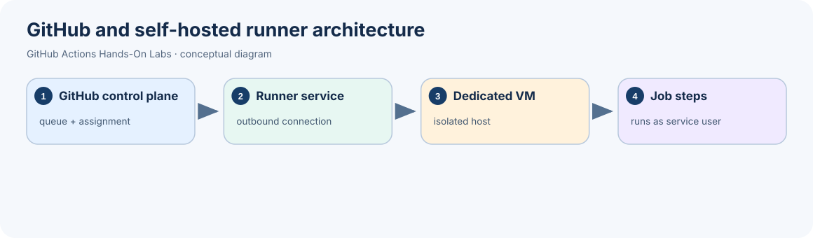
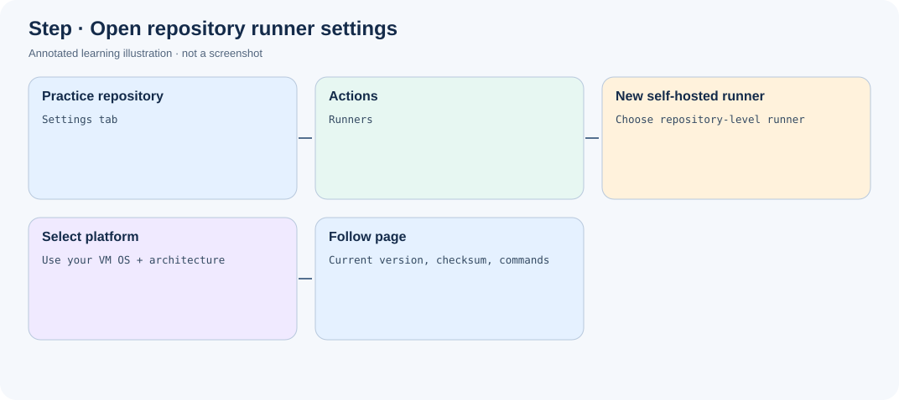
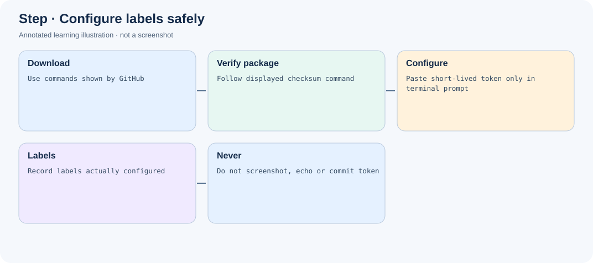
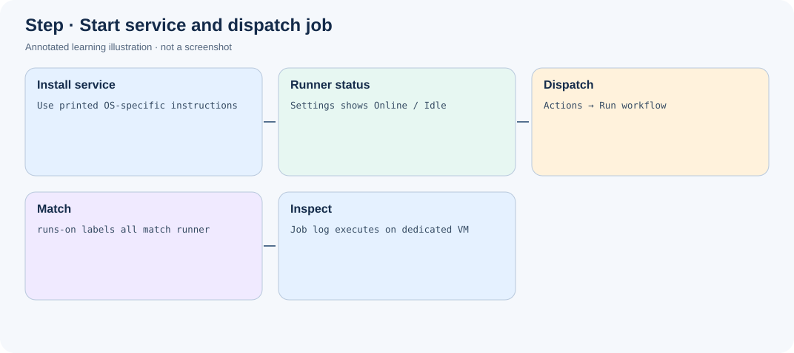
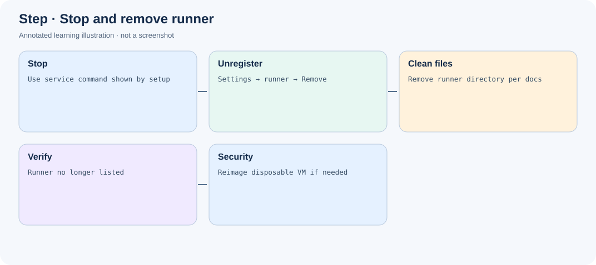

# Lab 04 — Self-Hosted GitHub Actions Runner

Register a dedicated VM as a repository runner, target it with labels, dispatch one safe workflow, then stop and remove it. A self-hosted runner executes with access to its machine and network; isolate it and only run trusted code.

## Estimated time and outcomes

| Activity | Duration |
|---|---:|
| Runner and threat concepts | 35 min |
| Prepare isolated VM | 30 min |
| Settings, register and configure | 45 min |
| Dispatch and inspect | 25 min |
| Remove and troubleshoot | 25 min |
| Exercises | 20 min |
| **Total** | **3 h** |

Beginners may need additional time. Need Lab 01, repository admin access, internet and a disposable dedicated VM or machine. Do not use a shared host. Choose Linux/macOS/Windows to match your machine and architecture.

## Architecture and trust boundary

GitHub schedules work; the runner application maintains an outbound connection and receives matching jobs. Workflow steps execute on the host under the runner service account.

*Conceptual architecture; the VM is a security boundary you own and maintain.*

## Step 1 — Prepare the VM and open runner settings

Update the dedicated VM, create a non-admin runner account where practical, and ensure it has only the network access it needs. In your practice repository, open **Settings → Actions → Runners → New self-hosted runner**. Choose the VM operating system and architecture from the page.

*This is a navigation illustration, not a GitHub screenshot. Exact labels may change; follow the current Settings page.*

The GitHub page shows the current runner package, checksum, configuration and service commands. Follow those commands exactly; do not use old copied versions. Verify package integrity using the checksum instructions shown there.

## Step 2 — Configure labels and start the runner

Run the setup commands in the VM terminal in the directory you chose for the runner. GitHub generates a short-lived registration token. Paste it only into the interactive configuration prompt. Do not echo, save in workflow files, commit, or include it in screenshots. Keep the default labels and note the actual labels shown by runner setup.

*Token is omitted from the illustration. Never capture the token on the live setup page.*

Install/start the runner service using the commands for your selected OS. Verify repository Settings shows the runner **Online** and **Idle**.

## Step 3 — Dispatch the workflow

Copy [`self-hosted.yml`](.github/workflows/self-hosted.yml) to the practice repo root at `.github/workflows/self-hosted.yml`. Its `workflow_dispatch` trigger avoids automatically executing code on every unreviewed push. `runs-on: [self-hosted, linux, x64]` requires all those labels; change `linux` or `x64` to labels actually present on your VM.

*All requested labels must match an online runner before GitHub can assign the job.*

On GitHub select **Actions → Self-hosted runner demo → Run workflow**. Open the resulting run, job and step log. Confirm the runner has transitioned from idle to busy and back to idle. The commands report the runner OS and kernel; values differ by VM. Do not echo full environment variables or secrets.

## Step 4 — Stop, unregister and clean up

Stop the service using the OS-specific command printed in the GitHub setup instructions. In Settings → Actions → Runners, select the runner and remove it. Remove runner files/configuration following current official instructions; reimage the disposable VM if appropriate.

*Success means no runner entry remains and its service is stopped.*

## Security, exercises and further reading

Never run fork pull-request code on a privileged self-hosted runner. A compromised job may access host files, credentials and private network resources. Use ephemeral isolated VMs with no production secrets, patch them, monitor them and restrict network access. A queued job usually indicates an offline runner or a label mismatch; compare the workflow selector to registered labels and check service status/logs.

Exercises: print hostname only; add a custom label; compare with a hosted runner. Questions: who patches this VM? What can a compromised job access? Why require every label? Why use manual dispatch? Why remove registration? Debug: change a label, observe queued state, then restore it. Integration: execute safe system-info workflow then unregister. Hints: do not print all env values; `hostname` is safe for a disposable VM.

Further reading: [self-hosted runner setup](https://docs.github.com/en/actions/how-tos/manage-runners/self-hosted-runners), [runner reference](https://docs.github.com/en/actions/reference/runners/self-hosted-runners), [security hardening](https://docs.github.com/en/actions/security-for-github-actions/security-guides/security-hardening-for-github-actions). Next: [Lab 05](../05-crud-application-cicd/README.md).

## Visual coverage checklist

| Stage | Aid type | Evidence status |
|---|---|---|
| Architecture and host boundary | Concept diagram | Runner architecture above |
| Settings navigation and platform choice | Interface map illustration | Not a captured screenshot; exact capture guide below |
| Configure labels and service | Annotated command illustration | No token rendered |
| Online/idle, assignment and logs | State-flow illustration | Capture real run in practice repo |
| Stop and unregister | Cleanup illustration | Verify Settings list is empty |
| Genuine GitHub/terminal screenshots | Capture instructions | [`images/screenshots/README.md`](images/screenshots/README.md) |
