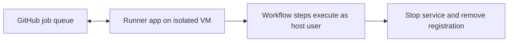
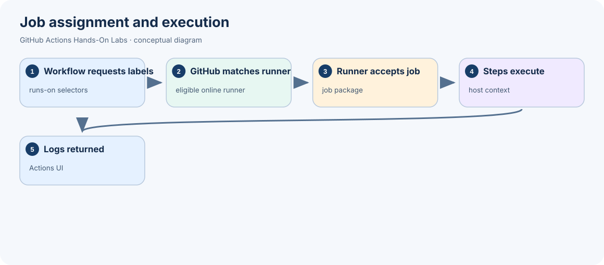
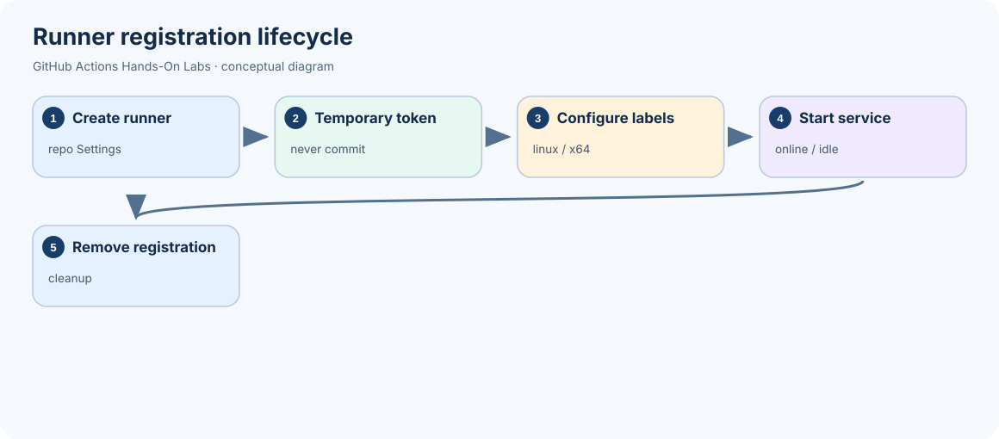
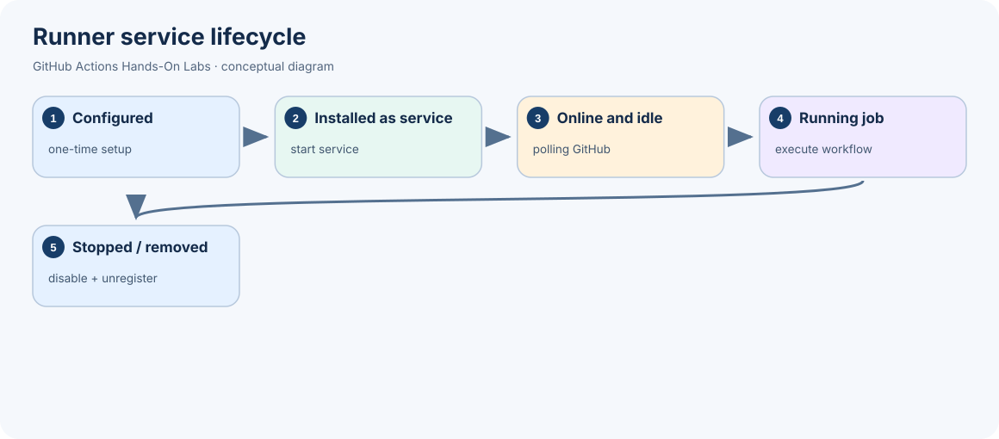
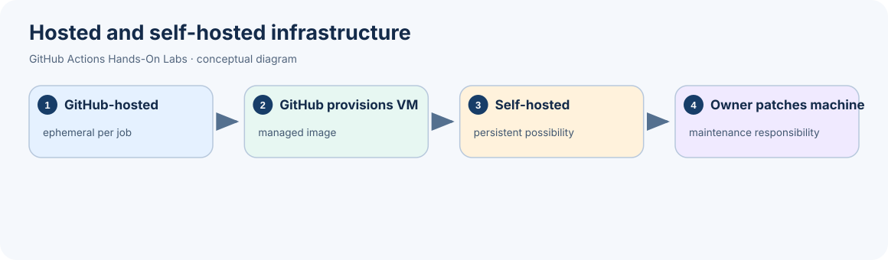
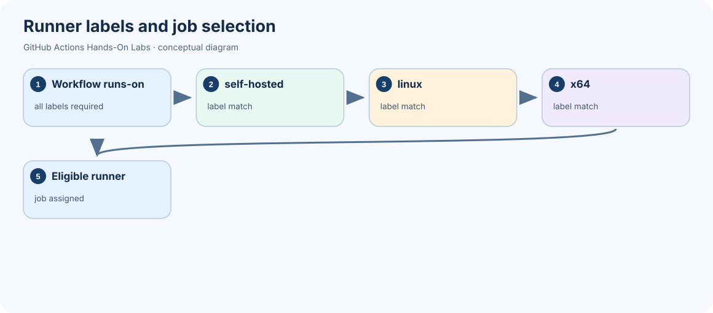
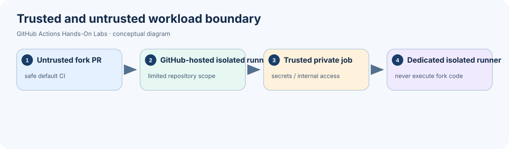

# Lab 04 — Self-Hosted GitHub Actions Runner

A self-hosted runner is a machine you operate that connects to GitHub, polls for eligible jobs and executes them. Unlike a fresh hosted VM, it can retain state and access its host network/files. That power creates real risk.

## Estimated time

| Activity | Duration |
|---|---:|
| Concepts and security | 35 min |
| Prepare isolated VM | 30 min |
| Register and configure | 45 min |
| Execute and inspect | 25 min |
| Remove and troubleshoot | 25 min |
| Exercises | 20 min |
| **Total** | **3 h** |

Prerequisites: Lab 01, repository admin access, a dedicated disposable VM/computer, shell access and internet. Never use a shared workstation for untrusted workflow code.

## Procedure

Prepare a dedicated VM and update its OS. On the GitHub website open your *practice repository* → **Settings → Actions → Runners → New self-hosted runner**. Select OS and architecture. Follow the current page's download, checksum, configure and service commands exactly; package versions and commands change, so this lab deliberately does not hardcode a runner tarball or registration token. Keep the short-lived registration token in the terminal prompt only; never commit, paste into workflow, log or screenshot it. Configure labels including `linux` and `x64` (adapt YAML if different).

Copy `.github/workflows/self-hosted.yml` into your practice repo. It uses `workflow_dispatch`, the labels select a matching runner, and commands print basic host information. In Actions manually start **Self-hosted runner demo**. Verify the runner says **Idle** before dispatch, then **Online** and job completes. The job runs as the runner service account with access permitted to that host.

Stop the runner with the service instructions printed by GitHub's setup page. In Settings → Runners, remove it. Then remove the runner directory and credentials/config from the VM according to official cleanup instructions. Confirm it no longer appears in repository Settings.

## Security and troubleshooting

Never run fork PR code or other untrusted code on a privileged self-hosted runner. Use ephemeral, isolated VMs with minimum network access and no production credentials; patch and monitor them. Registration tokens are temporary but sensitive. Runner labels mismatch or machine offline causes a queued job; check runner status, service logs and exact labels. A job must target `self-hosted` plus labels actually registered. Avoid `pull_request_target` here.

Exercises: add a safe hostname line; add a custom label and target it; document runner OS version. Challenges: compare same job on hosted runner; build an ephemeral disposable VM lifecycle. Questions: who patches runner? Why is its filesystem sensitive? What causes queued jobs? What is registration token? Why avoid untrusted PRs? Debug: change one label and inspect queue, then restore. Integration: run safe info job, then deregister and verify cleanup. Hints: do not print all environment variables; hostname command is `hostname`.

Further reading: [self-hosted runners](https://docs.github.com/en/actions/how-tos/manage-runners/self-hosted-runners), [runner reference](https://docs.github.com/en/actions/reference/runners/self-hosted-runners), [secure use](https://docs.github.com/en/actions/security-for-github-actions/security-guides/security-hardening-for-github-actions). Next: [Lab 05](../05-crud-application-cicd/README.md).

## Screenshot index

Capture Settings runner status, setup page with all tokens redacted, workflow run and deregistered runner list. Never save a token-containing screenshot. `images/README.md` is the capture plan.

## Visual guide

These original diagrams explain the architecture and execution paths before you run the example. They are conceptual illustrations, not evidence that a workflow executed. Open [all diagrams and screenshot guidance](images/README.md).

### Job Assignment Sequence

### Runner Registration Lifecycle

### Runner Service Lifecycle

### Hosted Self Hosted Infrastructure

### Runner Label Selection

### Control Plane Runner

### Trusted Untrusted Boundary

