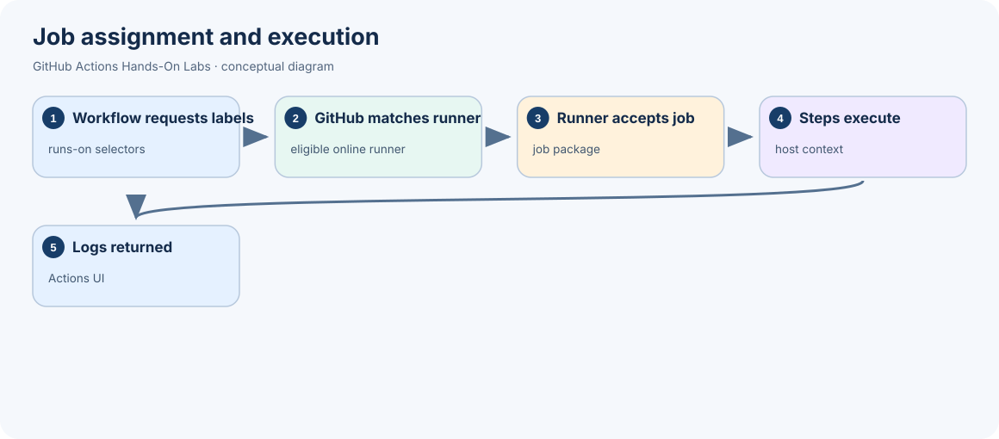
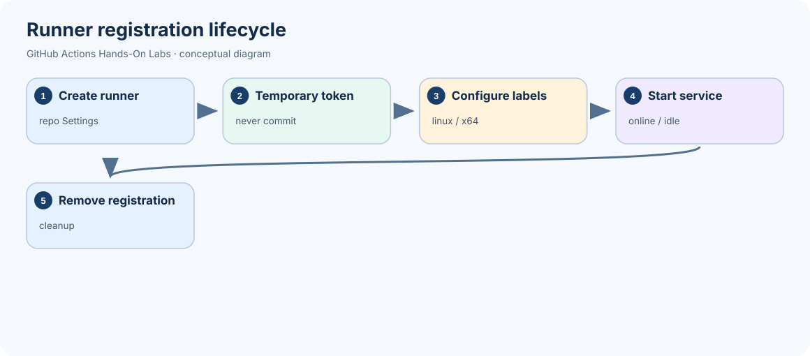
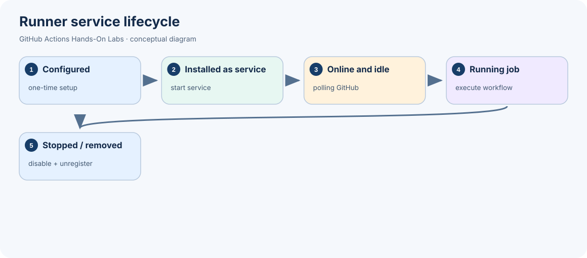
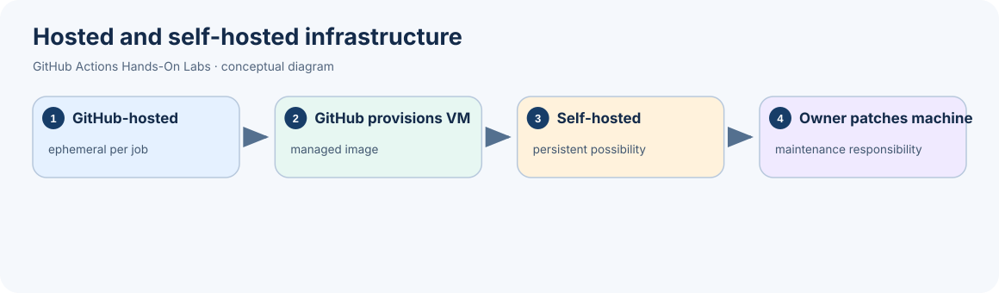
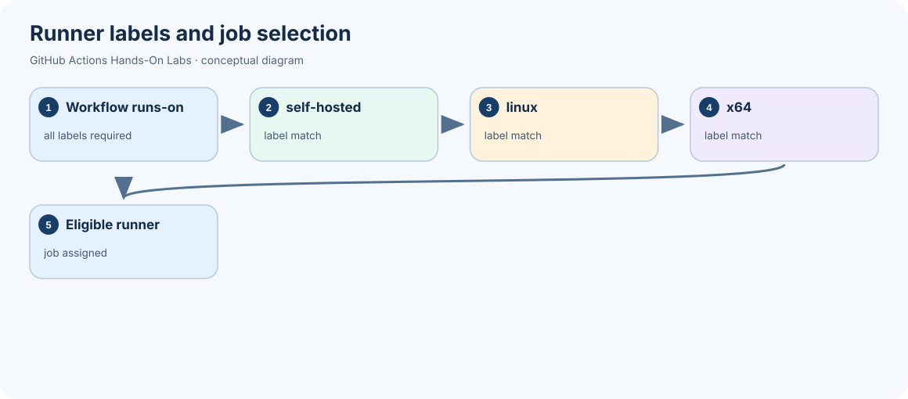
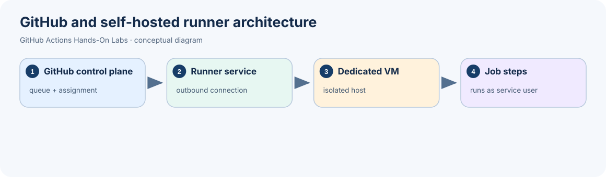
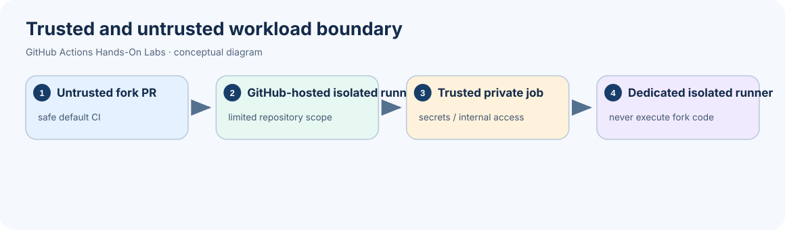

# Visual index

## Original technical diagrams

### Job Assignment Sequence

[Open editable SVG source](diagrams/job-assignment-sequence.svg).

### Runner Registration Lifecycle

[Open editable SVG source](diagrams/runner-registration-lifecycle.svg).

### Runner Service Lifecycle

[Open editable SVG source](diagrams/runner-service-lifecycle.svg).

### Hosted Self Hosted Infrastructure

[Open editable SVG source](diagrams/hosted-self-hosted-infrastructure.svg).

### Runner Label Selection

[Open editable SVG source](diagrams/runner-label-selection.svg).

### Control Plane Runner

[Open editable SVG source](diagrams/control-plane-runner.svg).

### Trusted Untrusted Boundary

[Open editable SVG source](diagrams/trusted-untrusted-boundary.svg).

## Genuine screenshots

Place real captures from your own practice execution in `screenshots/`. The authoring checkout does not include real workstation or GitHub UI captures, so none are presented as execution evidence.

[Screenshot capture guide](screenshots/README.md).
