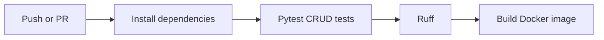
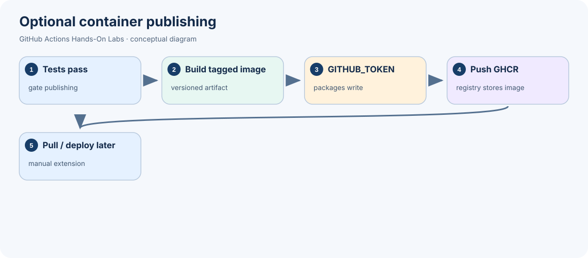
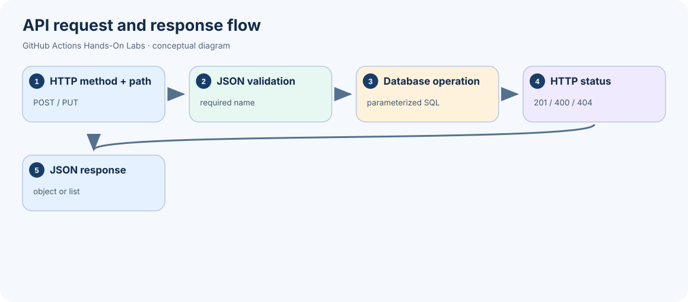
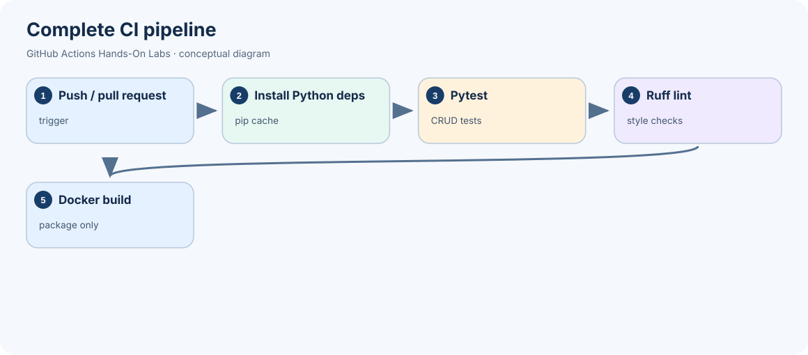
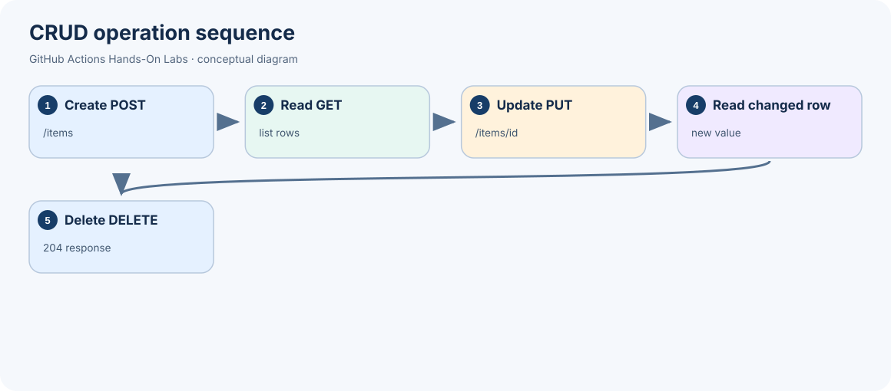
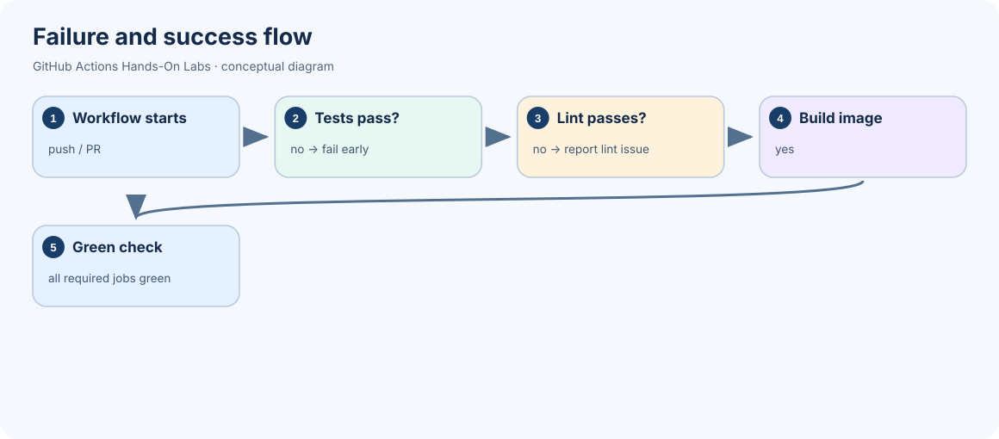
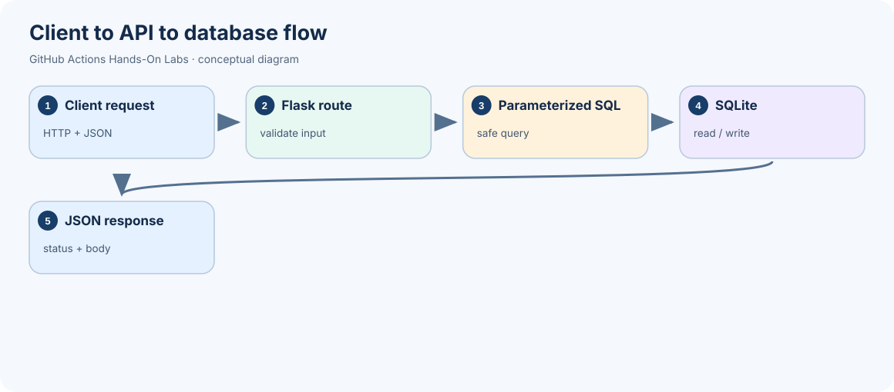
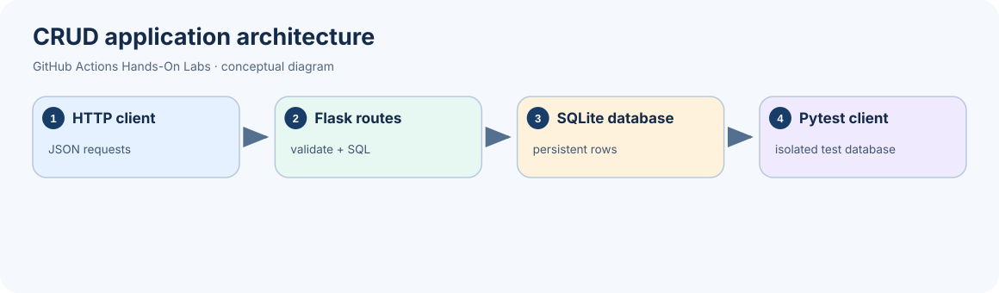
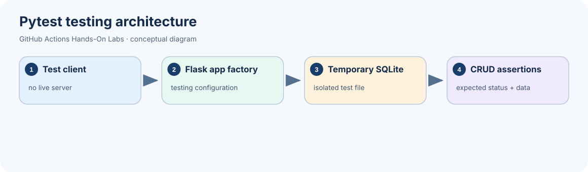
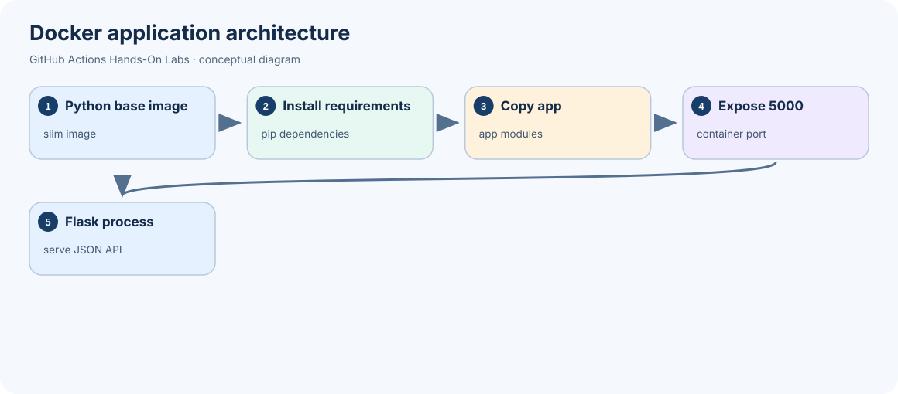

# Lab 05 — Building a CRUD Application CI/CD Pipeline

Build a small Flask JSON API backed by SQLite, test all CRUD operations, lint it and build a container in CI. This lab joins application structure, dependencies, API, database, tests, caching and Docker. It does not deploy publicly or require paid hosting.

## Estimated time

| Activity | Duration |
|---|---:|
| Architecture/concepts | 45 min |
| Python environment setup | 30 min |
| App and database implementation | 90 min |
| Tests and local verification | 45 min |
| Docker and workflow | 45 min |
| Debugging/exercises | 45 min |
| **Total** | **4 h 40 min** |

Need Python 3.12+, Git, VS Code, Docker, and previous labs. App endpoints: `POST /items` create, `GET /items` read, `PUT /items/<id>` update, `DELETE /items/<id>` delete.

## Project and run locally

Copy this module into a separate practice repository preserving its folders. From `05-crud-application-cicd` (the app folder), create an environment: macOS/Linux `python3 -m venv .venv && source .venv/bin/activate`; PowerShell `py -m venv .venv; .venv\\Scripts\\Activate.ps1`. Install with `python -m pip install -r requirements.txt`. Run `python -m pytest tests -q`, then `python -m ruff check app tests`. Expected illustrative output: `2 passed`; Ruff exits with no findings. Start `python -m app.run`; open `http://localhost:5000/items` (initially `[]`). Test with `curl -X POST http://localhost:5000/items -H 'Content-Type: application/json' -d '{"name":"Notebook"}'` (PowerShell use `Invoke-RestMethod -Method Post -Uri http://localhost:5000/items -ContentType 'application/json' -Body '{"name":"Notebook"}'`).

The application factory configures SQLite and registers routes; parameterized SQL prevents treating submitted names as SQL code. Tests use an in-memory database so runs are isolated. Docker copies dependencies and application only; `.dockerignore` excludes local state and secrets. For local container: `docker build -t crud-api:local .`, then `docker run --rm -p 5000:5000 crud-api:local`. The mounted host port serves the API. Remove container with Ctrl+C (without `--rm`) or let `--rm` clean it up.

Copy `.github/workflows/ci-cd.yml` to practice repository root. The workflow sets read-only contents permission, installs Python, caches pip dependencies, runs tests/lint and builds image. Its paths assume the lab folder remains named `05-crud-application-cicd`; if copied contents to repository root, remove that prefix. Push and inspect Actions. A green run shows all checks and image build completed. No deployment or image publishing occurs. GitHub Environments and approvals are useful for later deployment, but configure them only when you have a real target and safe credentials.

## Troubleshooting, practice and security

SQLite errors: verify writable current directory and no stale database file. Import errors: run from this lab directory with venv active. Docker failure: start daemon. Workflow path errors: preserve module path or remove the prefix consistently. Tests: guided add missing-item 404 test; invalid empty name; add route docstrings. Independent add pagination; return structured health endpoint. Questions: why app factory? why in-memory test db? what does cache key use? why tests before image? why avoid auto deployment? Debugging: change expected status 201 to 200, inspect and repair. Integration: add test for update/delete nonexistent IDs and enforce green CI. Solutions: verify route returns 404; `requirements.txt` drives pip cache. Protect secrets; never include `.env` or database credentials in image. Dummy app has no auth, so do not expose it as a production API.

Further reading: [Flask](https://flask.palletsprojects.com/), [pytest](https://docs.pytest.org/), [SQLite](https://sqlite.org/docs.html), [Python setup action](https://github.com/actions/setup-python), [GitHub Environments](https://docs.github.com/en/actions/managing-workflow-runs-and-deployments/managing-deployments/managing-environments-for-deployment). Next: optional [Lab 06](../06-github-actions-security/README.md).

## Screenshot index

Capture VS Code app/tree, local API response, test output, Docker page and CI graph/log. No screenshot here asserts execution not performed in this authoring environment.

## Visual guide

These original diagrams explain the architecture and execution paths before you run the example. They are conceptual illustrations, not evidence that a workflow executed. Open [all diagrams and screenshot guidance](images/README.md).

### Image Publishing Flow

### Api Request Response

### Complete Ci Pipeline

### Crud Sequence

### Pipeline Outcomes

### Client Api Database Flow

### Application Architecture

### Pytest Architecture

### Docker Application Architecture

