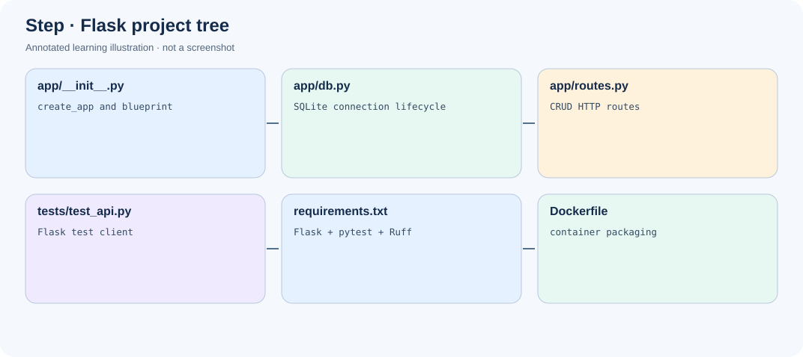
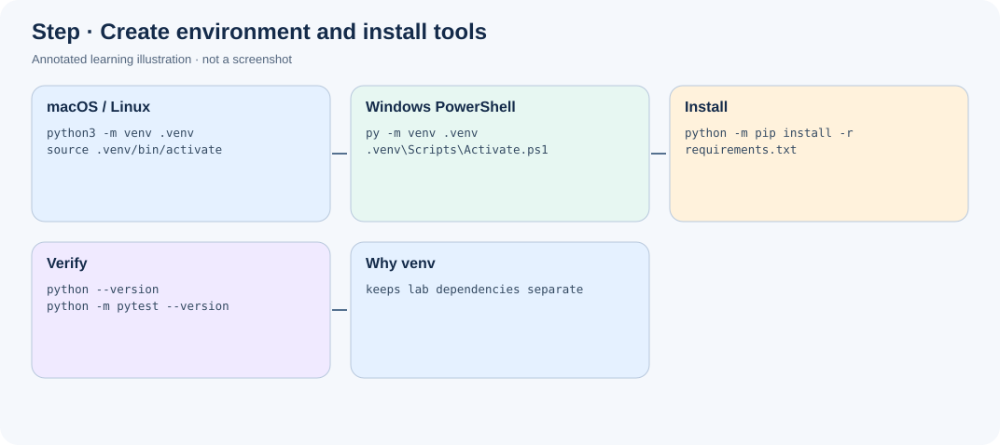
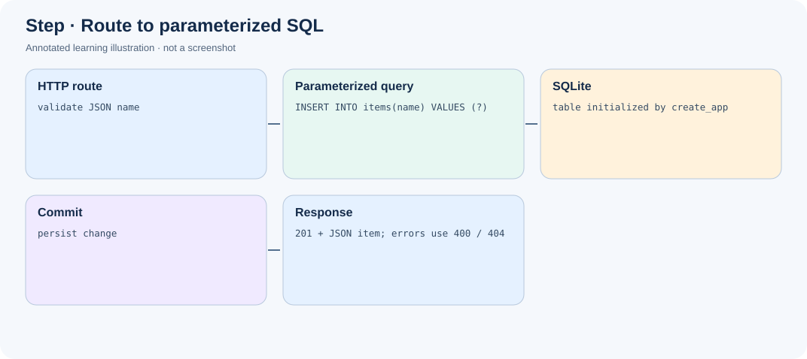
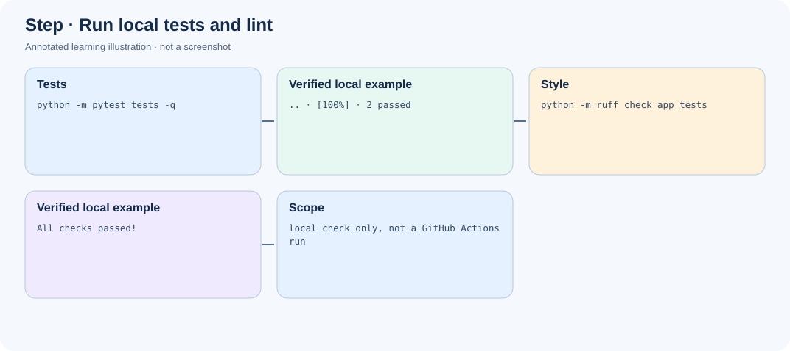
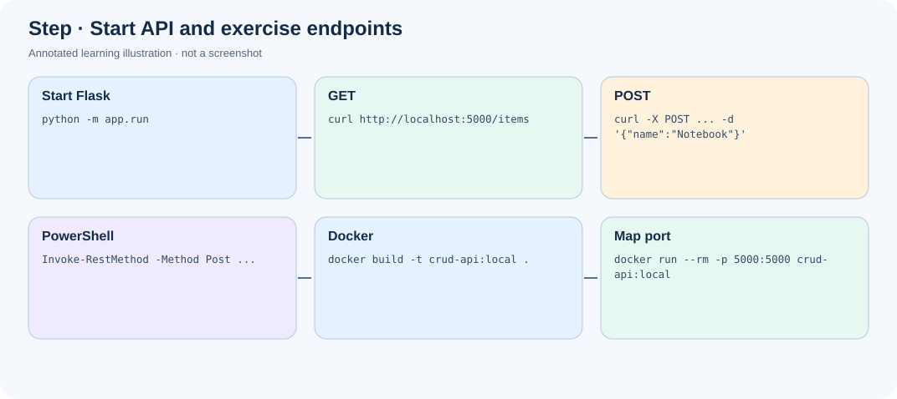
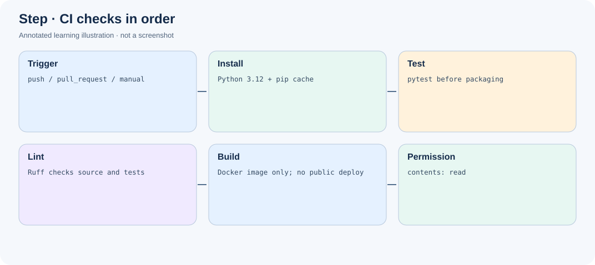

# Lab 05 — Building a CRUD Application CI/CD Pipeline

Build a Flask JSON API that creates, reads, updates and deletes SQLite rows. Pytest exercises the API through Flask's test client, Ruff checks style, and Docker packages the app. GitHub Actions runs checks on pushes and pull requests; it does not deploy publicly.

## Estimated time and outcomes

| Activity | Duration |
|---|---:|
| Architecture and Python setup | 45 min |
| Application/database implementation | 90 min |
| Tests and local API verification | 45 min |
| Docker and workflow | 45 min |
| Debugging and exercises | 45 min |
| **Total** | **4 h 40 min** |

Beginners may need extra time. Need Python 3.12+, Git, an editor, terminal, Docker and prior labs. An IDE is optional: any editor that can open a project folder and a terminal works. VS Code is the walkthrough's primary editor.

## Step 1 — Create the lab project

Copy this module's files into a practice repository while preserving the top-level folder `05-crud-application-cicd/`. The workflow's `working-directory` and dependency cache paths expect this structure. Open that folder in your IDE/project editor. The diagram is editor-independent: each box is an actual checked-in file.



*Project map: routes use the database helper, tests use the app factory, and Docker packages `app/`.*

## Step 2 — Create an isolated Python environment

**Working directory:** `05-crud-application-cicd/`. Use the terminal pane in your IDE or a system terminal opened at this folder.

macOS/Linux:

```sh
python3 -m venv .venv
source .venv/bin/activate
python -m pip install -r requirements.txt
python --version
```

Windows PowerShell:

```powershell
py -m venv .venv
.venv\Scripts\Activate.ps1
python -m pip install -r requirements.txt
python --version
```



*Command illustration; the exact prompt prefix and installed versions vary by system.*

If PowerShell blocks activation, use the Python executable directly: `.venv\Scripts\python.exe -m pip install -r requirements.txt`. Do not change machine-wide execution policy for this course. `requirements.txt` pins Flask, pytest and Ruff; `.venv` stays local and is ignored by Git.

## Step 3 — Understand app factory, routes and database

Open `app/__init__.py`, `app/db.py` and `app/routes.py` in your editor. `create_app` configures SQLite and registers a blueprint. The database helper opens a connection per Flask application context and closes it at teardown. Routes validate the JSON `name` field and use SQL placeholders (`?`) so user content remains data, not SQL syntax.



*This illustrates the actual CRUD route and SQLite flow. Tests use a temporary SQLite file per test fixture so app-context cleanup does not erase the database during a test.*


*The API and tests each use the app factory; tests configure an isolated SQLite file.*


*Sequence uses the item created at the start; IDs are runtime values.*

Endpoints: `POST /items` returns 201 and an object; `GET /items` returns a list; `PUT /items/<id>` updates or returns 404; `DELETE /items/<id>` returns 204 or 404. Invalid/missing names return 400.

## Step 4 — Run tests and lint locally

From the lab folder with the environment active:

```sh
python -m pytest tests -q
python -m ruff check app tests
```



*The two-test result and Ruff success were observed locally in this workspace. This is an output illustration recreated from command output, not a terminal screenshot and not a GitHub Actions run.*

The pytest fixture creates a testing Flask app and a temporary SQLite database; no public server or production database is involved. If imports fail, check the working directory and environment. If Ruff reports a location, open the named file and line.

## Step 5 — Start the API and verify requests

Start the development server in one terminal:

```sh
python -m app.run
```

Open `http://localhost:5000/items`; the initial response is `[]`. In another terminal, create an item:

```sh
curl -X POST http://localhost:5000/items -H 'Content-Type: application/json' -d '{"name":"Notebook"}'
curl http://localhost:5000/items
```

PowerShell alternative:

```powershell
Invoke-RestMethod -Method Post -Uri http://localhost:5000/items -ContentType 'application/json' -Body '{"name":"Notebook"}'
Invoke-RestMethod -Uri http://localhost:5000/items
```



*Expected response includes an item ID and `Notebook`; IDs vary. Stop Flask with Ctrl+C.*

## Step 6 — Build and run the Docker image

From the lab folder:

```sh
docker build -t crud-api:local .
docker run --rm -p 5000:5000 crud-api:local
```


*The container serves the same Flask routes on port 5000; this does not expose a public deployment.*

The Dockerfile installs dependencies in a Python slim image, copies only `app/`, and runs Flask on container port 5000. `.dockerignore` excludes the Git folder, virtual environment, database, cache and `.env`. Open or request `http://localhost:5000/items`. The `--rm` option removes the container after Ctrl+C; remove image using `docker image rm crud-api:local`.

## Step 7 — Add and inspect CI

Copy `.github/workflows/ci-cd.yml` from this module to the same relative path in your practice repo. It expects the module folder to remain named `05-crud-application-cicd/`. On push, pull request or manual dispatch it checks out code, sets Python 3.12, caches pip dependencies, installs packages, runs pytest, Ruff and Docker build. Permissions are read-only. No publishing or deployment happens.



*Workflow path map: test and lint must pass before the Docker build step; image stays on that runner.*

From the course checkout, `git add 05-crud-application-cicd` stages the module; in the learner's practice repository run `git add .`, commit and push. Open **Actions → CRUD CI → newest run → test job** and inspect pytest, Ruff and build steps. A green job means all three completed. Workflow examples are nested course files; GitHub only executes files copied into the practice repo's root `.github/workflows/`.


*This course workflow fails fast if tests or lint fail; only a passing validation reaches the Docker build.*

## Troubleshooting, security and practice

Database error: verify writable folder and check `DATABASE` config. Import error: run from lab directory. Docker daemon error: start Docker Desktop. Workflow cannot find requirements: confirm folder retained or update `working-directory`, cache path and Docker context together. Do not deploy this unauthenticated demo publicly or add real credentials.

Guided: add a 404 test; reject whitespace-only names; add route docstrings. Independent: add a health endpoint; add another field with a migration strategy. Questions: why use an app factory? Why temporary DB in tests? What is SQL parameterization? Why test before packaging? Why does no public deploy reduce risk? Debug: change expected POST code 201 to 200, inspect failure, repair. Integration: verify create/read/update/delete and add green CI. Hints: Flask test client accepts `json=...`; tests use `tmp_path`.

Further reading: [Flask](https://flask.palletsprojects.com/), [pytest](https://docs.pytest.org/), [SQLite](https://sqlite.org/docs.html), [setup-python](https://github.com/actions/setup-python), [GitHub Environments](https://docs.github.com/en/actions/managing-workflow-runs-and-deployments/managing-deployments/managing-environments-for-deployment). Next: optional [Lab 06](../06-github-actions-security/README.md).

## Visual coverage checklist

| Stage | Visual type | Status |
|---|---|---|
| Files and module relationships | Implementation diagram | Project map above |
| Environment creation and install | Annotated command illustration | Commands and OS-specific variants above |
| App factory, routes and SQLite | Data-flow diagram | Route/database map above |
| Pytest and Ruff verification | Output illustration | Based on actual local command result, explicitly not a screenshot |
| API, Docker and CI | Command/workflow diagrams | Beside corresponding steps |
| Genuine editor/API/Docker/Actions evidence | Screenshot capture cards | [`images/screenshots/README.md`](images/screenshots/README.md) |
