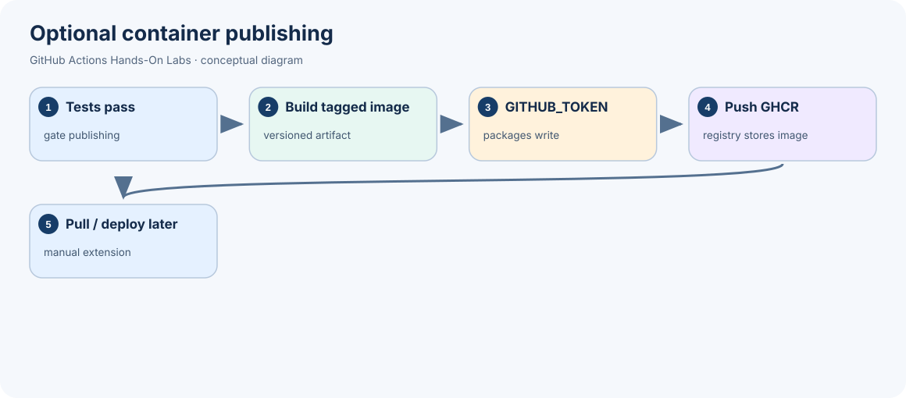
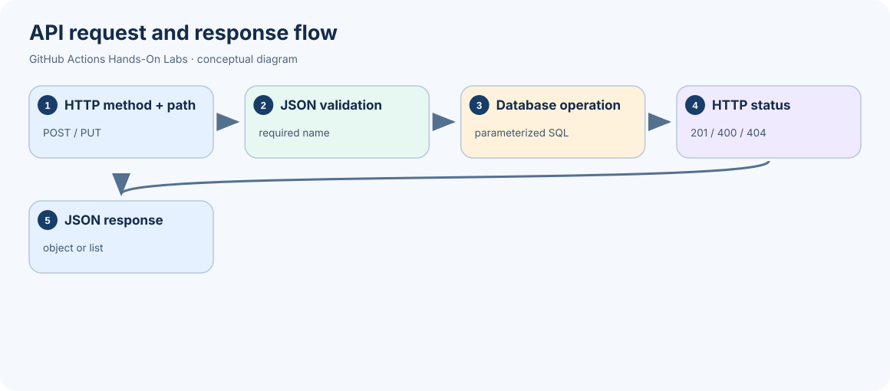
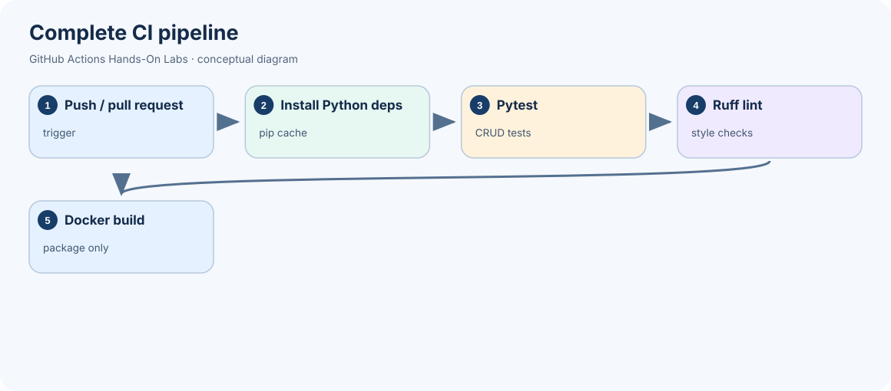
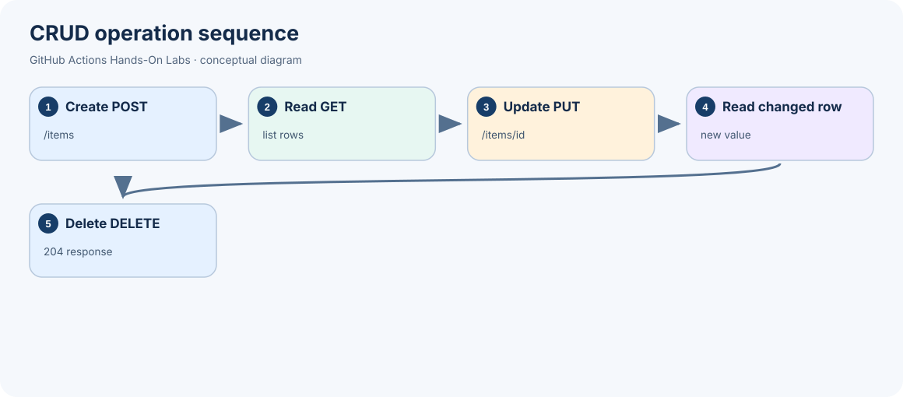
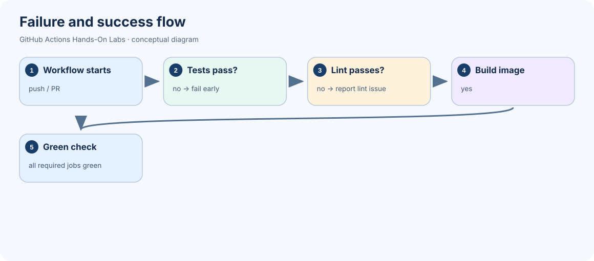
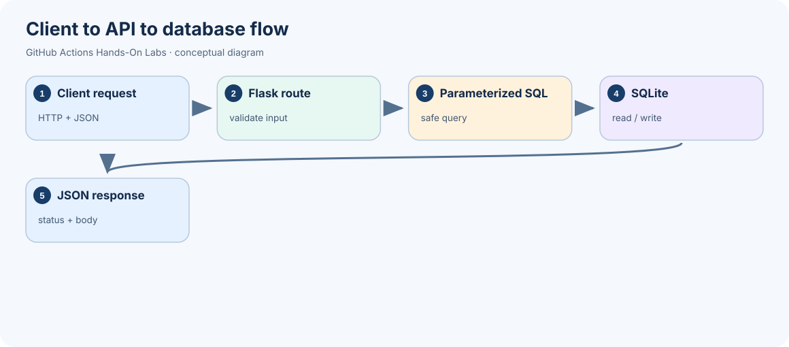
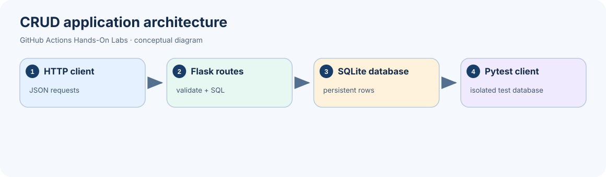
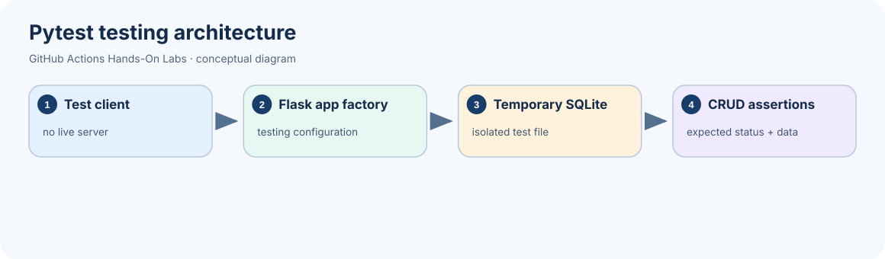
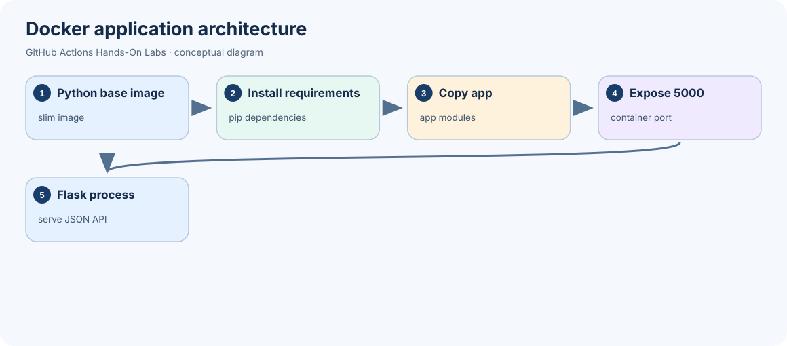

# Visual index

## Original technical diagrams

### Image Publishing Flow

[Open editable SVG source](diagrams/image-publishing-flow.svg).

### Api Request Response

[Open editable SVG source](diagrams/api-request-response.svg).

### Complete Ci Pipeline

[Open editable SVG source](diagrams/complete-ci-pipeline.svg).

### Crud Sequence

[Open editable SVG source](diagrams/crud-sequence.svg).

### Pipeline Outcomes

[Open editable SVG source](diagrams/pipeline-outcomes.svg).

### Client Api Database Flow

[Open editable SVG source](diagrams/client-api-database-flow.svg).

### Application Architecture

[Open editable SVG source](diagrams/application-architecture.svg).

### Pytest Architecture

[Open editable SVG source](diagrams/pytest-architecture.svg).

### Docker Application Architecture

[Open editable SVG source](diagrams/docker-application-architecture.svg).

## Genuine screenshots

Place real captures from your own practice execution in `screenshots/`. The authoring checkout does not include real workstation or GitHub UI captures, so none are presented as execution evidence.

[Screenshot capture guide](screenshots/README.md).
