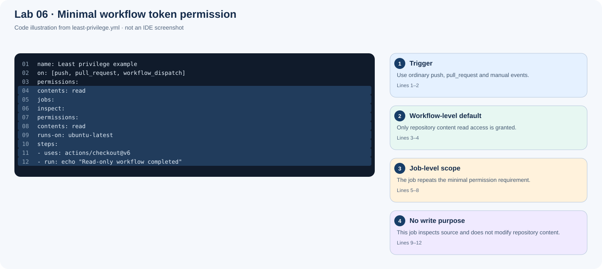
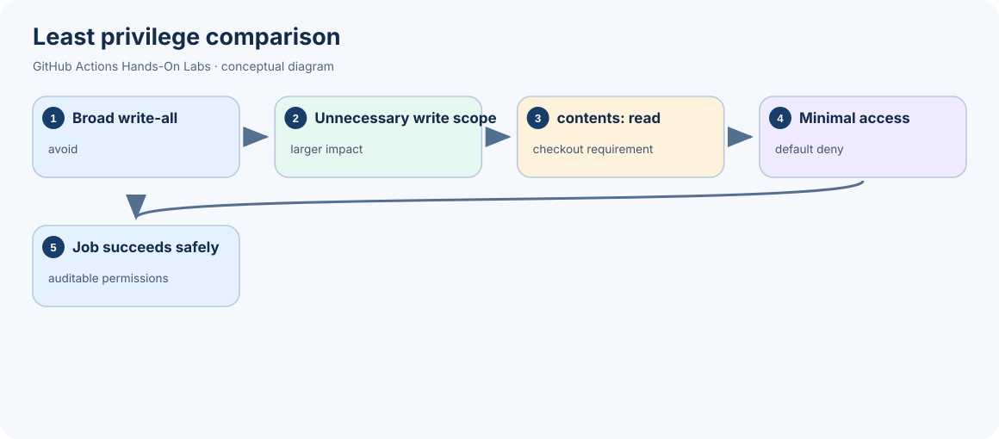
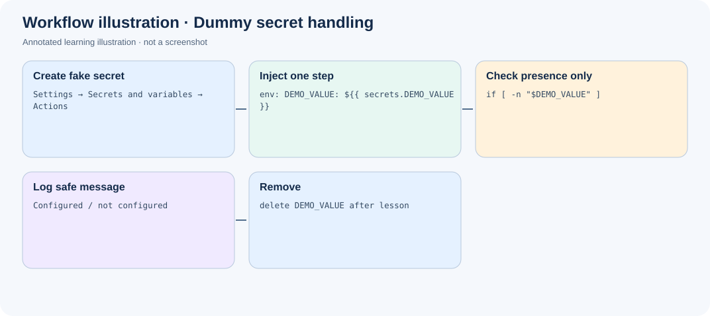
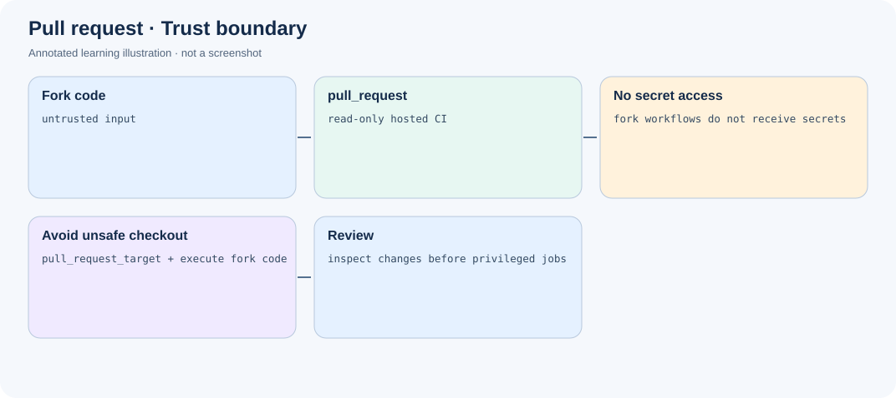
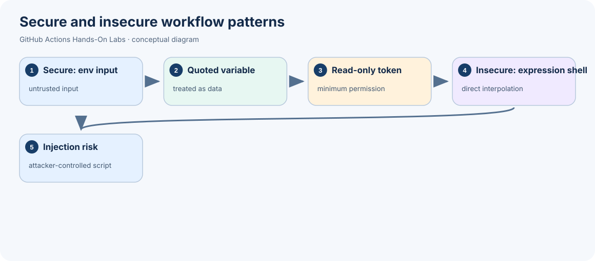
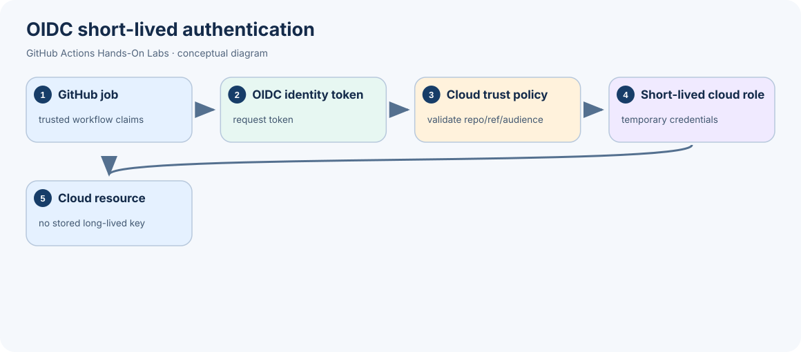

# Optional Lab 06 — GitHub Actions Security, Secrets and Permissions

Practice safe workflow configuration using read-only access and a fake secret. Learn why fork code is untrusted, why `pull_request_target` needs special care, and how OIDC can replace long-lived cloud credentials.

## Estimated time and prerequisites

| Activity | Duration |
|---|---:|
| Threat concepts | 35 min |
| Workflow and settings setup | 30 min |
| Exercises | 45 min |
| Inspect/debug | 25 min |
| Cleanup and review | 15 min |
| **Total** | **2 h 30 min** |

Beginners may need extra time. Need Lab 01 and admin rights on a disposable practice repository. Never enter real production credentials.

## Step 1 — Inspect permissions and token boundary

Copy [`least-privilege.yml`](.github/workflows/least-privilege.yml) to your practice repo's root `.github/workflows/`. This example grants `contents: read`; checkout needs to read source, while this workflow has no write purpose. When specifying any permissions, unspecified scopes become `none`. Actions may access `github.token` even when the workflow does not explicitly pass it, so workflow permissions still matter.

*The permission box shows the example scope, not an Actions UI capture.*

*The secure example grants read access needed for checkout and no broad write scope.*

## Step 2 — Use a dummy secret without logging it

In practice repo **Settings → Secrets and variables → Actions → New repository secret**, add key `DEMO_VALUE` with a fake value such as `not-a-real-credential`. The sample injects it only into one step and prints a presence message. It never prints the value. After pushing and inspecting the step log, delete the dummy secret from Settings.

*Do not include secret values in terminal captures, screenshots, artifacts or debug logs. Masking is not a guarantee against transformations or exfiltration.*

## Step 3 — Review pull request trust and safer patterns

A fork pull request is untrusted code. Run ordinary CI on `pull_request` with minimal permissions and no secrets. Do not combine `pull_request_target` with checking out and executing fork content: that event runs in the base repository trust context. Pass untrusted values to shell through environment variables and quote variables rather than interpolating attacker-controlled expressions into scripts.

*Safe read-only fork CI and privileged base-repository events belong on different trust paths.*

## Step 4 — Explore environments and OIDC

An environment can store environment-scoped secrets and apply protection rules/approval gates before a deployment job proceeds. Do not configure an actual deployment for this lab. OIDC lets a job request a short-lived identity token; a cloud trust policy checks repository/ref/workflow claims before granting temporary access. This avoids storing a long-lived cloud key, but policy must still be narrow.

Other topics: review third-party actions, pin sensitive dependencies to a full commit SHA, track updates, and keep token scopes minimal. Read the security guide before broadening permissions.

*The unsafe pattern interpolates untrusted text into a shell script; treat it as a review example only.*

*OIDC relies on cloud-side claim validation and short-lived credentials; it is a concept diagram, not a cloud login run.*

## Verify, practice and cleanup

Push the workflow and inspect **Actions → Least privilege example → job → Use a dummy secret**. With no secret, it prints `No dummy secret configured`; with the fake value, it prints only `Dummy secret is configured`. Both are expected. Remove `DEMO_VALUE` in Settings after the exercise.

Guided: narrow permissions in a job; add a dummy secret; set up a protected environment without deployment. Independent: audit each action reference; replace unsafe shell interpolation with a quoted environment variable. Questions: why least privilege? What can masking miss? Why are fork PRs different? Why pin action SHAs? What does OIDC replace? Debug: remove `contents: read`, observe checkout fail, then restore. Integration: safe read-only PR checks and a gated deployment design with no real credentials.

Further reading: [security hardening](https://docs.github.com/en/actions/security-for-github-actions/security-guides/security-hardening-for-github-actions), [GITHUB_TOKEN](https://docs.github.com/en/actions/tutorials/authenticate-with-github_token), [secure pull_request_target](https://docs.github.com/en/actions/reference/security/securely-using-pull_request_target), [OIDC](https://docs.github.com/en/actions/security-for-github-actions/security-hardening-your-deployments/about-security-hardening-with-openid-connect).

## Visual coverage checklist

| Stage | Aid | Location |
|---|---|---|
| Permissions and token boundary | Annotated workflow illustration | Above Step 1 |
| Secret injection/removal | Lifecycle diagram | Above Step 2 |
| PR trust boundary | Security flow diagram | Above Step 3 |
| OIDC exchange | Conceptual diagram | [`oidc-authentication.svg`](images/diagrams/oidc-authentication.svg) |
| Genuine Settings/run captures | Redacted screenshot instructions | [`images/screenshots/README.md`](images/screenshots/README.md) |
