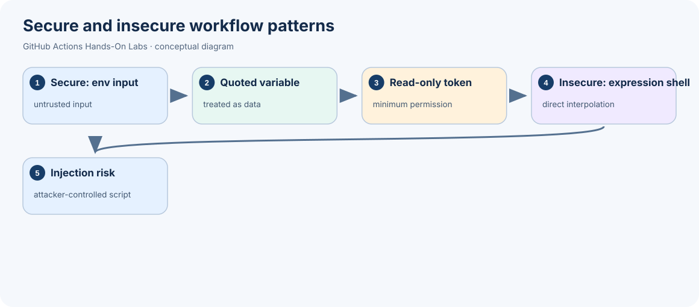
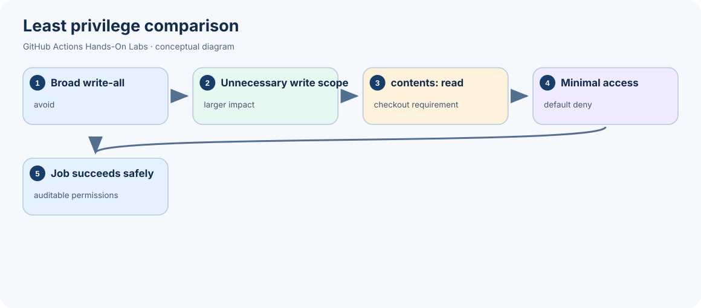
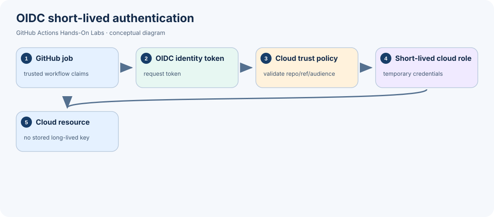
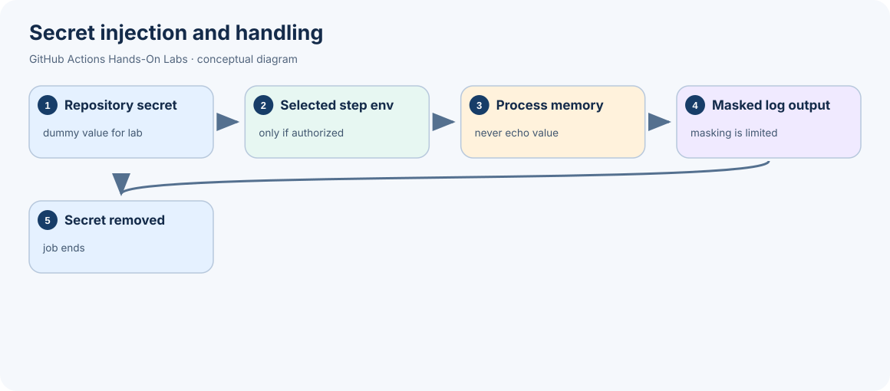
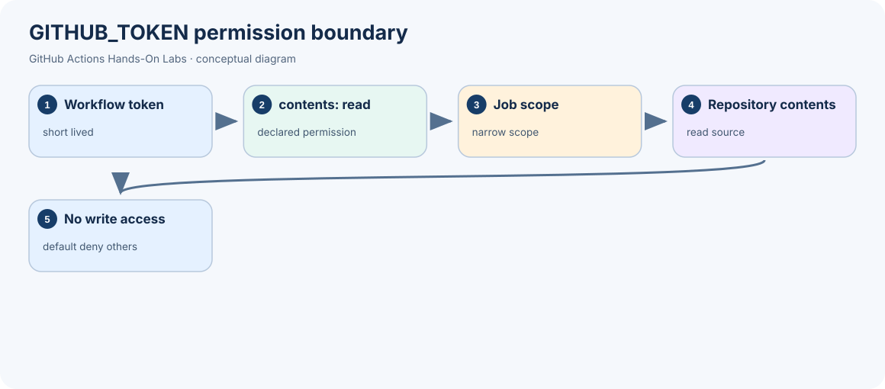
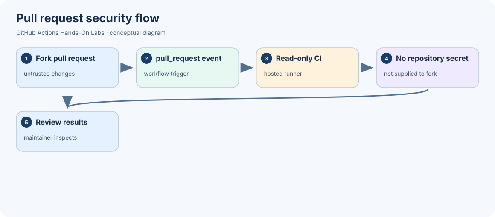
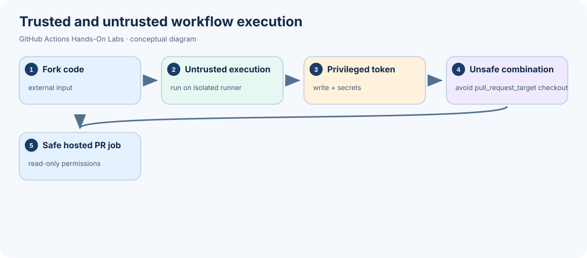
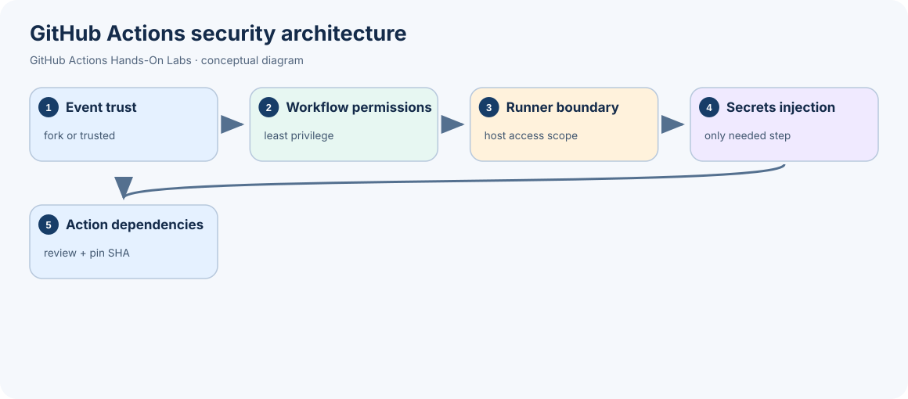

# Visual index

## Original technical diagrams

### Secure Insecure Patterns

[Open editable SVG source](diagrams/secure-insecure-patterns.svg).

### Least Privilege Comparison

[Open editable SVG source](diagrams/least-privilege-comparison.svg).

### Oidc Authentication

[Open editable SVG source](diagrams/oidc-authentication.svg).

### Secret Lifecycle

[Open editable SVG source](diagrams/secret-lifecycle.svg).

### Token Permission Boundary

[Open editable SVG source](diagrams/token-permission-boundary.svg).

### Pull Request Security

[Open editable SVG source](diagrams/pull-request-security.svg).

### Trusted Untrusted Workflows

[Open editable SVG source](diagrams/trusted-untrusted-workflows.svg).

### Security Architecture

[Open editable SVG source](diagrams/security-architecture.svg).

## Genuine screenshots

Place real captures from your own practice execution in `screenshots/`. The authoring checkout does not include real workstation or GitHub UI captures, so none are presented as execution evidence.

[Screenshot capture guide](screenshots/README.md).
