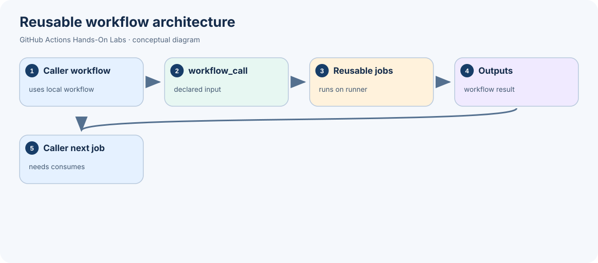
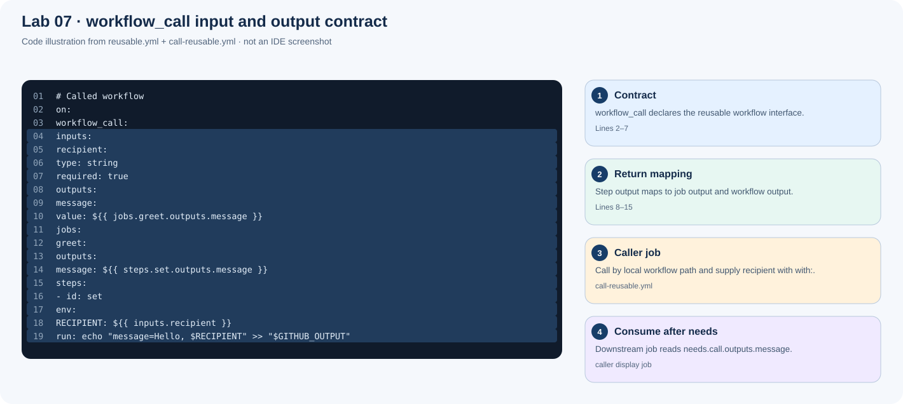
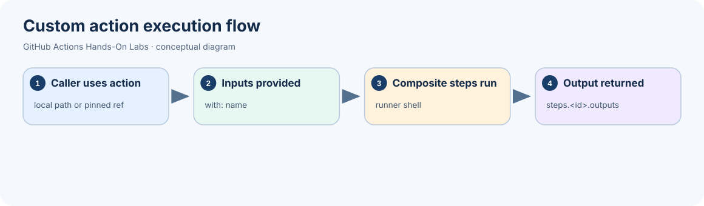
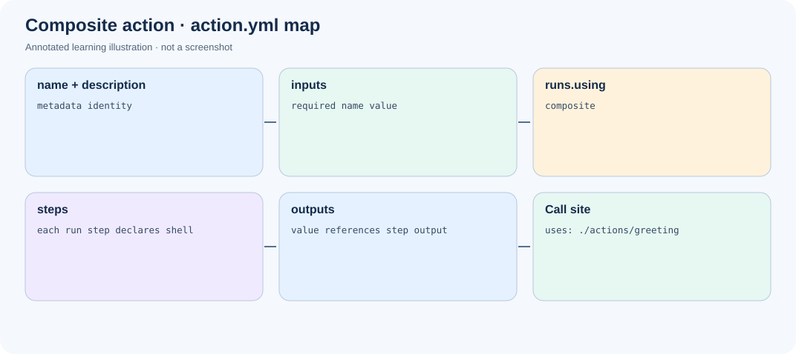
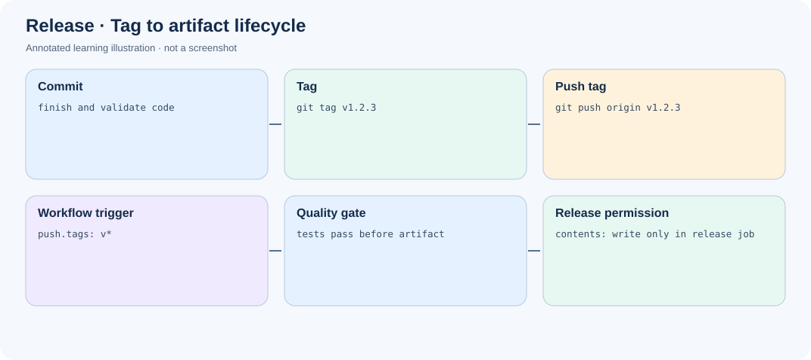

# Optional Lab 07 — Reusable Workflows, Custom Actions and Release Automation

Reuse a workflow through `workflow_call`, define a composite action, pass values between jobs and understand tag-driven release automation. The examples do not publish a release until you explicitly add and authorize a release job.

## Estimated time and outcomes

| Activity | Duration |
|---|---:|
| Concepts | 35 min |
| Workflow and action implementation | 70 min |
| Tag practice | 35 min |
| Verification/debugging | 25 min |
| Exercises | 20 min |
| **Total** | **3 h 5 min** |

Beginners may need longer. Need Lab 02 and Git/GitHub practice repository. At completion you can explain callable workflows, action inputs/outputs, composite metadata and version tags.



*The caller uses a workflow as a job; the called workflow owns its runner and steps.*

## Step 1 — Create the reusable workflow contract

Copy [`reusable.yml`](.github/workflows/reusable.yml) and [`call-reusable.yml`](.github/workflows/call-reusable.yml) into your practice repository root `.github/workflows/`. The called workflow declares `workflow_call`, a required string input and a workflow output. The caller job uses the local workflow path and supplies `with.recipient`.



*Contract illustration follows the checked-in caller and reusable workflow.*


*Inputs enter the called workflow; outputs return through step, job and workflow mappings.*

The reusable workflow maps the step's `$GITHUB_OUTPUT` value to a job output, then to the callable workflow output. Caller jobs read returned values through `needs.call.outputs.message`.

## Step 2 — Build and use the composite action

The action lives in `actions/greeting/action.yml`; source path matters. Composite actions group steps in one `action.yml`, and each `run` step declares its shell. Copy `actions/greeting/` into the same relative path in your practice repo. Add this step to a workflow:

```yaml
- uses: ./actions/greeting
  id: greeting
  with:
    name: Actions learner
- run: echo "${{ steps.greeting.outputs.greeting }}"
```



*Inputs enter the local composite action; its declared output returns to the caller step.*



*The action output is set through `$GITHUB_OUTPUT`; local paths resolve from repository root.*

## Step 3 — Verify the workflow call

Commit and push from the practice repository. In GitHub select **Actions → Call reusable workflow → newest run**. The graph shows the called job followed by `display`; the log prints `Hello, Actions learner`. If the workflow is not found, verify both files are at the root `.github/workflows/`. If output is empty, check output names through step, job and workflow layers.

## Step 4 — Practice tags and release artifacts safely

Semantic version tags use `vMAJOR.MINOR.PATCH`, such as `v1.2.3`. From the practice repo, after tests pass:

```sh
git tag v1.2.3
git push origin v1.2.3
```

A release workflow can trigger on `push.tags` and build/upload an artifact. A GitHub Release job needs `contents: write`; grant it only to that job, gate it on successful checks, and trust only reviewed tags. The current samples deliberately remain read-only and do not create/publish a release. Scheduled workflows use UTC cron and may start later than the exact scheduled minute; manual dispatch is useful for controlled tests.



*Release flow illustration; it is not evidence that a release was published.*

## Exercises and further reading

Guided: add an optional greeting input; add an output; create a manual tag-print workflow. Independent: zip an artifact on tag; version a composite action. Questions: reusable workflow vs composite action? Where do outputs cross job boundaries? Why grant `contents: write` only at release time? What is semantic versioning? Why are tags security-sensitive? Debug: rename output key then repair. Integration: tag triggers tests then an artifact upload, with no public deployment.

Further reading: [reusable workflows](https://docs.github.com/en/actions/using-workflows/reusing-workflows), [composite actions](https://docs.github.com/en/actions/sharing-automations/creating-actions/creating-a-composite-action), [GitHub Releases](https://docs.github.com/en/repositories/releasing-projects-on-github), [workflow events and cron](https://docs.github.com/en/actions/reference/workflows-and-actions/events-that-trigger-workflows).

## Visual coverage checklist

| Stage | Aid | Location |
|---|---|---|
| Caller/callee, `workflow_call`, outputs | Annotated flow illustration | Above Step 1 |
| Composite action metadata | File structure illustration | Above Step 2 |
| Workflow logs and output | Genuine screenshot capture card | [`images/screenshots/README.md`](images/screenshots/README.md) |
| Tag and release artifact | Lifecycle diagram | Above Step 4; conceptual only |
