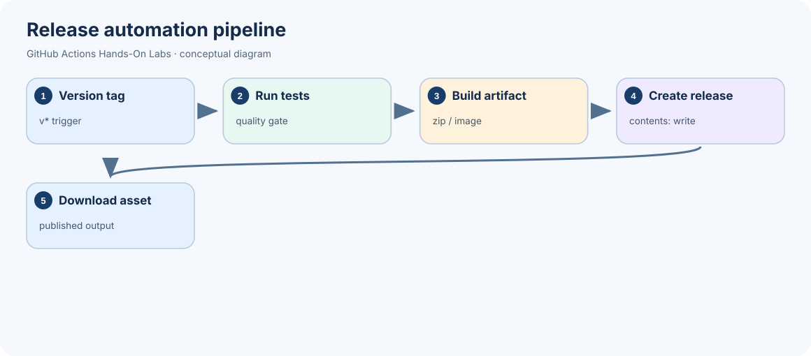
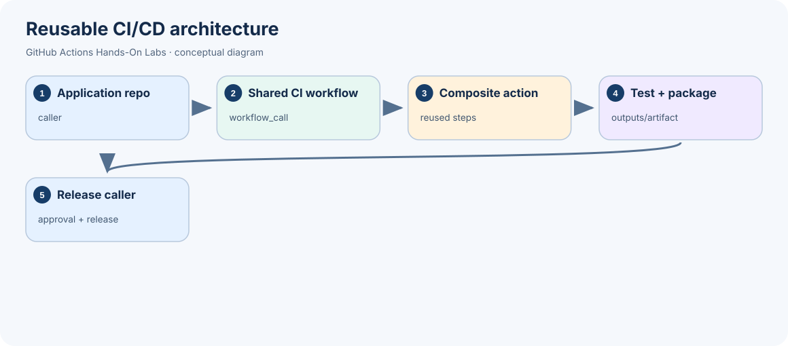
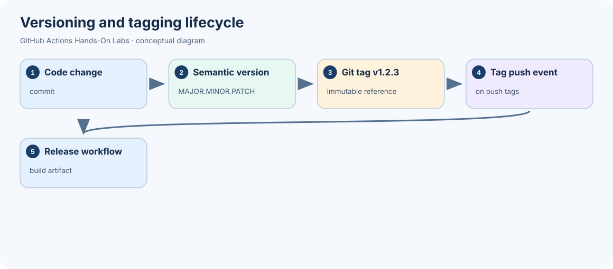
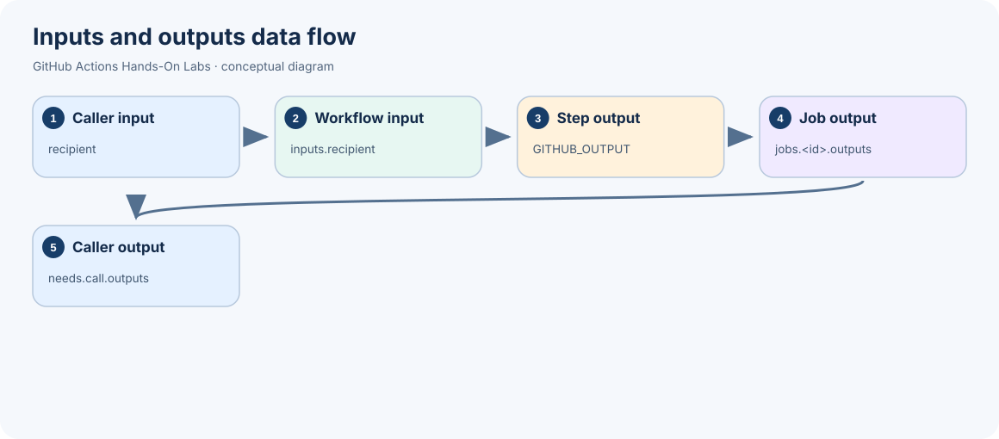

# Optional Lab 07 — Reusable Workflows, Custom Actions and Release Automation

Reuse a whole workflow through `workflow_call`, expose inputs/outputs, package a composite action and understand release triggers. This reduces duplicate CI configuration and gives teams a consistent reusable building block.

## Estimated time

| Activity | Duration |
|---|---:|
| Concepts | 35 min |
| Implementation | 70 min |
| Tag/release practice | 35 min |
| Verification/debugging | 25 min |
| Exercises | 20 min |
| **Total** | **3 h 5 min** |

Prerequisite: Lab 02. Copy the workflows into a practice repo root. `reusable.yml` declares `workflow_call`, a required string input and output; caller passes input and consumes returned output after `needs`. Composite action metadata lives under `actions/greeting/action.yml`; `runs.using: composite` and shell per step are required. To use it, add a workflow step `uses: ./actions/greeting` with `with: name: ...`.

The caller example prints `Hello, Actions learner`. Inspect **Actions** graph and output. A local reusable workflow path is relative to repository root. Fix metadata YAML indentation if VS Code flags it; action metadata is not itself a workflow. Release automation uses tags such as `v1.2.3` (semantic version MAJOR.MINOR.PATCH); a `push.tags` trigger can build a release artifact. Publishing a GitHub Release with `GITHUB_TOKEN` requires `contents: write`, which this read-only example deliberately does not request. Add that permission only for a release job and review tag trust. Scheduled workflows use POSIX cron in UTC and can run late; manual dispatch is useful for controlled practice.

Exercises: add optional greeting style input; make a reusable test workflow; add a tag trigger that prints the tag. Independent: create a zip artifact on tag; version a composite action. Questions: reusable workflow vs composite action? How does output cross jobs? Why not write token broadly? What is semantic version? Why use tags? Debug: rename output key and repair caller. Integration: on tag, test then upload artifact (no public deployment). Hints: `workflow_call`, `needs.<job>.outputs`, `actions/upload-artifact`. Avoid creating releases from untrusted tags or leaking secrets.

Further reading: [reusable workflows](https://docs.github.com/en/actions/using-workflows/reusing-workflows), [composite actions](https://docs.github.com/en/actions/sharing-automations/creating-actions/creating-a-composite-action), [releases](https://docs.github.com/en/repositories/releasing-projects-on-github), [workflow events and cron](https://docs.github.com/en/actions/reference/workflows-and-actions/events-that-trigger-workflows). This completes the optional path.

## Screenshot index

Capture caller/callee job graph, input/output logs, composite action directory and release artifact page from a real practice run; no fabricated evidence is included.

## Visual guide

These original diagrams explain the architecture and execution paths before you run the example. They are conceptual illustrations, not evidence that a workflow executed. Open [all diagrams and screenshot guidance](images/README.md).

### Custom Action Execution

### Release Automation Pipeline

### Reusable Cicd Architecture

### Versioning Tagging Lifecycle

### Caller Reusable Relationship

### Inputs Outputs Dataflow

### Reusable Workflow Architecture

### Composite Action Structure

