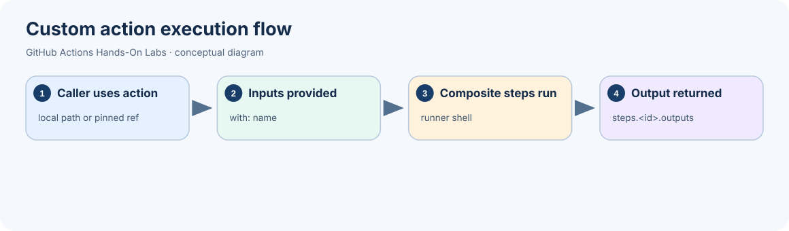
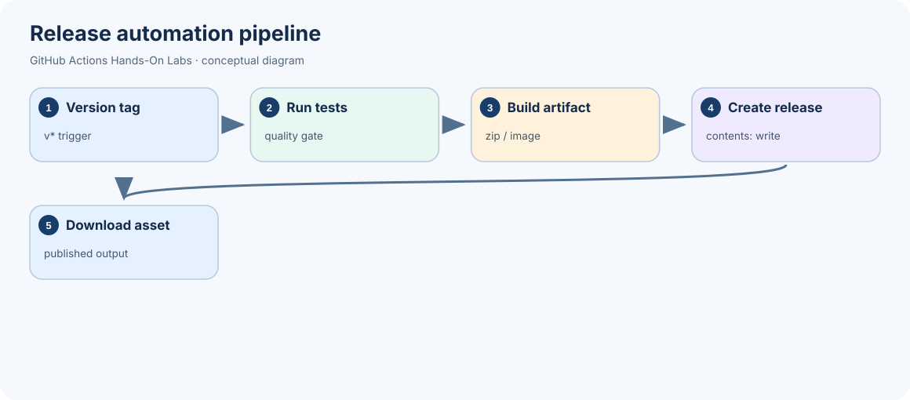
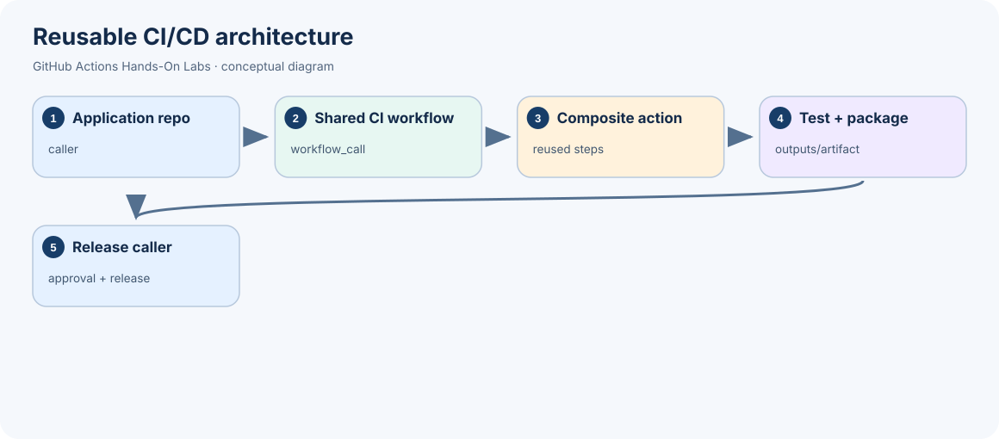
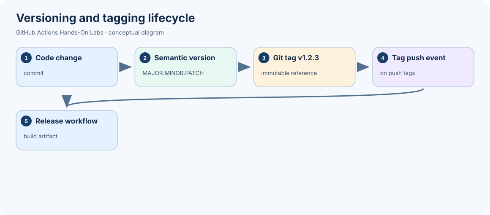
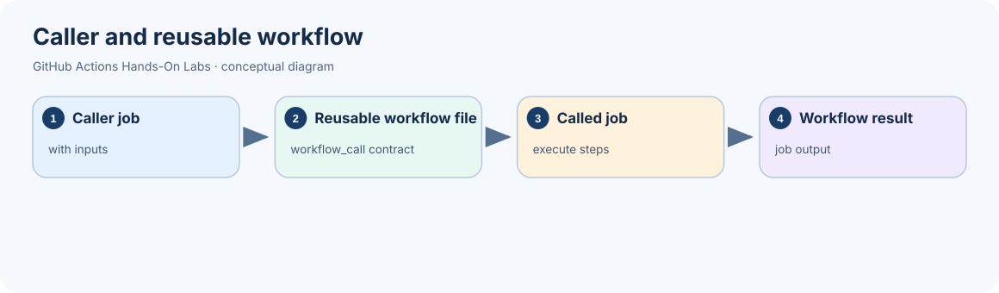
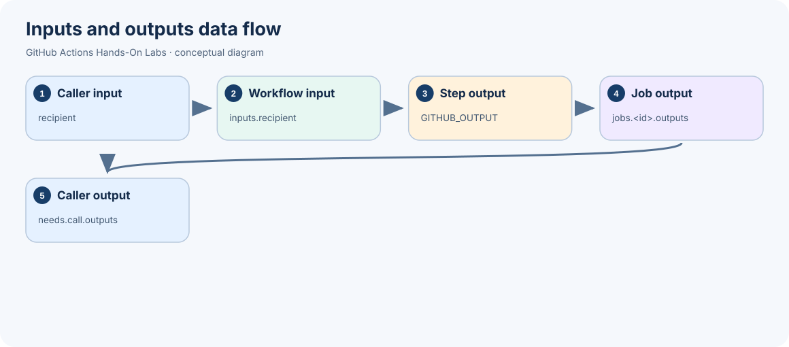
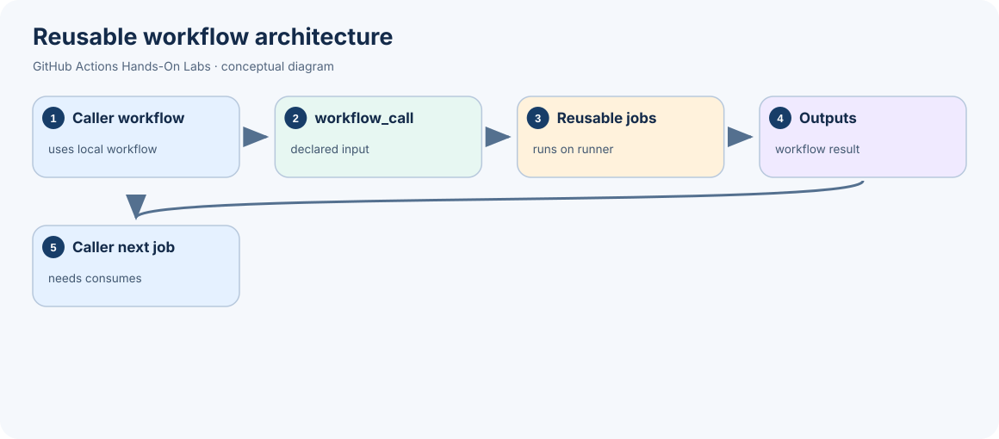
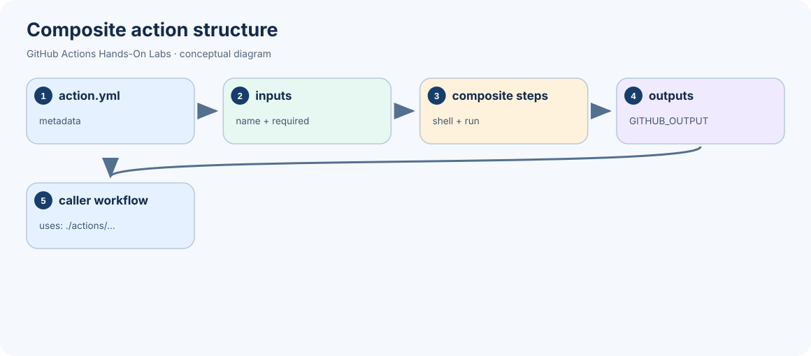

# Visual index

## Original technical diagrams

### Custom Action Execution

[Open editable SVG source](diagrams/custom-action-execution.svg).

### Release Automation Pipeline

[Open editable SVG source](diagrams/release-automation-pipeline.svg).

### Reusable Cicd Architecture

[Open editable SVG source](diagrams/reusable-cicd-architecture.svg).

### Versioning Tagging Lifecycle

[Open editable SVG source](diagrams/versioning-tagging-lifecycle.svg).

### Caller Reusable Relationship

[Open editable SVG source](diagrams/caller-reusable-relationship.svg).

### Inputs Outputs Dataflow

[Open editable SVG source](diagrams/inputs-outputs-dataflow.svg).

### Reusable Workflow Architecture

[Open editable SVG source](diagrams/reusable-workflow-architecture.svg).

### Composite Action Structure

[Open editable SVG source](diagrams/composite-action-structure.svg).

## Genuine screenshots

Place real captures from your own practice execution in `screenshots/`. The authoring checkout does not include real workstation or GitHub UI captures, so none are presented as execution evidence.

[Screenshot capture guide](screenshots/README.md).
